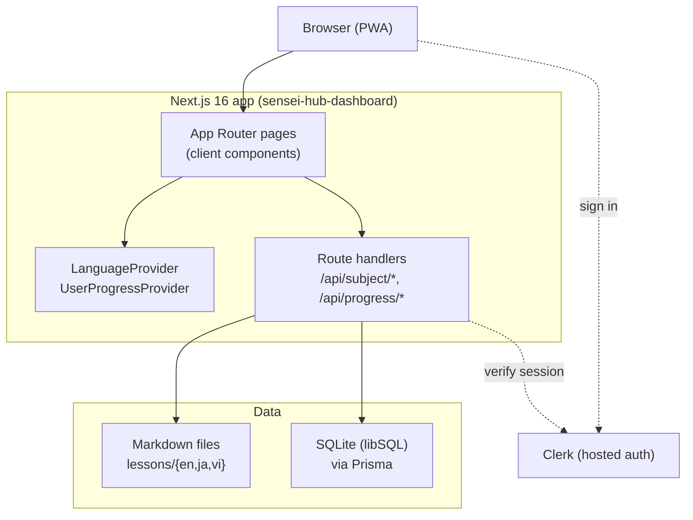

# Architecture

> Updated: 2026-06-17

## Overview

Sensei Hub is a single Next.js 16 (App Router) application. There is no separate
backend service — API routes inside the app read Markdown lessons from disk and
persist learner progress to SQLite. Authentication is delegated to Clerk.

## Request flows

**Reading a lesson.** The lesson page calls `GET /api/subject/[slug]/lesson?path=…&lang=…`.
The handler resolves the Markdown file under `LESSONS_DIR` (default `../lessons`),
parses frontmatter (`lib/markdown.ts`), compiles the body to HTML with `marked`,
and returns it. The client sanitizes the HTML with DOMPurify before rendering,
and renders Mermaid code blocks on the client. Responses are cached in-memory
(`lib/api-cache.ts`, 1h TTL) and rate-limited per IP (`lib/rate-limiter.ts`).

**Listing lessons.** `GET /api/subject/[slug]/lessons?lang=…` walks the subject
directory, extracts titles, and returns an ordered list used for navigation,
module grouping, and search.

**Progress.** `UserProgressProvider` loads progress from localStorage immediately,
then merges server state from `GET /api/progress/load` and pushes local changes
to `POST /api/progress/sync`. Both endpoints read the Clerk `userId` via
`auth()`; the user row is created lazily on first write (id = Clerk userId).

## Key modules

| Path | Responsibility |
|------|----------------|
| `app/page.tsx` | Dashboard |
| `app/subject/[slug]/page.tsx` | Subject detail (modules, quiz button) |
| `app/subject/[slug]/lesson/[...path]/page.tsx` | Lesson viewer |
| `app/subject/[slug]/quiz/page.tsx` | Quiz placeholder (coming soon) |
| `app/settings/page.tsx` | Language + AI provider config |
| `app/{about,contact,privacy,terms,blog}/page.tsx` | Static pages |
| `lib/subjects.ts` | Static course/module metadata |
| `lib/i18n.tsx` | `LanguageProvider` + translation table (en/ja/vi) |
| `lib/markdown.ts` | Frontmatter parsing & title formatting (shared) |
| `lib/search.ts` | Pure search/ranking used by the ⌘K palette |
| `lib/prisma.ts` | Prisma client (libSQL adapter, singleton) |
| `components/dashboard/*` | Sidebar, top bar, hero, search, etc. |
| `components/floating-chat.tsx` | AI chat launcher scaffold |
| `middleware.ts` | Clerk route protection (lesson APIs are public) |

## Notable constraints

- The in-memory cache and rate-limiter are per-process; they reset on restart and
  do not coordinate across instances. This is acceptable for the single-instance
  EC2 target. Horizontal scaling would require externalizing them.
- Lesson HTML is repo-authored (trusted); Mermaid runs with `securityLevel: loose`
  and content is injected via `dangerouslySetInnerHTML` after DOMPurify.
- The app ships a single dark theme.

See [DEPLOYMENT.md](./DEPLOYMENT.md) and [DATABASE_DESIGN.md](./DATABASE_DESIGN.md).
