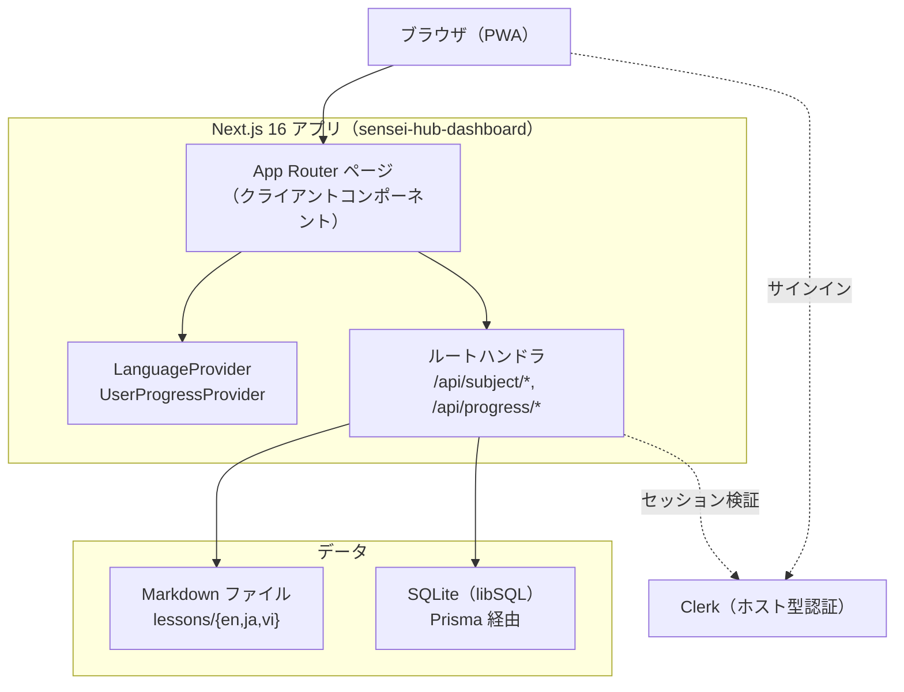

# アーキテクチャ

> 更新日: 2026-06-17

## 概要

Sensei Hub は単一の Next.js 16（App Router）アプリです。独立したバックエンドは
なく、アプリ内の API ルートがディスクから Markdown レッスンを読み取り、学習進捗を
SQLite に保存します。認証は Clerk に委譲します。

## リクエストフロー

**レッスンの表示。** レッスンページが `GET /api/subject/[slug]/lesson?path=…&lang=…`
を呼び出す。ハンドラは `LESSONS_DIR`（既定は `../lessons`）配下の Markdown を解決し、
フロントマターを解析（`lib/markdown.ts`）、本文を `marked` で HTML 化して返す。
クライアント側は DOMPurify でサニタイズしてから描画し、Mermaid のコードブロックは
クライアントで図に変換する。レスポンスはメモリにキャッシュ（`lib/api-cache.ts`、TTL 1
時間）し、IP 単位でレート制限する（`lib/rate-limiter.ts`）。

**レッスン一覧。** `GET /api/subject/[slug]/lessons?lang=…` は教科ディレクトリを走査し、
タイトルを抽出して順序付きの一覧を返す。ナビゲーション・モジュール分割・検索に使う。

**進捗。** `UserProgressProvider` はまず localStorage から進捗を即座に読み込み、
`GET /api/progress/load` のサーバー状態とマージし、ローカルの変更を
`POST /api/progress/sync` に送る。両エンドポイントは `auth()` で Clerk の `userId` を
取得し、初回書き込み時にユーザー行を遅延作成する（id = Clerk の userId）。

> パフォーマンス上の注意: `progress/load` は教科ごとのレッスンファイル一覧を
> `lib/api-cache` にキャッシュする。これがないとリクエストのたびに全教科を再帰走査し、
> メモリ／CPU を大量に消費して Heap out of memory を引き起こす。

## 主なモジュール

| パス | 責務 |
|------|----------------|
| `app/page.tsx` | ダッシュボード |
| `app/subject/[slug]/page.tsx` | 教科詳細（モジュール、Quiz ボタン） |
| `app/subject/[slug]/lesson/[...path]/page.tsx` | レッスンビューア |
| `app/subject/[slug]/quiz/page.tsx` | Quiz プレースホルダー（近日公開） |
| `app/settings/page.tsx` | 言語 + AI プロバイダー設定 |
| `app/{about,contact,privacy,terms,blog}/page.tsx` | 静的ページ |
| `lib/subjects.ts` | コース／モジュールの静的メタデータ |
| `lib/i18n.tsx` | `LanguageProvider` + 翻訳テーブル（en/ja/vi） |
| `lib/markdown.ts` | フロントマター解析・タイトル整形（共通） |
| `lib/search.ts` | ⌘K パレットで使う純粋な検索／ランキング |
| `lib/prisma.ts` | Prisma クライアント（libSQL アダプター、シングルトン） |
| `components/dashboard/*` | サイドバー、トップバー、ヒーロー、検索など |
| `components/floating-chat.tsx` | AI チャット起動ボタン（スキャフォールド） |
| `middleware.ts` | Clerk のルート保護（レッスン API は公開） |

## 留意点・制約

- メモリ内キャッシュとレート制限はプロセス単位。再起動でリセットされ、インスタンス間で
  共有されない。単一 EC2 構成では許容範囲。水平スケールには外部化が必要。
- レッスン HTML はリポジトリ管理の信頼済みコンテンツ。Mermaid は `securityLevel: loose`
  で動作し、DOMPurify 後に `dangerouslySetInnerHTML` で注入する。
- アプリはダークテーマ単一。

[DEPLOYMENT.md](./DEPLOYMENT.md) と [DATABASE_DESIGN.md](./DATABASE_DESIGN.md) も参照。
