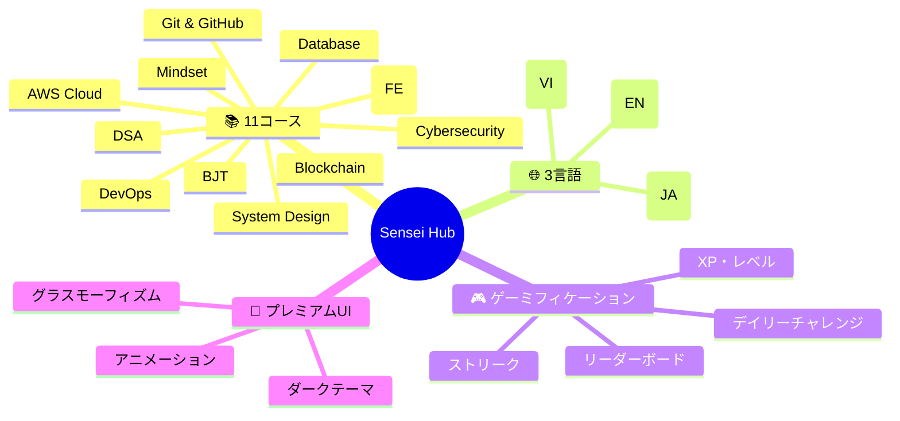

# 📝 Sensei Hub — プロジェクト概要書

> **バージョン**: 2.0.0  
> **最終更新**: 2026-05-20  
> **ステータス**: アクティブ開発中

---

## 1. 課題定義

### 1.1 背景

日本のIT業界では、多くの外国人エンジニア（特にベトナム人エンジニア）が活躍しています。しかし、以下の課題が存在します：

- **言語の壁**: IT専門用語が日本語・英語・母国語で異なり、学習コストが高い
- **資格試験の難しさ**: 基本情報技術者試験（FE）やBJTなどの日本固有の資格試験は、日本語のみの教材が多く、外国人にとってハードルが高い
- **体系的な学習教材の不足**: AWS、System Design、DevOpsなどの実践的なスキルを母国語で体系的に学べる教材が少ない
- **モチベーション維持の困難**: 独学では学習の継続が難しく、進捗の可視化やゲーミフィケーション要素が必要

### 1.2 対象ユーザー

| ユーザータイプ | 特徴 | ニーズ |
|--------------|------|------|
| 🇻🇳 **ベトナム人ITエンジニア** | 日本で就職予定・就業中 | 日本語IT用語の習得、FE試験対策 |
| 🌏 **その他の外国人エンジニア** | 日本のIT企業で勤務 | 技術スキル向上、BJT対策 |
| 🇯🇵 **日本人ITエンジニア** | スキルアップ志望 | AWS、System Design、DevOps学習 |
| 🎓 **IT学生** | 就職準備中 | 基本情報対策、実践スキル習得 |

---

## 2. 解決策

### 2.1 Sensei Hub プラットフォーム

**Sensei Hub** は、以下の特徴を持つトリリンガル学習プラットフォームです：

### 2.2 核心機能

| 機能 | 説明 | ステータス |
|------|------|-----------|
| 📖 **マークダウンレッスン** | 1,560以上のレッスンファイル、3つの構造パターン対応 | ✅ 完了 |
| 🖥 **ダッシュボード** | ゲーミフィケーション要素付きの学習管理画面 | ✅ 完了 |
| 🌐 **多言語対応** | React Contextベースのi18nシステム（80以上の翻訳キー） | ✅ 完了 |
| 📊 **科目詳細ページ** | 科目別ヘッダー・統計・モジュールリスト | ✅ 完了 |
| 📚 **語彙辞典** | トリリンガル語彙エントリ、お気に入り、検索 | 🔧 開発中 |
| 🧪 **インタラクティブクイズ** | 選択式問題、スコアリング、タイマー、結果分析 | 🔧 開発中 |
| 🔐 **認証システム** | Auth.js v5による認証・権限管理 | 🔧 開発中 |

---

## 3. コースカリキュラム詳細

### 3.1 コース一覧

#### ☁️ AWS Cloud Engineering（60日間）
クラウドの基礎からEC2、Lambda、S3、VPC、データベースサービスまで、AWSエコシステムを体系的に学習。実践的なハンズオンとケーススタディを含む。

#### ⛓️ Blockchain & Web3 Fundamentals（20日間）
ブロックチェーンの基本概念、暗号技術、スマートコントラクト、DApps開発の基礎を学習。Web3エコシステムの理解を深める。

#### 🗣️ Business Japanese Test — BJT（120日間）
日本企業で必要なビジネス日本語を体系的に学習。敬語、技術用語、会議、メールの4モジュールで構成。BJT試験対策に最適。

#### 🛡️ Cybersecurity Awareness（15日間）
サイバーセキュリティの基礎知識、脅威と対策、セキュリティベストプラクティスを短期集中で学習。

#### 🧮 Data Structures & Algorithms（60日間）
配列、リスト、木構造、動的プログラミング、貪欲法の5モジュール。コーディングインタビュー対策にも最適。

#### 🗄️ Database Engineering（30日間）
SQL、インデックス最適化、ACID特性、NoSQL、シャーディングまで、データベース技術を深く学習。

#### 🧠 Developer Mindset（30日間・3フェーズ）
Deep Work、学習法、コミュニケーション、複雑性管理の4テーマ。エンジニアとしてのマインドセット変革を促す。

#### 🔧 DevOps Engineering（60日間）
Git、Docker、Kubernetes、CI/CDの4モジュール。インフラ自動化とデプロイメントパイプラインの構築を学習。

#### 📋 基本情報技術者試験 — FE（100日間・13フェーズ）
コンピュータ科学基礎から始まり、アルゴリズム、ネットワーク、データベース、ソフトウェア工学、管理戦略、セキュリティまで網羅。午前・午後試験の過去問対策を含む。

#### 🐙 Git & GitHub（10日間）
バージョン管理の基礎からブランチ戦略、プルリクエスト、GitHub Actions、チーム開発ワークフローまでを短期集中で習得。

#### 🏗️ System Design & Architecture（60日間・4フェーズ）
基礎（15日）→ スケーラビリティ・信頼性（15日）→ マイクロサービスDeep Dive（15日）→ 実世界ケーススタディ（15日）の4フェーズ構成。

---

## 4. 技術的制約

| 制約 | 詳細 |
|------|------|
| チーム規模 | 3名体制（アジャイル開発） |
| 開発期間 | 約5週間（5スプリント） |
| デプロイ先 | AWS（Amplify, RDS, S3） |
| 対応言語 | 英語・日本語・ベトナム語の3言語 |
| コンテンツ形式 | Markdown（.md）ベース |
| データベース | PostgreSQL（Prisma ORM） |

---

## 5. 成功指標

| 指標 | 目標 |
|------|------|
| レッスンコンテンツ | 11コース × 3言語の全レッスン完成 |
| UI/UX | プレミアムダッシュボードの完全実装 |
| 多言語対応 | 3言語のシームレスな切り替え |
| 認証 | Auth.js v5による安全な認証フロー |
| デプロイ | AWSへの本番環境デプロイ |

---

## 📎 関連ドキュメント

- [TECH_STACK.md](./TECH_STACK.md) — 技術スタック詳細
- [ARCHITECTURE.md](./ARCHITECTURE.md) — システムアーキテクチャ
- [FEATURES_DETAIL.md](./FEATURES_DETAIL.md) — 機能要件詳細
- [ROADMAP.md](./ROADMAP.md) — 開発ロードマップ
