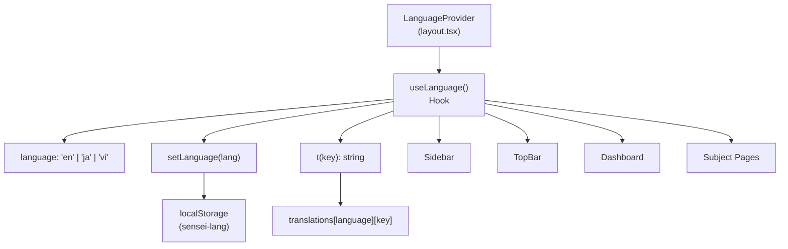

# 🌐 Sensei Hub — 国際化（i18n）戦略

> **バージョン**: 2.0.0  
> **最終更新**: 2026-05-20

---

## 1. アーキテクチャ概要

Sensei Hubの多言語対応は、**React Context パターン**を採用しています。



### 技術的な選択理由

| 選択肢 | 採用 | 理由 |
|-------|------|------|
| React Context | ✅ | シンプル、Server Components不要、クライアントサイドで完結 |
| next-intl | ❌ | URL構造の変更が不要なため、オーバースペック |
| i18next | ❌ | 追加依存関係を最小限にするため |

---

## 2. 対応言語

| コード | 言語 | ラベル | デフォルト |
|-------|------|--------|----------|
| `en` | English | EN | — |
| `ja` | 日本語 | JA | — |
| `vi` | Tiếng Việt | VI | ✅（初期値） |

---

## 3. 実装詳細

### 3.1 LanguageProvider（`lib/i18n.tsx`）

```typescript
type Language = "en" | "ja" | "vi";

interface LanguageContextType {
  language: Language;
  setLanguage: (lang: Language) => void;
  t: (key: string) => string;
}

// Context + Provider パターン
const LanguageContext = createContext<LanguageContextType>(/* ... */);

export function LanguageProvider({ children }: { children: React.ReactNode }) {
  const [language, setLanguageState] = useState<Language>("vi");

  useEffect(() => {
    // localStorageから言語設定を復元
    const saved = localStorage.getItem("sensei-lang") as Language;
    if (saved && ["en", "ja", "vi"].includes(saved)) {
      setLanguageState(saved);
    }
  }, []);

  const setLanguage = (lang: Language) => {
    setLanguageState(lang);
    localStorage.setItem("sensei-lang", lang);
  };

  const t = (key: string): string => {
    return translations[language]?.[key] || translations["en"]?.[key] || key;
  };

  return (
    <LanguageContext.Provider value={{ language, setLanguage, t }}>
      {children}
    </LanguageContext.Provider>
  );
}

export const useLanguage = () => useContext(LanguageContext);
```

### 3.2 言語の永続化

| 項目 | 詳細 |
|------|------|
| 保存先 | `localStorage` |
| キー名 | `sensei-lang` |
| 初期値 | `vi`（ベトナム語） |
| フォールバック | 英語（en） |

### 3.3 LanguageSwitcher コンポーネント

TopBar内に配置されるドロップダウン式言語切替コンポーネント：

```typescript
// components/dashboard/language-switcher.tsx
const languages = [
  { code: "en", label: "EN", flag: "🇺🇸" },
  { code: "ja", label: "JA", flag: "🇯🇵" },
  { code: "vi", label: "VI", flag: "🇻🇳" },
];
```

---

## 4. 翻訳キー一覧

### 4.1 ナビゲーション（`nav.*`）

| キー | EN | JA | VI |
|------|-----|-----|-----|
| `nav.dashboard` | Dashboard | ダッシュボード | Bảng điều khiển |
| `nav.subjects` | Subjects | 科目 | Môn học |
| `nav.vocabulary` | Vocabulary | 語彙 | Từ vựng |
| `nav.quiz` | Quiz | クイズ | Trắc nghiệm |
| `nav.settings` | Settings | 設定 | Cài đặt |
| `nav.progress` | Progress | 進捗 | Tiến độ |
| `nav.leaderboard` | Leaderboard | ランキング | Bảng xếp hạng |
| `nav.bookmarks` | Bookmarks | ブックマーク | Đánh dấu |

### 4.2 ヘッダー（`header.*`）

| キー | EN | JA | VI |
|------|-----|-----|-----|
| `header.greeting` | Good morning | おはようございます | Chào buổi sáng |
| `header.subtitle` | Ready to learn? | 学習の準備はできましたか？ | Sẵn sàng học? |

### 4.3 ヒーロー（`hero.*`）

| キー | EN | JA | VI |
|------|-----|-----|-----|
| `hero.title` | Master IT Skills | ITスキルをマスターしよう | Chinh phục IT |
| `hero.subtitle` | Learn in your language | 母国語で学ぶ | Học bằng ngôn ngữ của bạn |
| `hero.cta` | Start Learning | 学習を始める | Bắt đầu học |

### 4.4 統計（`stats.*`）

| キー | EN | JA | VI |
|------|-----|-----|-----|
| `stats.streak` | Day Streak | 連続学習 | Chuỗi ngày |
| `stats.xp` | Total XP | 合計XP | Tổng XP |
| `stats.level` | Level | レベル | Cấp độ |
| `stats.completed` | Completed | 完了 | Hoàn thành |

### 4.5 セクション（`sections.*`）

| キー | EN | JA | VI |
|------|-----|-----|-----|
| `sections.subjects` | Your Subjects | あなたの科目 | Môn học của bạn |
| `sections.challenge` | Daily Challenge | デイリーチャレンジ | Thử thách hàng ngày |
| `sections.leaderboard` | Leaderboard | リーダーボード | Bảng xếp hạng |
| `sections.activity` | Recent Activity | 最近のアクティビティ | Hoạt động gần đây |
| `sections.courses` | Featured Courses | おすすめコース | Khóa học nổi bật |

### 4.6 科目名（`subjects.*`）

| キー | EN | JA | VI |
|------|-----|-----|-----|
| `subjects.aws` | AWS Cloud | AWSクラウド | AWS Cloud |
| `subjects.bjt` | Business Japanese | ビジネス日本語 | Tiếng Nhật thương mại |
| `subjects.database` | Database | データベース | Cơ sở dữ liệu |
| `subjects.devops` | DevOps | DevOps | DevOps |
| `subjects.dsa` | DSA | データ構造 | Cấu trúc dữ liệu |
| `subjects.fe` | FE Exam | 基本情報 | Kỳ thi FE |
| `subjects.mindset` | Mindset | マインドセット | Tư duy |
| `subjects.system-design` | System Design | システム設計 | Thiết kế hệ thống |

### 4.7 アクション（`actions.*`）

| キー | EN | JA | VI |
|------|-----|-----|-----|
| `actions.start` | Start | 開始 | Bắt đầu |
| `actions.continue` | Continue | 続ける | Tiếp tục |
| `actions.view` | View All | すべて見る | Xem tất cả |
| `actions.complete` | Complete | 完了する | Hoàn thành |

### 4.8 曜日（`days.*`）

| キー | EN | JA | VI |
|------|-----|-----|-----|
| `days.mon` | Mon | 月 | T2 |
| `days.tue` | Tue | 火 | T3 |
| `days.wed` | Wed | 水 | T4 |
| `days.thu` | Thu | 木 | T5 |
| `days.fri` | Fri | 金 | T6 |
| `days.sat` | Sat | 土 | T7 |
| `days.sun` | Sun | 日 | CN |

---

## 5. レッスンコンテンツの多言語対応

UIの翻訳とは別に、レッスンコンテンツは**言語別フォルダ構成**で管理されています。

```
lessons/
├── en/    # 英語版レッスン
├── ja/    # 日本語版レッスン
└── vi/    # ベトナム語版レッスン
```

### フォールバック優先順序

1. ユーザーの選択言語のレッスン
2. 英語（en）版へフォールバック
3. ベトナム語（vi）版へフォールバック
4. 404エラー

---

## 6. 新しい翻訳キーの追加ガイド

### ステップ1: `lib/i18n.tsx` にキーを追加

```typescript
const translations: Record<Language, Record<string, string>> = {
  en: {
    // 既存のキー...
    "new.key": "English text",
  },
  ja: {
    // 既存のキー...
    "new.key": "日本語テキスト",
  },
  vi: {
    // 既存のキー...
    "new.key": "Tiếng Việt",
  },
};
```

### ステップ2: コンポーネントで使用

```typescript
const { t } = useLanguage();
return <p>{t("new.key")}</p>;
```

---

## 7. 新しい言語の追加ガイド

1. `Language` 型に新言語コードを追加
2. `translations` オブジェクトに全キーの翻訳を追加
3. `LanguageSwitcher` のリストに追加
4. `lessons/` に新言語フォルダを作成
5. レッスンコンテンツを翻訳

---

## 📎 関連ドキュメント

- [LESSON_ENGINE.md](./LESSON_ENGINE.md) — レッスンエンジン
- [ARCHITECTURE.md](./ARCHITECTURE.md) — システムアーキテクチャ
- [FEATURES_DETAIL.md](./FEATURES_DETAIL.md) — 機能要件
