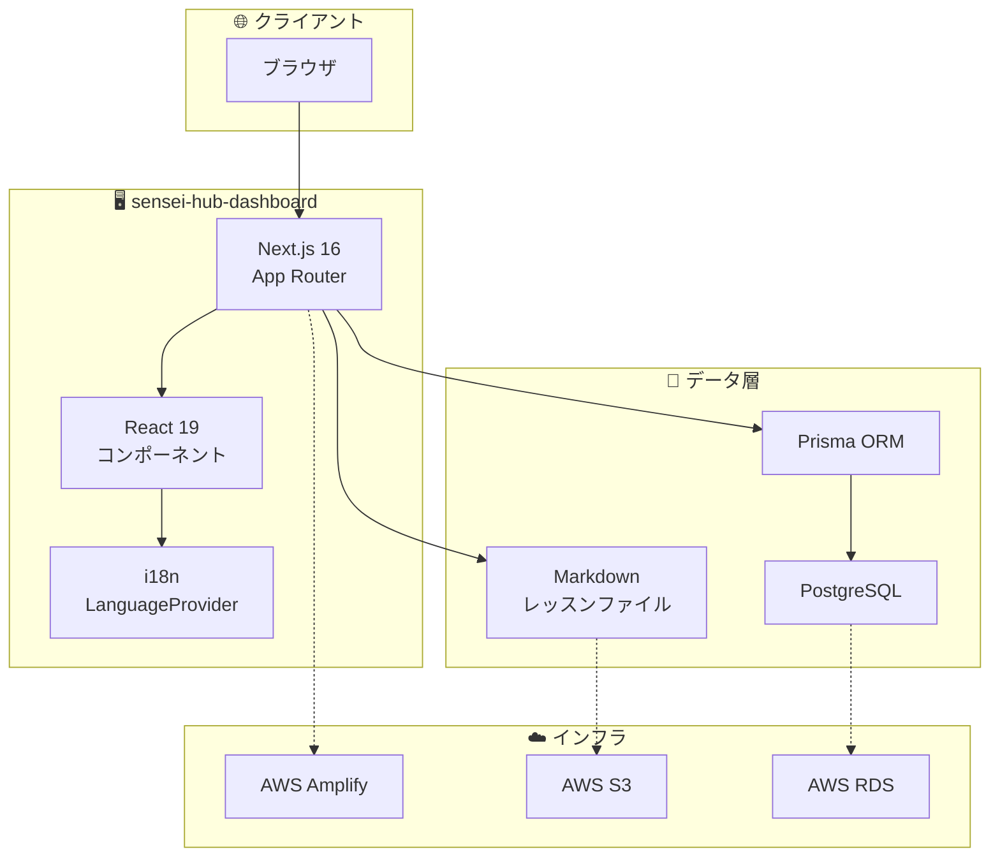

# 📋 Sensei Hub — マスタードキュメントインデックス

> **バージョン**: 2.0.0  
> **最終更新**: 2026-05-20  
> **ステータス**: アクティブ開発中

---

## 🎯 プロジェクトビジョン

**Sensei Hub（センセイハブ）** は、日本で働くITエンジニア向けのトリリンガル学習プラットフォームです。英語・日本語・ベトナム語の3言語で、AWS、基本情報技術者試験、System Design、データ構造・アルゴリズム、データベース、DevOps、BJT、Blockchain、サイバーセキュリティ、Git & GitHub、Developer Mindsetの**11コース**（合計**1,560以上のレッスン**）を提供します。

---

## 📑 ドキュメント一覧

### コアドキュメント（ルート）

| # | ファイル名 | カテゴリ | 説明 |
|---|-----------|---------|------|
| 1 | [INDEX.md](./INDEX.md) | 📋 索引 | マスターインデックス（本ファイル） |
| 2 | [BRIEF.md](./BRIEF.md) | 📝 概要 | プロジェクト概要・課題定義・解決策 |
| 3 | [TECH_STACK.md](./TECH_STACK.md) | 🛠 技術 | テックスタック詳細・バージョン・選定理由 |
| 4 | [ARCHITECTURE.md](./ARCHITECTURE.md) | 🏛 設計 | システムアーキテクチャ・データフロー図 |
| 5 | [PROJECT_STRUCTURE.md](./PROJECT_STRUCTURE.md) | 📁 構成 | ディレクトリ構成・命名規則・コーディング規約 |
| 6 | [DATABASE_DESIGN.md](./DATABASE_DESIGN.md) | 🗄 DB | データベース設計・Prismaスキーマ・ERD |
| 7 | [API_SPECS.md](./API_SPECS.md) | 🔌 API | REST API / Server Actions 仕様書 |
| 8 | [LESSON_ENGINE.md](./LESSON_ENGINE.md) | 📝 エンジン | レッスンコンテンツエンジン設計 |
| 9 | [I18N_STRATEGY.md](./I18N_STRATEGY.md) | 🌐 i18n | 国際化（多言語対応）戦略 |
| 10 | [UI_UX_SPEC.md](./UI_UX_SPEC.md) | 🎨 デザイン | UI/UX仕様・デザインシステム |
| 11 | [MOCKUPS.md](./MOCKUPS.md) | 🖼 モック | UIモックアップ画像集 |
| 12 | [FEATURES_DETAIL.md](./FEATURES_DETAIL.md) | ⚙️ 機能 | 機能要件詳細・受入基準 |
| 13 | [ROADMAP.md](./ROADMAP.md) | 🗺 計画 | ロードマップ・マイルストーン |
| 14 | [MASTER_PHASE_TASKS.md](./MASTER_PHASE_TASKS.md) | 📊 管理 | フェーズ別タスクマトリックス |
| 15 | [DETAILED_BACKLOG.md](./DETAILED_BACKLOG.md) | ✅ タスク | 詳細バックログ・進捗トラッキング |
| 16 | [TEAM_ROLES.md](./TEAM_ROLES.md) | 👥 チーム | チーム役割分担・責任範囲 |
| 17 | [DEPLOYMENT.md](./DEPLOYMENT.md) | 🚀 運用 | デプロイメントガイド・AWS構築手順 |
| 18 | [BRSE_INPUT_CHECKLIST.md](./BRSE_INPUT_CHECKLIST.md) | ✅ BrSE | BrSEインプットチェックリスト |

### サブディレクトリ

| # | ファイル名 | カテゴリ | 説明 |
|---|-----------|---------|------|
| 19 | [design/DATABASE_SCHEMA.md](./design/DATABASE_SCHEMA.md) | 📊 ERD | ER図（Mermaid） |
| 20 | [design/SCREEN_FLOW.md](./design/SCREEN_FLOW.md) | 🔄 フロー | 画面遷移図 |
| 21 | [design/SCREEN_FLOW_JA.md](./design/SCREEN_FLOW_JA.md) | 🔄 フロー | 画面遷移図（詳細版） |
| 22 | [design/UI_KIT_JA.md](./design/UI_KIT_JA.md) | 🎨 UI | UIキット・デザイントークン |
| 23 | [specs/SRS_SENSEI_HUB.md](./specs/SRS_SENSEI_HUB.md) | 📋 SRS | ソフトウェア要件仕様書（正式版） |

### アセット

| フォルダ | 内容 |
|---------|------|
| [assets/](./assets/) | モックアップ画像（PNG） |
| [assets/mockups/](./assets/mockups/) | 追加モックアップ（ダッシュボード、試験室、レッスンUI、Wiki UI） |

---

## 🏛 システムアーキテクチャ概要

---

## 👥 チーム構成

| 役割 | 担当領域 |
|------|---------|
| ☁️ **クラウドアーキテクト** | AWS（RDS, S3, Amplify）、Docker、CI/CD |
| ⚙️ **バックエンドエンジニア** | Prisma、Auth.js、API Routes、Server Actions |
| 🎨 **フロントエンドエンジニア** | Next.js、React、Tailwind CSS、UI/UXデザイン |

---

## 📅 スプリント概要

| フェーズ | 期間 | 内容 | ステータス |
|---------|------|------|-----------|
| Phase 1 | Week 1-2 | インフラ構築・コンテンツ作成・ダッシュボードUI | ✅ 完了 |
| Phase 2 | Week 3 | バックエンド統合・認証・API | 🔧 進行中 |
| Phase 3 | Week 4 | 機能完成（語彙・クイズ・レッスンビューア） | ⏳ 予定 |
| Phase 4 | Week 5+ | 最適化・テスト・AWSデプロイ | ⏳ 予定 |

---

## 🔗 クイックリンク

- 📦 **リポジトリ**: [github.com/bakaryuu1997-sys/Sensei-Hub](https://github.com/bakaryuu1997-sys/Sensei-Hub)
- 🖥 **ダッシュボード**: `sensei-hub-dashboard/` ディレクトリ
- 📚 **レッスン**: `lessons/` ディレクトリ（EN/JA/VI）
- 🐳 **Docker**: `docker-compose.yml`（ローカルPostgreSQL）

---

## 📖 推奨読了順序

1. 🔰 **[BRIEF.md](./BRIEF.md)** — プロジェクトの全体像を把握
2. 🛠 **[TECH_STACK.md](./TECH_STACK.md)** — 技術スタックの理解
3. 🏛 **[ARCHITECTURE.md](./ARCHITECTURE.md)** — システム設計の理解
4. 📁 **[PROJECT_STRUCTURE.md](./PROJECT_STRUCTURE.md)** — ディレクトリ構成の把握
5. 🗄 **[DATABASE_DESIGN.md](./DATABASE_DESIGN.md)** — データモデルの理解
6. 📝 **[LESSON_ENGINE.md](./LESSON_ENGINE.md)** — レッスンコンテンツの仕組み
7. 🗺 **[ROADMAP.md](./ROADMAP.md)** — 開発計画の確認
