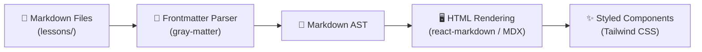
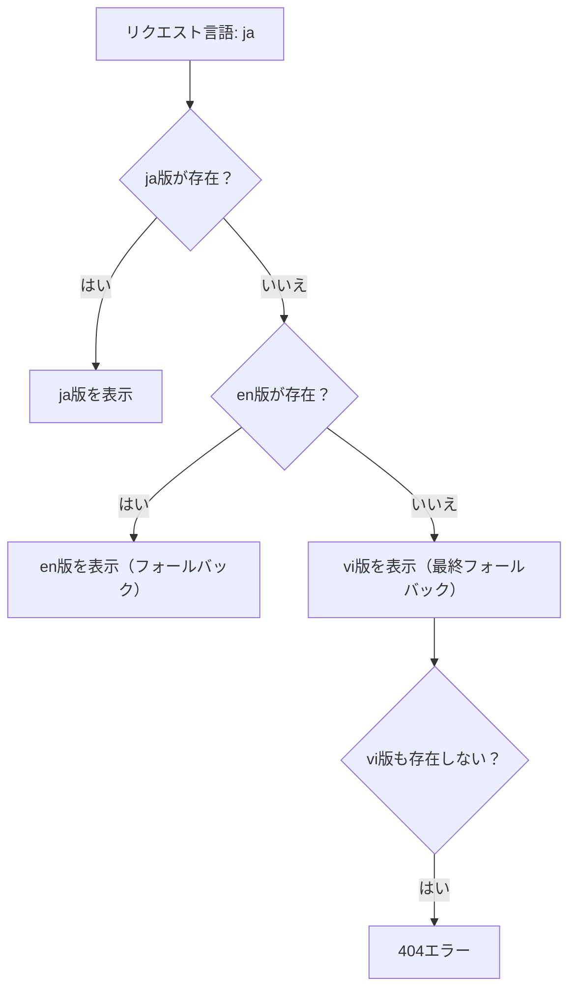

# 📝 Sensei Hub — レッスンエンジン設計

> **バージョン**: 2.0.0  
> **最終更新**: 2026-05-20

---

## 1. 概要

Sensei Hubのレッスンエンジンは、**Markdownベース**のコンテンツ管理システムです。11コース × 3言語 = **約1,560以上のレッスンファイル**をファイルシステム上で管理し、動的にパース・レンダリングします。



---

## 2. コンテンツ構造パターン

レッスンファイルは**3つの構造パターン**で管理されています。

### パターン A: フラットフォルダ（`day-XX/content.md`）

```
lessons/{lang}/{course}/
├── day-01/
│   └── content.md
├── day-02/
│   └── content.md
└── day-60/
    └── content.md
```

**使用コース**:

| コース | 日数 | パス例 |
|-------|------|--------|
| AWS Cloud Engineering | 60 | `lessons/ja/aws/day-01/content.md` |
| Data Structures & Algorithms | 60 | `lessons/ja/data-structures-and-algorithms/day-01/content.md` |
| Database Engineering | 30 | `lessons/ja/database-engineering/day-01/content.md` |
| DevOps Engineering | 60 | `lessons/ja/devops-engineering/day-01/content.md` |

### パターン B: フラットファイル（`day-XX.md`）

```
lessons/{lang}/{course}/
├── day-01.md
├── day-02.md
└── day-XX.md
```

**使用コース**:

| コース | 日数 | パス例 |
|-------|------|--------|
| Blockchain & Web3 Fundamentals | 20 | `lessons/ja/blockchain-and-web3-fundamentals/day-01.md` |
| Cybersecurity Awareness | 15 | `lessons/ja/cybersecurity-awareness/day-01.md` |
| Git & GitHub | 10 | `lessons/ja/git-and-github/day-01.md` |

### パターン C: フェーズ制（`phase-XX/day-XX/lesson.md`）

```
lessons/{lang}/{course}/
├── ROADMAP.md (オプション)
├── phase-01-{name}/
│   ├── day-01/
│   │   └── lesson.md
│   └── day-10/
│       └── lesson.md
├── phase-02-{name}/
│   ├── day-11/
│   │   └── lesson.md
│   └── day-20/
│       └── lesson.md
└── phase-03-{name}/
    └── ...
```

**使用コース**:

| コース | 日数 | フェーズ数 | パス例 |
|-------|------|----------|--------|
| Business Japanese Test (BJT) | 120 | — | `lessons/ja/business-japanese-test/day-001/lesson.md` |
| Developer Mindset | 30 | 3 | `lessons/ja/developer-mindset/phase-01-transformation/day-01/lesson.md` |
| Fundamental IT Engineer (FE) | 100 | 13 (EN/JA) / 8 (VI) | `lessons/ja/fundamental-it-engineer/phase-01-computer-science-basics/day-01/lesson.md` |
| System Design | 60 | 4 | `lessons/ja/system-design/phase-01-foundations/day-01/lesson.md` |

---

## 3. コース一覧総括表

| # | コース | スラッグ | 日数 | パターン | フェーズ |
|---|-------|---------|------|---------|---------|
| 1 | ☁️ AWS Cloud Engineering | `aws` | 60 | A | — |
| 2 | ⛓️ Blockchain & Web3 | `blockchain-and-web3-fundamentals` | 20 | B | — |
| 3 | 🗣️ BJT | `business-japanese-test` | 120 | C | — |
| 4 | 🛡️ Cybersecurity | `cybersecurity-awareness` | 15 | B | — |
| 5 | 🧮 DSA | `data-structures-and-algorithms` | 60 | A | — |
| 6 | 🗄️ Database | `database-engineering` | 30 | A | — |
| 7 | 🧠 Mindset | `developer-mindset` | 30 | C | 3 |
| 8 | 🔧 DevOps | `devops-engineering` | 60 | A | — |
| 9 | 📋 FE（基本情報） | `fundamental-it-engineer` | 100 | C | 13/8 |
| 10 | 🐙 Git & GitHub | `git-and-github` | 10 | B | — |
| 11 | 🏗️ System Design | `system-design` | 60 | C | 4 |

**合計**: 565日 × 3言語 = **1,695レッスンスロット**（一部欠番あり、実ファイル数約1,560以上）

---

## 4. Frontmatterスキーマ

### パターン A & C（content.md / lesson.md）

```yaml
---
title: "Day 1: AWSの基礎 — クラウドの世界への入口"
description: "AWS Cloud の概要と主要サービスの理解"
day: 1
chapter: "AWS Fundamentals"
category: "aws"
---
```

| フィールド | 型 | 必須 | 説明 |
|-----------|-----|------|------|
| `title` | string | ✅ | レッスンタイトル |
| `description` | string | ✅ | レッスンの説明文 |
| `day` | number | ✅ | 日数番号 |
| `chapter` | string | ✅ | チャプター名 |
| `category` | string | ✅ | コースカテゴリ |

### パターン B（day-XX.md）

```yaml
---
title: "Day 1: Gitとは何か"
description: "バージョン管理の基礎概念とGitのアーキテクチャ"
---
```

| フィールド | 型 | 必須 | 説明 |
|-----------|-----|------|------|
| `title` | string | ✅ | レッスンタイトル |
| `description` | string | ✅ | レッスンの説明文 |

---

## 5. レッスンコンテンツ構成

### 標準テンプレート（パターン A/C）

```markdown
---
title: "Day X: タイトル"
description: "説明文"
day: X
chapter: "チャプター名"
category: "カテゴリ"
---

## 🎯 The Hook（導入）
読者の興味を引くシナリオや問題提起

## 🧠 Analogy（アナロジー）
日常生活の例えを使った概念の説明

## 🔍 Under the Hood（詳細解説）
技術的な詳細解説、図表、コード例

### サブセクション1
...

### サブセクション2
...

## 💻 Practice（実践）
ハンズオン演習、コマンド例、実装例

## 🧪 Quick Quiz（確認クイズ）
1. 問題1
2. 問題2
3. 問題3

## 📚 Case Study（ケーススタディ）
実世界のユースケースと適用例

## 💡 Master Pro-Tips（プロのヒント）
- 上級テクニック1
- 上級テクニック2
- 上級テクニック3
```

### コンテンツ品質基準

| 基準 | 目標値 |
|------|--------|
| 1レッスンあたりの語数 | 2,000〜2,200語 |
| セクション数 | 5〜7セクション |
| コード例 | 最低2つ |
| 図・テーブル | 最低1つ |
| クイズ問題 | 3〜5問 |
| メタファー/アナロジー | 最低1つ |

---

## 6. フェーズ構成詳細

### System Design（4フェーズ・60日間）

| フェーズ | 名称 | 日数 | 範囲 |
|---------|------|------|------|
| Phase 1 | Foundations（基礎） | 15日 | Day 1-15 |
| Phase 2 | Scalability & Reliability（拡張性・信頼性） | 15日 | Day 16-30 |
| Phase 3 | Microservices Deep Dive（マイクロサービス） | 15日 | Day 31-45 |
| Phase 4 | Real-World Case Studies（実世界ケース） | 15日 | Day 46-60 |

### Developer Mindset（3フェーズ・30日間）

| フェーズ | 名称 | 日数 | 範囲 |
|---------|------|------|------|
| Phase 1 | Transformation（変革） | 10日 | Day 1-10 |
| Phase 2 | Social API（社会的スキル） | 10日 | Day 11-20 |
| Phase 3 | Influence（影響力） | 10日 | Day 21-30 |

### Fundamental IT Engineer — FE（13フェーズ・100日間）

| フェーズ | 名称 | 日数 | 範囲 |
|---------|------|------|------|
| Phase 1 | Computer Science Basics | 20日 | Day 1-20 |
| Phase 2 | Algorithm & Programming | 10日 | Day 21-30 |
| Phase 3 | Core Infrastructure | 10日 | Day 31-40 |
| Phase 4 | Software Engineering | 10日 | Day 41-50 |
| Phase 5 | Advanced Systems & Network | 6日 | Day 51-56 |
| Phase 6 | Database Engineering | 5日 | Day 56-60 |
| Phase 7 | Software Engineering (Advanced) | 5日 | Day 61-65 |
| Phase 8 | Management & Strategy | 5日 | Day 66-70 |
| Phase 9 | Advanced Math | 5日 | Day 71-75 |
| Phase 10 | Final Review | 5日 | Day 76-80 |
| Phase 11 | Management Master | 5日 | Day 81-85 |
| Phase 12 | Security Master | 5日 | Day 86-90 |
| Phase 13 | Cloud & Security Master | 10日 | Day 91-100 |

---

## 7. 新しいコースの追加方法

### ステップ1: フォルダ構成の作成

```bash
# 3言語分のフォルダを作成
mkdir -p lessons/{en,ja,vi}/new-course-name
```

### ステップ2: レッスンファイルの作成

パターンに応じたフォルダ・ファイル構成でレッスンを作成。

### ステップ3: ダッシュボードへの登録

`sensei-hub-dashboard/lib/subjects.ts` にコースデータを追加：

```typescript
{
  id: "new-course",
  slug: "new-course",
  name: "New Course",
  fullName: "New Course Name",
  tagline: "コースの説明",
  description: "詳細な説明文",
  icon: LucideIcon,
  gradient: "from-blue-500 to-cyan-500",
  // ...
}
```

### ステップ4: i18nキーの追加

`lib/i18n.tsx` に翻訳キーを追加。

---

## 8. 言語フォールバック戦略



**フォールバック優先順序**: リクエスト言語 → 英語（en） → ベトナム語（vi） → 404

---

## 9. サポートされるMarkdown機能

| 機能 | 構文 | サポート |
|------|------|---------|
| 見出し | `# H1` 〜 `###### H6` | ✅ |
| 太字/斜体 | `**bold**` / `*italic*` | ✅ |
| コードブロック | ` ```language ``` ` | ✅（シンタックスハイライト対応） |
| インラインコード | `` `code` `` | ✅ |
| テーブル | `\| col1 \| col2 \|` | ✅ |
| リスト | `- item` / `1. item` | ✅ |
| リンク | `[text](url)` | ✅ |
| 画像 | `` | ✅ |
| Mermaid図 | ` ```mermaid ``` ` | ✅ |
| 数式 | `$E = mc^2$` | ⚠️ 拡張予定 |
| アラート | `> [!NOTE]` | ⚠️ 拡張予定 |

---

## 📎 関連ドキュメント

- [PROJECT_STRUCTURE.md](./PROJECT_STRUCTURE.md) — ディレクトリ構成
- [I18N_STRATEGY.md](./I18N_STRATEGY.md) — 国際化戦略
- [FEATURES_DETAIL.md](./FEATURES_DETAIL.md) — 機能要件
