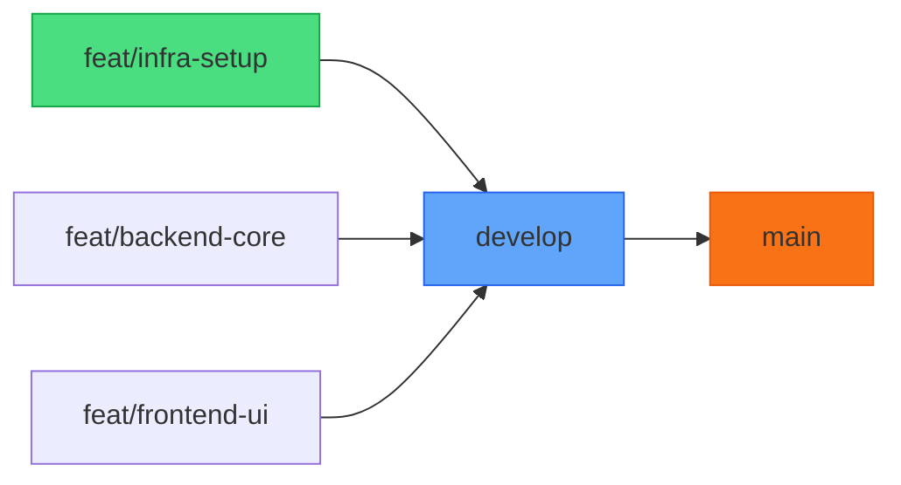

# 📊 Sensei Hub — フェーズ別タスクマトリックス

> **バージョン**: 2.0.0  
> **最終更新**: 2026-05-20

---

## 1. ブランチ戦略

### 1.1 ブランチ構成

| ブランチ | 用途 | ステータス |
|---------|------|-----------|
| `main` | 本番環境（安定版） | ✅ 同期済み |
| `develop` | 開発統合ブランチ | ✅ 同期済み |
| `feat/infra-setup` | インフラ構築・基盤開発 | ✅ メインブランチ |
| `feat/backend-core` | バックエンドコア開発 | ✅ 同期済み |
| `feat/frontend-ui` | フロントエンドUI開発 | ✅ 同期済み |

> **注**: 全ブランチは2026-05-20に `feat/infra-setup` と完全同期済み。

### 1.2 開発フロー



### 1.3 コミット規約

```
<type>(<scope>): <description>

feat(lessons): add blockchain course translations
fix(dashboard): resolve sidebar animation glitch
docs(architecture): update system diagram
chore(deps): bump next.js to 16.2.6
```

---

## 2. タスクマトリックス

### Phase 1: インフラ構築・コンテンツ作成 — ✅ 完了

| タスクID | タスク名 | 担当 | ステータス |
|---------|---------|------|-----------|
| P1-A1 | AWS IAM・権限設計 | Cloud | ✅ 完了 |
| P1-A2 | Docker Compose 構築 | Cloud | ✅ 完了 |
| P1-B1 | Next.js 16 初期化 | Backend | ✅ 完了 |
| P1-B2 | Prisma スキーマ設計（7モデル） | Backend | ✅ 完了 |
| P1-B3 | shadcn/ui セットアップ（57コンポーネント） | Backend | ✅ 完了 |
| P1-C1 | ダッシュボードUI（19コンポーネント） | Frontend | ✅ 完了 |
| P1-C2 | 科目詳細ページUI（3コンポーネント） | Frontend | ✅ 完了 |
| P1-C3 | i18nシステム（3言語） | Frontend | ✅ 完了 |
| P1-ALL1 | レッスンコンテンツ作成（11コース） | 全員 | ✅ 完了 |
| P1-ALL2 | レッスン翻訳（EN/JA/VI） | 全員 | ✅ 完了 |
| P1-ALL3 | ドキュメント整備 | 全員 | ✅ 完了 |

### Phase 2: バックエンド統合 — 🔧 進行中

| タスクID | タスク名 | 担当 | ステータス |
|---------|---------|------|-----------|
| P2-A1 | AWS RDS PostgreSQL 構築 | Cloud | ⏳ 予定 |
| P2-B1 | Auth.js v5 統合 | Backend | 🔧 進行中 |
| P2-B2 | Prisma マイグレーション | Backend | ⏳ 予定 |
| P2-B3 | Server Actions 実装 | Backend | ⏳ 予定 |
| P2-B4 | API Routes 実装 | Backend | ⏳ 予定 |
| P2-C1 | レッスンビューア | Frontend | ⏳ 予定 |
| P2-C2 | Markdown レンダリング | Frontend | ⏳ 予定 |
| P2-C3 | ログイン/登録画面 | Frontend | ⏳ 予定 |

### Phase 3: 機能完成 — ⏳ 予定

| タスクID | タスク名 | 担当 | ステータス |
|---------|---------|------|-----------|
| P3-B1 | 語彙CRUD API | Backend | ⏳ 予定 |
| P3-B2 | クイズAPI | Backend | ⏳ 予定 |
| P3-C1 | 語彙辞典UI | Frontend | ⏳ 予定 |
| P3-C2 | クイズUI | Frontend | ⏳ 予定 |
| P3-C3 | 管理画面 | Frontend | ⏳ 予定 |
| P3-ALL1 | データ連携テスト | 全員 | ⏳ 予定 |

### Phase 4: 最適化・デプロイ — ⏳ 予定

| タスクID | タスク名 | 担当 | ステータス |
|---------|---------|------|-----------|
| P4-A1 | AWS S3 + CloudFront | Cloud | ⏳ 予定 |
| P4-A2 | AWS Amplify デプロイ | Cloud | ⏳ 予定 |
| P4-A3 | CI/CD パイプライン | Cloud | ⏳ 予定 |
| P4-B1 | セキュリティ監査 | Backend | ⏳ 予定 |
| P4-C1 | パフォーマンス最適化 | Frontend | ⏳ 予定 |
| P4-ALL1 | E2Eテスト | 全員 | ⏳ 予定 |
| P4-ALL2 | ドキュメント最終更新 | 全員 | ⏳ 予定 |

---

## 📎 関連ドキュメント

- [ROADMAP.md](./ROADMAP.md) — ロードマップ
- [DETAILED_BACKLOG.md](./DETAILED_BACKLOG.md) — 詳細バックログ
- [TEAM_ROLES.md](./TEAM_ROLES.md) — チーム役割分担
