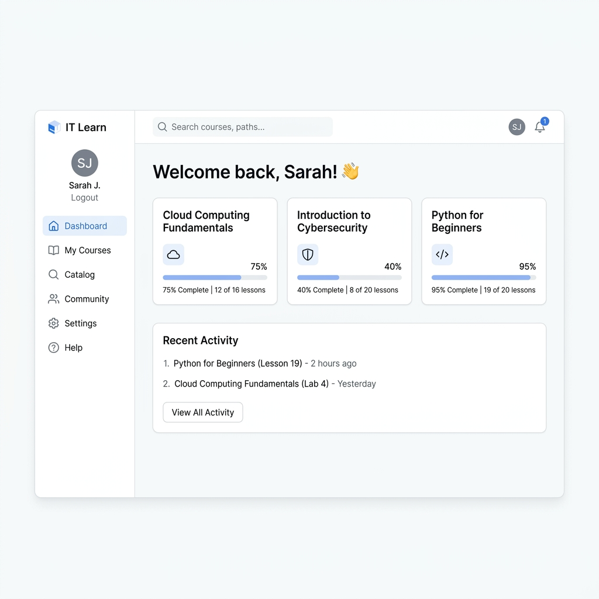
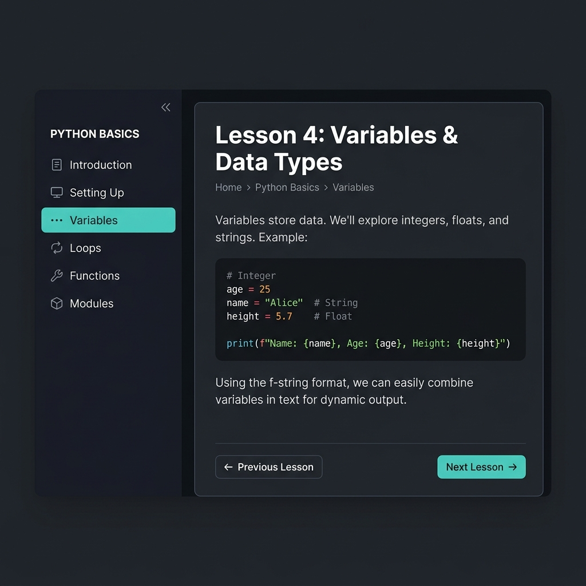
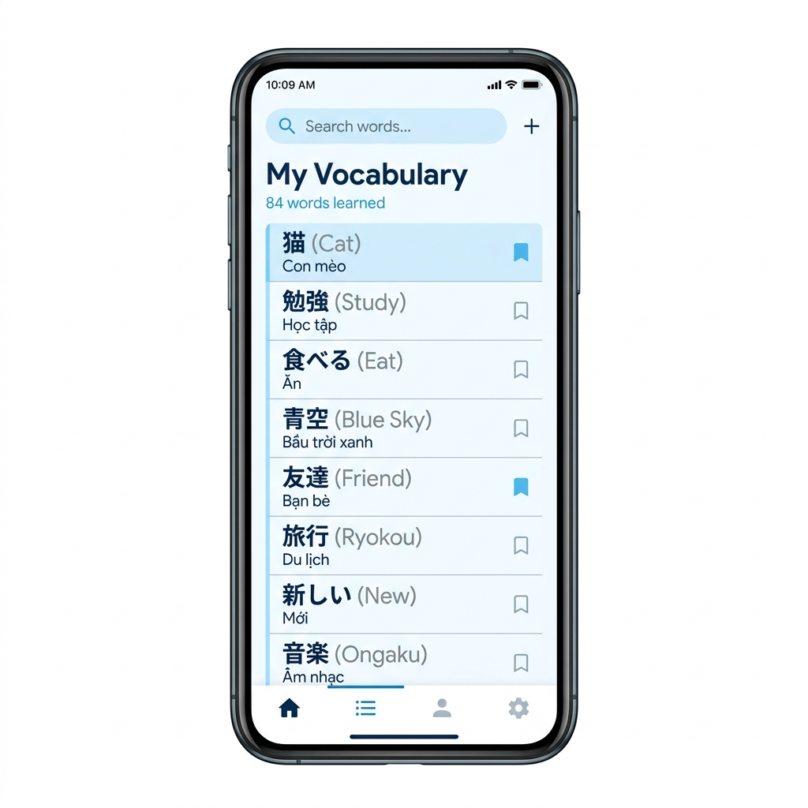
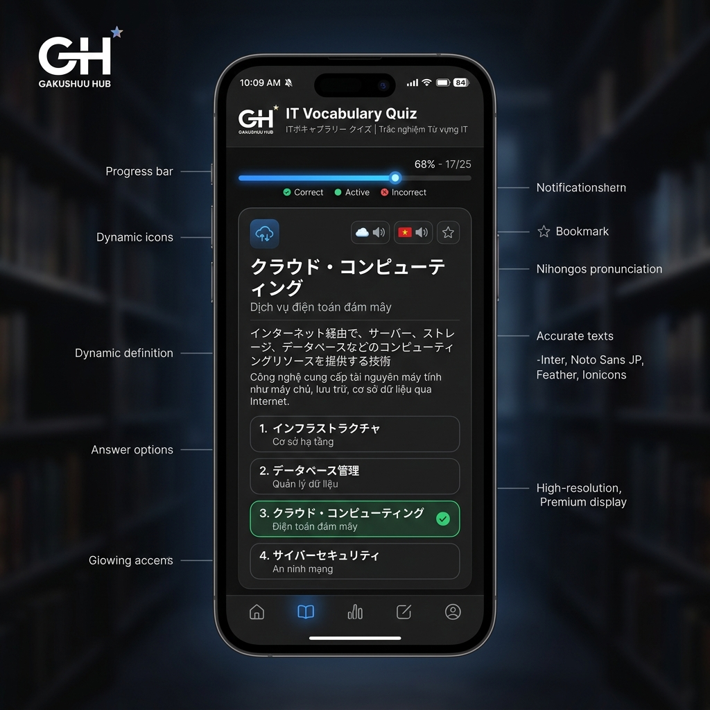
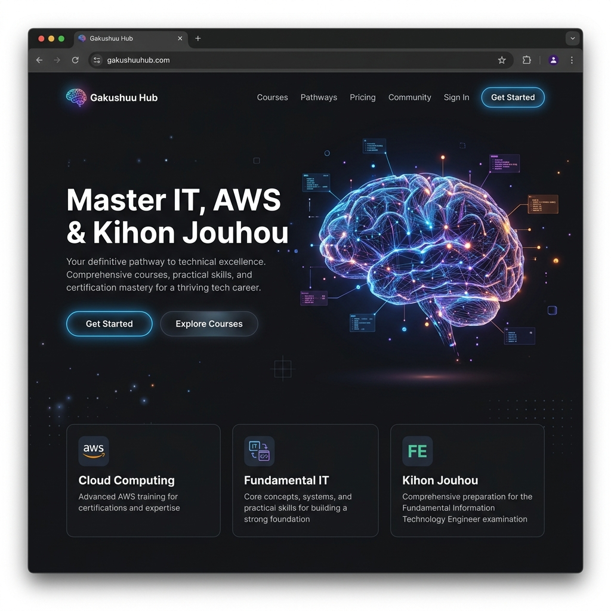

# 🖼️ UI モックアップ (UI Mockups): Sensei Hub

チームで共有するための、すべての主要な機能とページのUIデザイン（モックアップ）コレクションです。

---

## 💎 Option 1: プレミアムダークスタイル (Premium Dark Style)
モダンで高級感のあるデザイン。開発者が集中しやすいダークモードを基調とし、グロー効果やグラデーションを使用しています。

### ダッシュボード ＆ レッスン
- [プレミアムダッシュボードを見る](./assets/dashboard.png)
- [プレミアムレッスンを見る](./assets/lesson.png)

### カタログ ＆ プロフィール
- [プレミアムカタログを見る](./assets/catalog.png)
- [プレミアムプロフィールを見る](./assets/profile.png)

---

## 🕊️ Option 2: ミニマリストスタイル (Minimalist & Clean Style)
シンプルさとスピードを重視し、余計な装飾を削ぎ落としたクリーンなデザインです。

### ダッシュボード (ライトモード)
日中の学習に最適な、明るく清潔感のあるデザインです。

### レッスン画面 (ミニマリストダーク)
学習内容とコードブロックに100%集中できるよう、装飾を最小限に抑えています。

### モバイル用用語集 (フラットデザイン)
スマートフォンでの素早い検索を目的とした、フラットなUIです。

---

## 📱 モバイルインタラクション (Quiz & Vocab)
スマートフォンでのクイズや単語帳のインタラクティブなデザインです。

---

### 🎨 デザインの推奨方針 (Design Recommendation):
- **本格的な学習ツールを目指す場合:** 余計な装飾がなく目に優しい **Option 2 (Minimalist)** を推奨します。
- **マーケティングやアピールを重視する場合:** 初見のインパクトが強い **Option 1 (Premium)** を推奨します。
