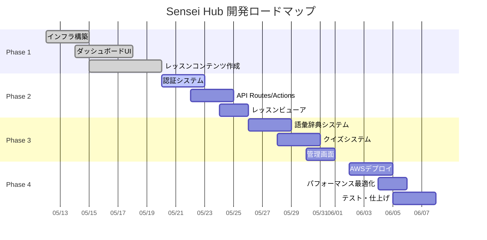

# 🗺 Sensei Hub — ロードマップ

> **バージョン**: 2.0.0  
> **最終更新**: 2026-05-20  
> **開始日**: 2026-05-12

---

## フェーズ概要

---

## Phase 1: インフラ構築・コンテンツ作成（Week 1-2）— ✅ 完了

### 達成項目

| # | タスク | 担当 | ステータス |
|---|-------|------|-----------|
| 1 | Git リポジトリ・ブランチ戦略構築 | 全員 | ✅ 完了 |
| 2 | Next.js 16 プロジェクト初期化 | Frontend | ✅ 完了 |
| 3 | Tailwind CSS v4 + shadcn/ui セットアップ | Frontend | ✅ 完了 |
| 4 | Prisma + PostgreSQL スキーマ設計 | Backend | ✅ 完了 |
| 5 | Docker Compose ローカル環境構築 | Cloud | ✅ 完了 |
| 6 | ダッシュボードUI（19コンポーネント） | Frontend | ✅ 完了 |
| 7 | 科目詳細ページUI（3コンポーネント） | Frontend | ✅ 完了 |
| 8 | i18nシステム（3言語・80キー） | Frontend | ✅ 完了 |
| 9 | レッスンコンテンツ作成（11コース × 3言語） | 全員 | ✅ 完了 |
| 10 | ドキュメント整備 | 全員 | ✅ 完了 |

### 成果物

- 📊 ダッシュボードUI: 19コンポーネント実装済み
- 📖 科目詳細ページ: 3コンポーネント実装済み
- 🌐 i18n: 3言語対応（~80翻訳キー）
- 📚 レッスン: 11コース × 3言語 = 約1,560ファイル
- 🗄 DB: 7モデルのPrismaスキーマ設計完了

---

## Phase 2: バックエンド統合（Week 3）— 🔧 進行中

### 予定タスク

| # | タスク | 担当 | ステータス |
|---|-------|------|-----------|
| 1 | Auth.js v5 統合（Credentials Provider） | Backend | 🔧 進行中 |
| 2 | Prisma マイグレーション実行 | Backend | ⏳ 予定 |
| 3 | Server Actions 実装（進捗更新） | Backend | ⏳ 予定 |
| 4 | API Routes 実装（語彙・クイズ） | Backend | ⏳ 予定 |
| 5 | レッスンビューアコンポーネント | Frontend | ⏳ 予定 |
| 6 | Markdown レンダリングパイプライン | Frontend | ⏳ 予定 |

### デモ目標

- ユーザー登録・ログインフローの動作
- レッスンコンテンツの表示と進捗保存

---

## Phase 3: 機能完成（Week 4）— ⏳ 予定

### 予定タスク

| # | タスク | 担当 | ステータス |
|---|-------|------|-----------|
| 1 | 語彙辞典UI（一覧・検索・詳細・お気に入り） | Frontend | ⏳ 予定 |
| 2 | 語彙CRUD API | Backend | ⏳ 予定 |
| 3 | クイズUI（問題表示・回答・結果） | Frontend | ⏳ 予定 |
| 4 | クイズAPI（出題・採点） | Backend | ⏳ 予定 |
| 5 | 管理画面（コンテンツ管理・ユーザー管理） | Full-stack | ⏳ 予定 |
| 6 | ダッシュボードデータ連携（実データ表示） | Full-stack | ⏳ 予定 |

### デモ目標

- 語彙辞典の3言語検索
- クイズの出題・採点・結果表示
- ダッシュボードの実データ反映

---

## Phase 4: 最適化・デプロイ（Week 5+）— ⏳ 予定

### 予定タスク

| # | タスク | 担当 | ステータス |
|---|-------|------|-----------|
| 1 | AWS RDS PostgreSQL セットアップ | Cloud | ⏳ 予定 |
| 2 | AWS S3 + CloudFront 設定 | Cloud | ⏳ 予定 |
| 3 | AWS Amplify デプロイ | Cloud | ⏳ 予定 |
| 4 | パフォーマンス最適化（画像・バンドルサイズ） | Frontend | ⏳ 予定 |
| 5 | SEO対応（メタタグ・OGP） | Frontend | ⏳ 予定 |
| 6 | E2Eテスト | 全員 | ⏳ 予定 |
| 7 | セキュリティ監査 | Backend/Cloud | ⏳ 予定 |

### デモ目標

- 本番環境でのフル機能デモ
- パフォーマンスレポート（Core Web Vitals）

---

## 📎 関連ドキュメント

- [MASTER_PHASE_TASKS.md](./MASTER_PHASE_TASKS.md) — タスクマトリックス
- [DETAILED_BACKLOG.md](./DETAILED_BACKLOG.md) — 詳細バックログ
- [DEPLOYMENT.md](./DEPLOYMENT.md) — デプロイメントガイド
