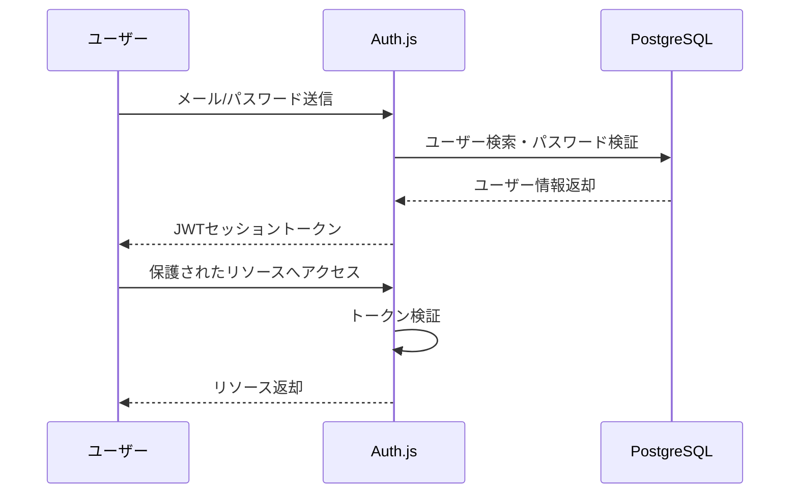

# 🛠 Sensei Hub — テックスタック詳細

> **バージョン**: 2.0.0  
> **最終更新**: 2026-05-20

---

## 1. フレームワーク＆コアランタイム

| テクノロジー | バージョン | 用途 | 選定理由 |
|------------|-----------|------|---------|
| **Next.js** | 16.2.6 | フルスタックフレームワーク | App Router、Server Actions、ISR/SSRの統合。React Server Componentsのネイティブサポート |
| **React** | 19 | UIライブラリ | `use()` Hook、Server Components、Concurrent Rendering。最新のパフォーマンス最適化 |
| **TypeScript** | 5.7.3 | 型安全な言語 | 厳格モード有効。型推論の改善、コンパイル時のバグ検出 |

### Next.js 設定ポイント

```javascript
// next.config.mjs
const nextConfig = {
  typescript: { ignoreBuildErrors: true },  // 開発中のみ
  images: { unoptimized: true },            // 静的エクスポート対応
};
```

---

## 2. スタイリング＆UIコンポーネント

| テクノロジー | バージョン | 用途 | 選定理由 |
|------------|-----------|------|---------|
| **Tailwind CSS** | 4.2.0 | ユーティリティCSS | v4の新しいOKLCHカラースペース、ネイティブCSS変数。ビルド速度の大幅向上 |
| **shadcn/ui** | — | UIコンポーネントライブラリ | 57コンポーネント実装（new-yorkスタイル）。カスタマイズ性が高く、Radix UIベース |
| **Framer Motion** | 12.38.0 | アニメーション | 宣言的API、レイアウトアニメーション、スタガードリビール。プレミアム感を演出 |
| **Lucide React** | 0.564.0 | アイコンライブラリ | 軽量、Tree-shaking対応。shadcn/uiとの親和性が高い |

### shadcn/ui 構成

```json
{
  "style": "new-york",
  "rsc": true,
  "tailwind": { "cssVariables": true, "baseColor": "neutral" },
  "iconLibrary": "lucide"
}
```

### 実装済みshadcn/uiコンポーネント（57個）

<details>
<summary>全コンポーネント一覧を表示</summary>

accordion, alert, alert-dialog, aspect-ratio, avatar, badge, breadcrumb, button, button-group, calendar, card, carousel, chart, checkbox, collapsible, command, context-menu, dialog, drawer, dropdown-menu, empty, field, form, hover-card, input, input-group, input-otp, item, kbd, label, menubar, navigation-menu, pagination, popover, progress, radio-group, resizable, scroll-area, select, separator, sheet, sidebar, skeleton, slider, sonner, spinner, switch, table, tabs, textarea, toast, toaster, toggle, toggle-group, tooltip, use-mobile, use-toast

</details>

---

## 3. データ＆バックエンド

| テクノロジー | バージョン | 用途 | 選定理由 |
|------------|-----------|------|---------|
| **Prisma ORM** | — | データベースORM | 型安全なクエリ、自動マイグレーション、直感的なスキーマ定義 |
| **PostgreSQL** | — | リレーショナルDB | 信頼性、ACID準拠、JSON型サポート、フルテキスト検索 |
| **Zod** | 3.24.1 | バリデーション | TypeScript統合、ランタイム型検証、React Hook Formとの連携 |
| **React Hook Form** | 7.54.1 | フォーム管理 | パフォーマンス最適化（再レンダリング最小化）、Zodリゾルバー対応 |

### Prisma データモデル（7モデル）

| モデル | 説明 | 主要フィールド |
|-------|------|--------------|
| `User` | ユーザー情報 | email, password, name, role, preferredLang |
| `LessonProgress` | レッスン進捗 | userId, lessonId, status, startedAt, completedAt |
| `Vocabulary` | 語彙エントリ | termJa, termVi, termEn, reading, definitions, examples |
| `FavoriteVocab` | お気に入り語彙 | userId, vocabId（複合主キー） |
| `Question` | クイズ問題 | contentJa, contentVi, type, explanation, category, level |
| `Option` | 選択肢 | questionId, textJa, textVi, isCorrect |
| `QuizResult` | クイズ結果 | userId, score, totalItems, category, duration |
| `QuizAnswer` | 個別回答 | quizResultId, questionId, selectedOptionId, isCorrect |

---

## 4. 認証＆セキュリティ

| テクノロジー | バージョン | 用途 | 選定理由 |
|------------|-----------|------|---------|
| **Auth.js** | v5 | 認証フレームワーク | Next.js App Router対応、Credentials Provider、セッション管理 |

### 認証フロー



---

## 5. チャート＆データ可視化

| テクノロジー | バージョン | 用途 | 選定理由 |
|------------|-----------|------|---------|
| **Recharts** | 2.15.0 | チャートライブラリ | React対応、宣言的API、レスポンシブ、shadcn/uiのChartコンポーネントと統合 |

---

## 6. UX強化ライブラリ

| テクノロジー | バージョン | 用途 |
|------------|-----------|------|
| **next-themes** | 0.4.6 | ダーク/ライトテーマ切替 |
| **canvas-confetti** | — | 達成時の紙吹雪エフェクト |
| **sonner** | — | トースト通知（非侵入型） |
| **vaul** | — | ドロワーコンポーネント（モバイル最適化） |
| **embla-carousel** | — | カルーセル（タッチ操作対応） |
| **date-fns** | — | 日付操作ユーティリティ |
| **cmdk** | — | コマンドパレット（⌘+K） |
| **react-resizable-panels** | — | リサイズ可能パネル |
| **@vercel/analytics** | 1.6.1 | ページビュー・Web Vitals分析 |

---

## 7. フォント

| フォント名 | 用途 | ウェイト | ソース |
|-----------|------|---------|-------|
| **Inter** | 本文テキスト（sans-serif） | 400, 500, 600, 700 | Google Fonts |
| **JetBrains Mono** | コードブロック（monospace） | 400, 500 | Google Fonts |

```typescript
// app/layout.tsx
const inter = Inter({ subsets: ["latin"], variable: "--font-sans" });
const jetbrainsMono = JetBrains_Mono({ subsets: ["latin"], variable: "--font-mono" });
```

---

## 8. 開発ツール＆インフラ

| テクノロジー | 用途 | 備考 |
|------------|------|------|
| **pnpm** | パッケージマネージャ | 高速インストール、ディスク効率 |
| **Docker** / **Docker Compose** | ローカル開発環境 | PostgreSQLコンテナ |
| **ESLint** | コード品質チェック | Next.js推奨設定 |
| **TypeScript Strict Mode** | 厳格型チェック | `strict: true` in tsconfig.json |
| **Git** | バージョン管理 | ブランチ戦略: main / develop / feat/* |
| **GitHub** | リポジトリホスティング | PR、Issue管理 |

### TypeScript 設定

```json
{
  "compilerOptions": {
    "target": "ES6",
    "strict": true,
    "moduleResolution": "bundler",
    "paths": { "@/*": ["./*"] }
  }
}
```

---

## 9. AWSインフラ（デプロイ先）

| サービス | 用途 | 備考 |
|---------|------|------|
| **AWS Amplify** | フロントエンドホスティング | Next.js SSR対応、自動ビルド |
| **AWS RDS** | PostgreSQLホスティング | マネージドDB、自動バックアップ |
| **AWS S3** | 静的アセット保存 | レッスン画像、アイコン等 |
| **AWS CloudFront** | CDN | S3コンテンツの高速配信 |

---

## 📎 関連ドキュメント

- [ARCHITECTURE.md](./ARCHITECTURE.md) — システムアーキテクチャ詳細
- [DATABASE_DESIGN.md](./DATABASE_DESIGN.md) — データベース設計
- [PROJECT_STRUCTURE.md](./PROJECT_STRUCTURE.md) — プロジェクト構成
