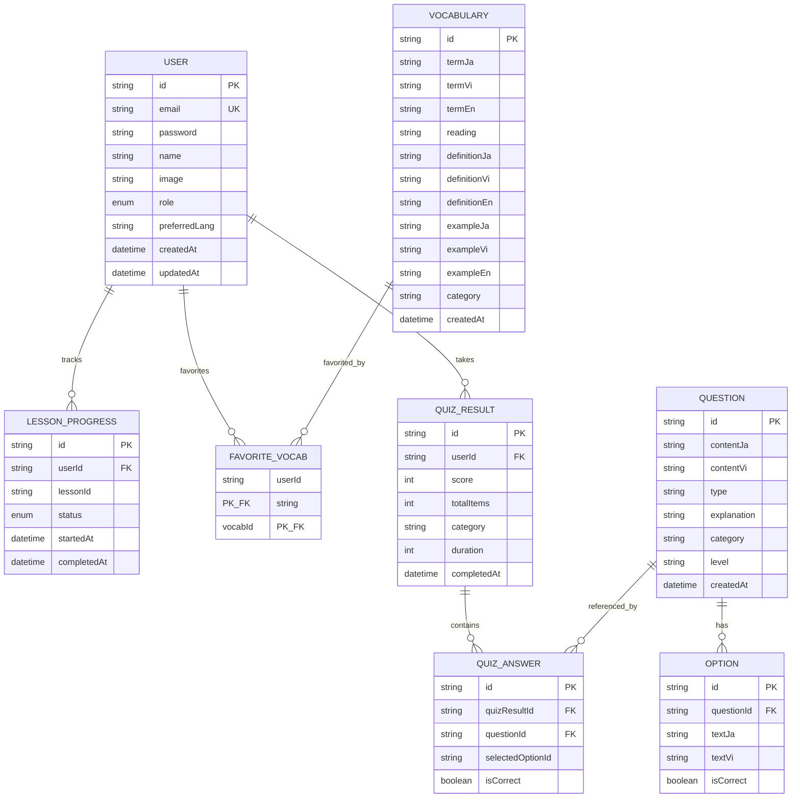

# 📊 Sensei Hub — データベーススキーマ（ER図）

> **バージョン**: 2.0.0  
> **最終更新**: 2026-05-20  
> **ORM**: Prisma  
> **データベース**: PostgreSQL

---

## ER図

---

## リレーションシップ説明

| 関係 | 型 | 説明 |
|------|-----|------|
| User → LessonProgress | 1:N | ユーザーは複数のレッスン進捗を持つ |
| User → FavoriteVocab | 1:N | ユーザーは複数の語彙をお気に入り登録可能 |
| User → QuizResult | 1:N | ユーザーは複数のクイズ結果を持つ |
| Vocabulary → FavoriteVocab | 1:N | 語彙は複数のユーザーにお気に入り登録される |
| Question → Option | 1:N | 問題は複数の選択肢を持つ |
| QuizResult → QuizAnswer | 1:N | クイズ結果は複数の回答を含む |
| Question → QuizAnswer | 1:N | 問題は複数の回答で参照される |

---

## 📎 関連ドキュメント

- [DATABASE_DESIGN.md](../DATABASE_DESIGN.md) — データベース設計（詳細版）
