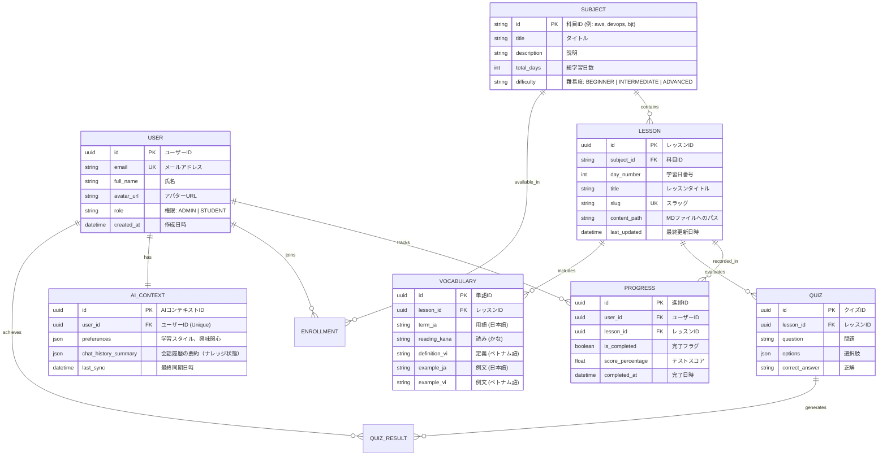

# データベース設計書 (ERD) - Sensei-Hub

このドキュメントは、AI駆動型学習とBrSE（ブリッジSE）カリキュラム管理に最適化された Sensei-Hub プラットフォームのデータ構造を定義します。

## 1. エンティティ関係図 (ERD)

## 2. データディクショナリの主要項目

### AI_CONTEXT (AIコンテキスト)
- **preferences**: ユーザーのカスタマイズ設定（例：AIによる解説を日本語メインにするか、ベトナム語にするか等）を保持します。
- **chat_history_summary**: AIチューターとの会話内容を要約し、トークン制限を回避しつつ学習コンテキストを維持するために使用します。

### PROGRESS (学習進捗)
- 日次（Day-by-Day）の学習状態を記録します。
- 「継続日数（Streak）」機能や、BrSE向けの進捗レポートをサポートします。

## 3. 実装上の注意
このスキーマは `schema.prisma` と同期させ、設計ドキュメントと実際のコードの整合性を担保します。
2026年5月時点の最新技術スタック（Next.js 15, PostgreSQL）に対応した設計となっています。
