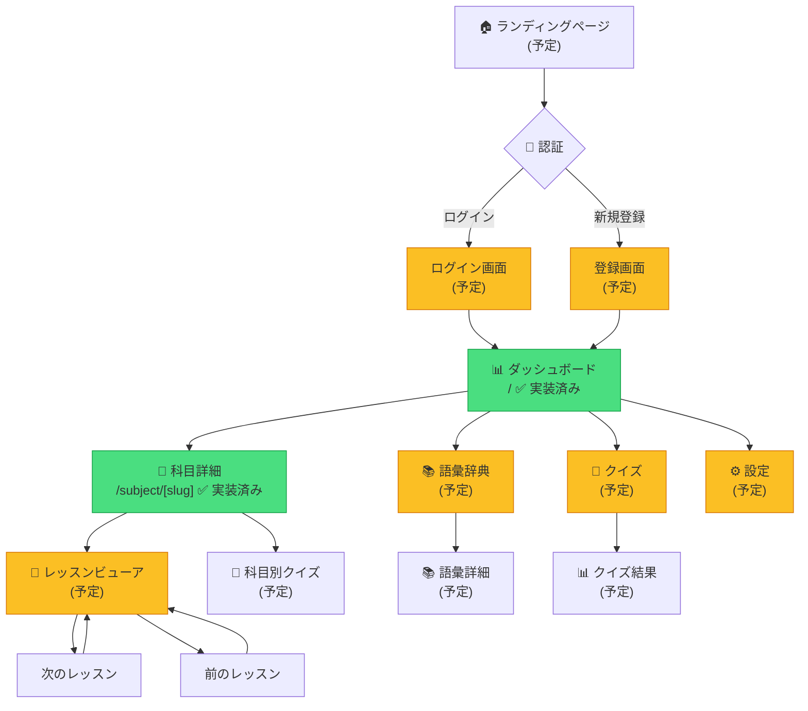

# 🔄 Sensei Hub — 画面遷移図

> **バージョン**: 2.0.0  
> **最終更新**: 2026-05-20

---

## 画面フロー

---

## 画面一覧

| # | 画面 | パス | ステータス | 説明 |
|---|------|------|-----------|------|
| 1 | ダッシュボード | `/` | ✅ 実装済み | ヒーローバナー、統計行、科目グリッド、チャレンジ、リーダーボード |
| 2 | 科目詳細 | `/subject/[slug]` | ✅ 実装済み | 科目ヘッダー、統計、モジュールリスト |
| 3 | ログイン | `/login` | ⏳ 予定 | メール/パスワードログイン |
| 4 | 新規登録 | `/register` | ⏳ 予定 | メール/パスワード/名前登録 |
| 5 | レッスンビューア | `/lesson/[subject]/[day]` | ⏳ 予定 | Markdownレンダリング、進捗保存 |
| 6 | 語彙辞典 | `/vocabulary` | ⏳ 予定 | 3言語並列表示、検索、お気に入り |
| 7 | クイズ | `/quiz` | ⏳ 予定 | 問題表示、タイマー、結果 |
| 8 | 設定 | `/settings` | ⏳ 予定 | プロフィール、言語、テーマ |

---

## 📎 関連ドキュメント

- [SCREEN_FLOW_JA.md](./SCREEN_FLOW_JA.md) — 画面遷移図（詳細版）
- [UI_UX_SPEC.md](../UI_UX_SPEC.md) — UI/UX仕様書
