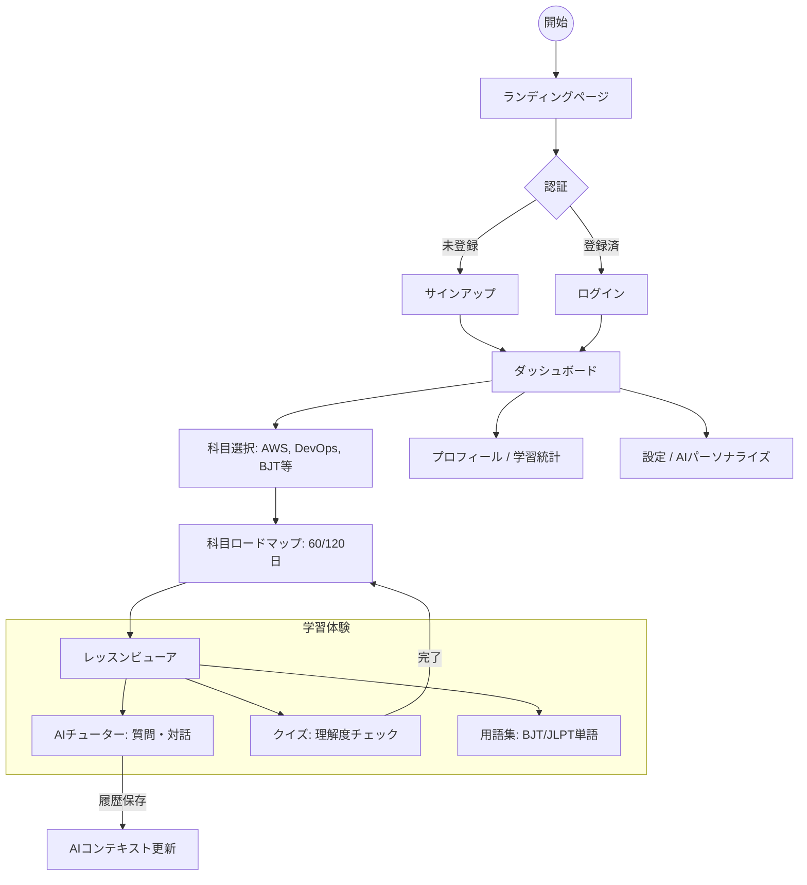

# 画面遷移図 (Screen Flow) - Sensei-Hub

Sensei-Hubプラットフォームのユーザー体験（UX）および主要な画面フローを定義します。

## 1. ユーザーフロー図

## 2. 画面詳細説明

### 2.1 ダッシュボード (Dashboard)
- ユーザーの学習進捗、現在のストリーク、おすすめのレッスンを表示。
- 全8科目の進捗状況を鳥瞰できるウィジェットを配置。

### 2.2 ロードマップ (Roadmap)
- 各科目の全レッスンを「Day 1」から「Day 120」までリスト表示。
- ロック機能：前日のレッスンを完了しないと次の日に進めない（オプション設定可能）。

### 2.3 レッスンビューア (Lesson Viewer)
- **メインコンテンツ**: Markdown形式の高品質な学習教材。
- **AIサイドバー**: 2026年5月時点の最新AIモデルを搭載したチューターが、質問に即座に回答。
- **インタラクティブ要素**: 読了ボタン、重要単語のブックマーク機能。

### 2.4 クイズ (Quiz)
- レッスンの最後に実施。J1+レベルの論理的思考を問う問題を含む。
- AIによる解説フィードバック機能。

## 3. デザイン方針 (2026年版)
- **Rich Aesthetics**: モダンなダークモード、グラスモーフィズムを採用し、プレミアムな学習体験を提供。
- **AI-First**: 常にAIアシスタントが寄り添うレイアウト。
- **Responsiveness**: デスクトップ、タブレット、モバイルのすべてでシームレスに動作。
