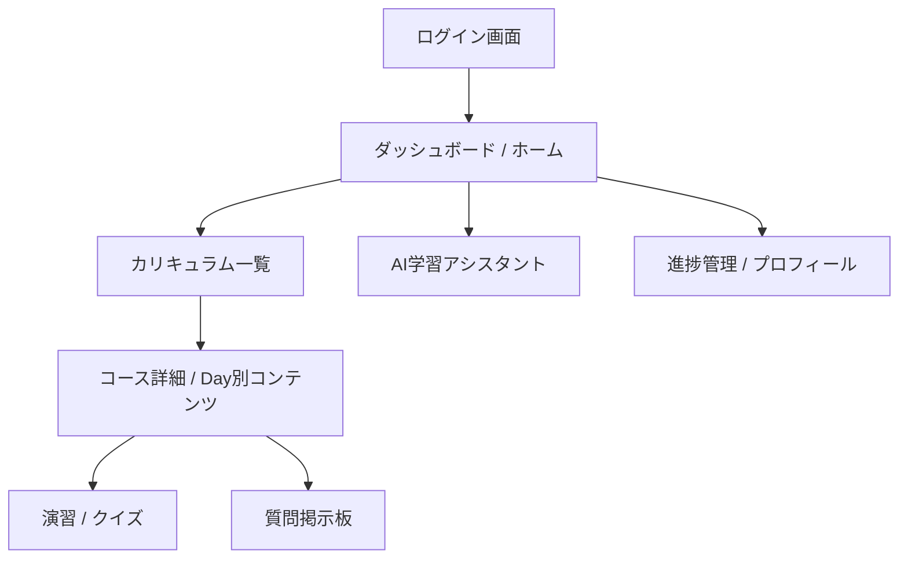

# Sensei-Hub 画面遷移図 (Screen Flow) - v1.0

このドキュメントでは、Sensei-Hub ダッシュボードの主要な画面遷移図を定義します。

## 1. ユーザーフローの概要

## 2. 主要画面の詳細

### A. ログイン / アカウント作成
- 入力: メールアドレス、パスワード、または GitHub/Google 連携。
- 機能: セッション管理、多要素認証 (MFA) 対応。

### B. ダッシュボード (メインハブ)
- 概要: 現在の進捗状況、今日の学習目標、最近の更新情報を表示。
- UI要素: プログレスバー、カレンダー、AIレコメンド。

### C. カリキュラム一覧
- 概要: AWS, System Design, Database Master などのコースを選択。
- 機能: カテゴリフィルタリング、レベル別表示。

### D. コンテンツ閲覧画面 (Reading Mode)
- 概要: Markdownベースの教材を表示。Elite 3.0形式。
- 機能: ダークモード切替、音声読み上げ (TTS)、コードエディタ統合。

### E. AI学習アシスタント (Chat)
- 概要: 教材の内容についてAIに質問できるサイドバー。
- 技術: Amazon Q または独自 RAG エージェント。
