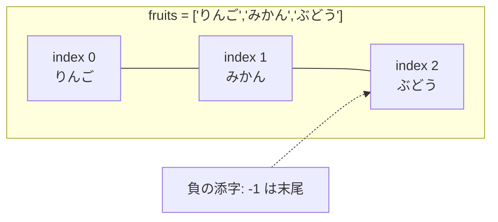

# 🐍 Python 教科 — カリキュラム計画書

> 作成日: 2026-06-23
> 本書は Python 教科（ブラウザ内コード実行）の**カリキュラムと残作業**を定義する。
> 完了した項目は削ってスリムに保つ。

## 1. 概要
- **対象**: プログラミング初学者〜中級。Python の基礎から機械学習・深層学習まで。
- **特徴**: ブラウザ内で**実際にコードを実行**して学ぶ（Pyodide = WebAssembly 版 CPython、
  Monaco エディタ、CodeSandbox コンポーネント）。サーバー不要・インストール不要。
- **構成**: 3 モジュール × 各 10 日 = 全 30 日。各日は読み物 + コーディング課題
  （`codingExercise: true` / `initialCode` / `testCode`（assert 形式））。
- **言語**: EN / JA / VI の 3 言語（全レッスンで i18n 必須）。

## 2. 現状サマリ（2026-06-23 時点）
- レッスンファイルは **30 日 × 3 言語 = 90 ファイル**が存在する。
- ⚠️ **実コンテンツは day-01 と day-11 のみ。残り 28 日は「Python Placeholder Topic」**
  （3 言語とも同じ＝各言語 28 ファイルが空テンプレ）。
- 既存の実コンテンツ:
  - **Day 1**: Python 入門・基本算術（`solve(a,b)` の課題）。
  - **Day 11**: NumPy と Scikit-Learn による線形回帰。
- subject 登録は `lib/subjects.ts`（`id: python`、3 モジュール: python-basics / python-ml / python-dl）。
- 実行系は `components/dashboard/code-sandbox.tsx` + `public/workers/pyodide.worker.js`
  （パッケージ動的検出・読込）。※ 現在ユーザーが調整中（本計画では触らない）。

## 3. ランタイム制約（重要）
Pyodide で動く / 動かないを最初に押さえる。これがカリキュラム設計を縛る。
- ✅ **動く**: 標準ライブラリ、`numpy`、`pandas`、`matplotlib`、`scikit-learn`
  （いずれも Pyodide 公式パッケージ）。
- ❌ **動かない**: `PyTorch` / `TensorFlow`（Pyodide 非対応）。
- → **深層学習モジュールは PyTorch を使わず、`numpy` だけでニューラルネットを実装する方針**
  （forward / backprop を手書きする micrograd 風）。これにより全 30 日がブラウザで実行可能。

## 4. 30 日カリキュラム（提案）
凡例: ✅=実コンテンツ有り / 📝=要作成（placeholder） / pkg=必要パッケージ

### モジュール 1: Python Basics（Day 1–10・Beginner・標準ライブラリのみ）
| Day | タイトル | 課題の狙い | 状態 |
|-----|---------|-----------|------|
| 1 | Python 入門と基本算術 | 変数・算術・関数 `solve` | ✅ |
| 2 | 変数・型・文字列 | 型変換、f-string、スライス | 📝 |
| 3 | 条件分岐（if/elif/else） | 比較・論理演算・分岐 | 📝 |
| 4 | ループ（for/while） | 反復・range・break/continue | 📝 |
| 5 | リストとタプル | 追加/削除・スライス・アンパック | 📝 |
| 6 | 辞書と集合 | キー操作・存在判定・集合演算 | 📝 |
| 7 | 関数とスコープ | 引数・戻り値・デフォルト引数 | 📝 |
| 8 | 内包表記とラムダ | list/dict 内包・map/filter | 📝 |
| 9 | 例外処理（try/except） | 例外捕捉・raise・finally | 📝 |
| 10 | クラスと OOP 入門 | `__init__`・メソッド・属性 | 📝 |

### モジュール 2: Machine Learning（Day 11–20・Intermediate・numpy/pandas/sklearn）
| Day | タイトル | 課題の狙い | pkg | 状態 |
|-----|---------|-----------|-----|------|
| 11 | NumPy と Scikit-Learn による線形回帰 | 回帰の基礎 | numpy, sklearn | ✅ |
| 12 | NumPy 配列とベクトル演算 | 配列・ブロードキャスト | numpy | 📝 |
| 13 | Pandas DataFrame とデータ整形 | 読込・欠損処理・抽出 | pandas | 📝 |
| 14 | データ可視化 | 散布図・ヒストグラム | matplotlib | 📝 |
| 15 | 訓練/テスト分割とモデル評価 | train_test_split・指標 | sklearn | 📝 |
| 16 | ロジスティック回帰（分類） | 二値分類・確率 | sklearn | 📝 |
| 17 | 決定木とランダムフォレスト | 木モデル・特徴量重要度 | sklearn | 📝 |
| 18 | K-means クラスタリング | 教師なし・クラスタ | sklearn | 📝 |
| 19 | 特徴量スケーリングと前処理 | 標準化・正規化 | sklearn | 📝 |
| 20 | 交差検証とハイパラ調整 | CV・グリッドサーチ | sklearn | 📝 |

### モジュール 3: Deep Learning with NumPy（Day 21–30・Advanced・numpy のみ）
> PyTorch は使わず numpy で実装する（ランタイム制約のため）。
| Day | タイトル | 課題の狙い | 状態 |
|-----|---------|-----------|------|
| 21 | ニューラルネットとは（パーセプトロン） | 重み・順伝播を numpy で | 📝 |
| 22 | 活性化関数 | sigmoid / ReLU / tanh 実装 | 📝 |
| 23 | 損失関数 | MSE / 交差エントロピー | 📝 |
| 24 | 勾配降下法をゼロから | 数値微分・パラメータ更新 | 📝 |
| 25 | 誤差逆伝播を手で | chain rule・勾配計算 | 📝 |
| 26 | 2 層ニューラルネット構築 | 隠れ層 + 出力層（numpy） | 📝 |
| 27 | 実データで学習 | XOR / moons 分類 | 📝 |
| 28 | ミニバッチと学習率 | バッチ・lr の影響 | 📝 |
| 29 | 正則化と過学習 | L2・early stopping | 📝 |
| 30 | 総合課題: 手書き数字分類 | numpy だけの MNIST-lite | 📝 |

> メモ: Day 11 は現在「線形回帰」。本提案の順序（NumPy 基礎 → 回帰）に合わせるなら
> Day 12〜15 のどこかへ再配置を検討（必須ではない）。

## 5. 各レッスンの構成テンプレート（必須）
全レッスンは**同じ構成**に従う。単なる文法説明ではなく「**なぜ**そうなるか」
「**どこでつまずくか**」「**内部の仕組み**」まで踏み込み、深い理解を促す。
EN / JA / VI の 3 言語で同じ構成・同じ図・同じ演習にする。

### 5.1 frontmatter（メタデータ）
```yaml
---
title: "Day N: トピック名"
description: "1 文でこのレッスンの狙い"
module: "python-basics"        # python-basics | python-ml | python-dl
difficulty: "Beginner"          # Beginner | Intermediate | Advanced
estMinutes: 20                  # 目安学習時間
packages: []                    # 例: ["numpy","pandas"]。Pyodide で読み込む追加パッケージ
codingExercise: true
initialCode: |
  def solve(...):
      # ここに書く
      ...
testCode: |
  assert solve(...) == ..., "失敗時に表示するヒント"
---
```
> `module / difficulty / estMinutes / packages` は将来のフィルタ・進捗表示・
> パッケージ事前読込に使える任意拡張。レンダラ未対応でも無害（読み飛ばされる）。

### 5.2 本文の固定セクション（この順序を厳守）
| # | セクション | 目的 | 必須 |
|---|-----------|------|------|
| 1 | 🎯 **学習目標** | 「このあと何ができるか」を 2–4 個の箇条書き | 必須 |
| 2 | 🧩 **中核概念（なぜ）** | 文法の前に「何の問題を解くのか／なぜ存在するか」 | 必須 |
| 3 | 🔁 **ロジックと動作** | 処理の流れを**言葉＋ Mermaid 図**で可視化 | 必須（図必須） |
| 4 | 📝 **注釈付きサンプル** | 実行できる短い例＋行コメントで意味を説明 | 必須 |
| 5 | ❌ **よくある間違い** | 「誤コード→実際のエラー→正コード」を 2–4 件 | 必須 |
| 6 | 💡 **コツ・イディオム・難しい書き方** | Pythonic な書き方／短く書く技／罠 | 必須 |
| 7 | 🧠 **深掘り（内部の仕組み）** | 参照/メモリ/計算量など。`<details>` で折りたたみ | 任意 |
| 8 | 🏋️ **演習** | `solve()` の課題＋ヒント＋ `testCode`（assert） | 必須 |
| 9 | ✅ **自己チェック** | 答え合わせ用のミニ問い 1–2 個（`<details>` で解答） | 推奨 |
| 10 | 📌 **まとめ** | 3–5 行の要点リスト | 必須 |

### 5.3 図（Mermaid）の指針
プラットフォームは Mermaid をレンダリングする。**毎レッスン最低 1 つ**入れる。
- **処理の流れ・分岐・ループ** → `flowchart`（`graph TD/LR`）
- **オブジェクト間のやり取り・関数呼び出し順** → `sequenceDiagram`
- **データ構造・参照関係（リスト/辞書/参照）** → `graph` のノード＋エッジ
- 図は**小さく 1 概念だけ**。複雑な図は 2 つに分ける。

### 5.4 「よくある間違い」の書き方（重要）
必ず **誤コード → 実際の Traceback → 正コード → 一言の理由** の 4 点セットで書く。
実際のエラーメッセージを見せることで「このエラーが出たらこれ」と結びつく。
````markdown
**間違い: ループ中にリストを変更する**
```python
nums = [1, 2, 3, 4]
for n in nums:
    if n % 2 == 0:
        nums.remove(n)   # 反復中に要素を削除 → インデックスがずれる
print(nums)  # 期待は奇数だけだが、削除でずれて一部がスキップされる
```
実行すると、削除のたびに後ろの要素が前へ詰まり、反復が一部要素を飛ばす。
```python
# 正しい: 新しいリストを作る（または逆順/内包表記）
nums = [n for n in [1, 2, 3, 4] if n % 2 != 0]  # [1, 3]
```
> 反復中のコレクション変更は「歩きながら足元の床を抜く」ようなもの。
````

### 5.5 記入例（モデルレッスン: Day 5「リストとタプル」）
以下は本テンプレートを**埋めた完成見本**。新規レッスンはこの粒度で書く。

---
#### 🎯 学習目標
- リストとタプルの違い（**可変 vs 不変**）を説明できる。
- 添字・スライス・追加・削除で要素を操作できる。
- 反復中の変更や添字ずれといった典型バグを避けられる。

#### 🧩 中核概念（なぜ）
複数の値を **1 つの順序付き集まり**として扱いたい。`list` は後から**変更できる**
（追加・削除・並べ替え）。`tuple` は作成後**変更できない**＝「壊れてほしくない
固定データ」（座標 `(x, y)`、RGB `(255,0,0)` など）に使う。不変だからこそ辞書のキーにもできる。

#### 🔁 ロジックと動作
リストは「番号付きの棚」。添字は **0 始まり**、末尾は `-1` でも指せる。


#### 📝 注釈付きサンプル
```python
fruits = ["りんご", "みかん", "ぶどう"]
print(fruits[0])     # りんご（先頭）
print(fruits[-1])    # ぶどう（末尾）
print(fruits[0:2])   # ['りんご', 'みかん']（0以上2未満のスライス）
fruits.append("もも") # 末尾に追加（リストは可変）
point = (35.6, 139.7)  # タプル＝不変。緯度経度のような固定ペア
```

#### ❌ よくある間違い
**間違い 1: 範囲外の添字**
```python
fruits = ["りんご", "みかん"]
print(fruits[2])
```
```text
IndexError: list index out of range
```
```python
print(fruits[-1])   # 末尾は -1、または len(fruits)-1
```
> 長さ 2 のリストの有効添字は 0 と 1 だけ。

**間違い 2: タプルを変更しようとする**
```python
point = (1, 2)
point[0] = 9
```
```text
TypeError: 'tuple' object does not support item assignment
```
```python
point = (9, 2)   # 変更ではなく作り直す
```
> 「不変」とは中身を書き換えられないこと。新しいタプルを作る。

**間違い 3: コピーのつもりが別名（エイリアス）**
```python
a = [1, 2, 3]
b = a          # 同じリストを指す“別名”。コピーではない
b.append(4)
print(a)       # [1, 2, 3, 4] ← a も変わる！
```
```python
b = a.copy()   # 浅いコピーで独立させる（または a[:] / list(a)）
```

#### 💡 コツ・イディオム・難しい書き方
- **スライスは安全**: `fruits[1:99]` は範囲外でもエラーにならず、ある分だけ返す。
- **アンパック**: `x, y = point` で一気に取り出す。`first, *rest = [1,2,3,4]` も可。
- **末尾追加は速い / 先頭挿入は遅い**: `append` は速いが `insert(0, x)` は全要素ずれる。
- **内包表記**で「変換＋絞り込み」を 1 行に: `[n*n for n in nums if n > 0]`。

#### 🧠 深掘り（内部の仕組み）
<details><summary>参照セマンティクスと計算量（クリックで展開）</summary>

- 変数は**箱の中身**ではなく**箱への矢印（参照）**を持つ。`b = a` は矢印の複製。
- `a.copy()` は**浅いコピー**: 1 段目は独立するが、中のリスト等は共有される。
  完全独立には `copy.deepcopy`。
- 計算量の目安: 末尾 `append` / 添字アクセスは **O(1)**、
  `insert(0,x)` / `remove` / `x in list` は **O(n)**。
  「含まれるか」を多用するなら `set`（平均 O(1)）を検討。
</details>

#### 🏋️ 演習
リスト `nums` を受け取り、**偶数だけを順番どおり**に並べた新しいリストを返す
`solve(nums)` を完成させよ（元のリストは変更しないこと）。
```python
def solve(nums):
    # ヒント: 内包表記 [... for ... if ...] が使える
    return None
```
```python
# testCode
assert solve([1, 2, 3, 4]) == [2, 4]
assert solve([1, 3, 5]) == []
assert solve([]) == []
_src = [2, 1]; solve(_src); assert _src == [2, 1], "元のリストを変更しないこと"
```

#### ✅ 自己チェック
1. `len(["a","b","c"])` の有効な添字は？
2. `t = (1,)` と `t = (1)` の違いは？
<details><summary>解答</summary>
1. 0,1,2（負なら -1,-2,-3）。2. `(1,)` は要素 1 個のタプル、`(1)` はただの整数 1（カンマが要る）。
</details>

#### 📌 まとめ
- `list` は可変、`tuple` は不変。用途で使い分ける。
- 添字は 0 始まり・末尾 `-1`。範囲外は `IndexError`、スライスは安全。
- `b = a` は別名、独立させるなら `a.copy()`。
- 反復中の変更・先頭挿入の遅さに注意。

---

## 6. 技術タスク（コンテンツ以外）
- [ ] **サンドボックス安全性**: ユーザーコードの実行に**タイムアウト**（無限ループ対策）と
      **メモリ上限**を設定。worker を terminate できる導線。`testCode` の assert 失敗を
      安全に表示。
- [ ] **バンドルサイズ**: Monaco / Pyodide は重い。Python レッスンを開いた時のみ
      遅延ロード（コード分割）し、初回表示と他教科に影響させない。
- [ ] **モバイル UX**: 小画面でのエディタ操作・実行結果表示・キーボード対応の検証。
- [ ] **テスト**: コードランナー（worker メッセージ、assert 判定、パッケージ検出）の
      ユニット/結合テスト。
- [ ] **i18n 整合**: 新規 30 日分のコンテンツを EN/JA/VI で同期（件数・見出しを揃える）。
- [ ] **frontmatter 検証**: `codingExercise` / `initialCode` / `testCode` のスキーマを
      検証するテスト（quiz と同様の方針）。

## 7. 優先順ロードマップ
1. **モジュール 1（Day 2–10）のコンテンツ作成** — 実行可能・依存なしで最速に価値が出る。
2. **サンドボックス安全性**（タイムアウト/メモリ）— ユーザーコード実行の必須ガード。
3. **バンドル遅延ロード** — 他教科・初回表示の性能を守る。
4. **モジュール 2（Day 12–20）** — numpy/pandas/sklearn のパッケージ読込を前提に。
5. **モジュール 3（Day 21–30）** — numpy 実装の深層学習。
6. コードランナーのテスト + i18n 整合。

## 守るべき原則
- **各レッスンは §5 のテンプレートに従う**（目標→概念→図→例→誤り→コツ→深掘り→
  演習→自己チェック→まとめ）。文法の羅列で終わらせず「なぜ・つまずき・仕組み」を入れる。
- コンテンツは必ず**ブラウザで実行可能**な範囲で設計（ランタイム制約 §3 を守る）。
- 新規レッスンは EN/JA/VI の 3 言語を必ず用意する。
- `.md`・新規コードコメントは日本語で記述する。
- **コンテンツ生成（30 日分の本文）はユーザーが別 AI で行う場合がある**。本計画書は
  その設計図として使う。実装着手はユーザーの指示を待つ。
