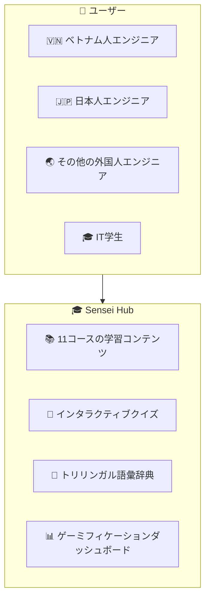

# 📋 Sensei Hub — ソフトウェア要件仕様書（SRS）

> **バージョン**: 2.0.0  
> **最終更新**: 2026-05-20  
> **ステータス**: アクティブ開発中

---

## 1. はじめに

### 1.1 目的

本ドキュメントは、**Sensei Hub（センセイハブ）** のソフトウェア要件仕様書（Software Requirements Specification）です。システムの機能要件・非機能要件・技術仕様を網羅的に定義します。

### 1.2 スコープ

Sensei Hubは、日本で働くITエンジニア（特にベトナム人・外国人エンジニア）向けのトリリンガル学習プラットフォームです。英語・日本語・ベトナム語の3言語で、11コースの学習コンテンツを提供します。

### 1.3 対象読者

- 開発チームメンバー（3名）
- プロジェクトマネージャー
- BrSE（ブリッジSE）
- ステークホルダー

### 1.4 用語定義

| 用語 | 定義 |
|------|------|
| FE | 基本情報技術者試験（Fundamental Information Technology Engineer Examination） |
| BJT | ビジネス日本語能力テスト（Business Japanese Proficiency Test） |
| DSA | データ構造とアルゴリズム（Data Structures and Algorithms） |
| i18n | 国際化（Internationalization） |
| XP | 経験値ポイント（Experience Points） |
| ORM | オブジェクト関係マッピング（Object-Relational Mapping） |

---

## 2. 全体概要

### 2.1 プロダクトの位置づけ

### 2.2 コース概要

| # | コース | 日数 | レベル | カテゴリ |
|---|-------|------|--------|---------|
| 1 | AWS Cloud Engineering | 60 | 中級 | クラウド |
| 2 | Blockchain & Web3 Fundamentals | 20 | 入門 | ブロックチェーン |
| 3 | Business Japanese Test (BJT) | 120 | 中級 | 語学 |
| 4 | Cybersecurity Awareness | 15 | 入門 | セキュリティ |
| 5 | Data Structures & Algorithms | 60 | 中級 | CS基礎 |
| 6 | Database Engineering | 30 | 上級 | データベース |
| 7 | Developer Mindset | 30 | 全レベル | ソフトスキル |
| 8 | DevOps Engineering | 60 | 中級 | DevOps |
| 9 | 基本情報技術者試験 (FE) | 100 | 上級 | 国家試験 |
| 10 | Git & GitHub | 10 | 入門 | ツール |
| 11 | System Design & Architecture | 60 | 上級 | アーキテクチャ |

### 2.3 ユーザー特性

| ユーザータイプ | 技術レベル | 主なニーズ |
|--------------|-----------|-----------|
| ベトナム人ITエンジニア | 中級〜上級 | FE/BJT試験対策、日本語IT用語 |
| 日本人ITエンジニア | 初級〜上級 | AWS、System Design、DevOps |
| IT学生 | 初級〜中級 | 基本情報対策、実践スキル |

---

## 3. 機能要件

### FR-1: ユーザー認証

| ID | 要件 | 優先度 |
|----|------|--------|
| FR-1.1 | メール/パスワードによるユーザー登録 | 高 |
| FR-1.2 | メール/パスワードによるログイン | 高 |
| FR-1.3 | JWTベースのセッション管理 | 高 |
| FR-1.4 | USER/ADMINロール管理 | 高 |
| FR-1.5 | プロフィール編集（名前、画像、言語設定） | 中 |
| FR-1.6 | パスワードリセット | 低 |

**技術**: Auth.js v5 (Credentials Provider)

### FR-2: レッスン管理

| ID | 要件 | 優先度 |
|----|------|--------|
| FR-2.1 | 11コースのレッスンコンテンツ表示 | 高 |
| FR-2.2 | 3言語でのレッスン切替（EN/JA/VI） | 高 |
| FR-2.3 | Markdownレンダリング（コードハイライト対応） | 高 |
| FR-2.4 | レッスン進捗のトラッキング | 高 |
| FR-2.5 | フロントマターメタデータの解析 | 中 |
| FR-2.6 | 前/次のレッスンナビゲーション | 中 |
| FR-2.7 | レッスン内容のフルテキスト検索 | 低 |

**コンテンツ量**: 1,560以上のMarkdownファイル

### FR-3: 語彙システム

| ID | 要件 | 優先度 |
|----|------|--------|
| FR-3.1 | トリリンガル語彙エントリの表示（用語・定義・例文） | 高 |
| FR-3.2 | カテゴリ別フィルタリング | 中 |
| FR-3.3 | 全言語対象のフルテキスト検索 | 中 |
| FR-3.4 | お気に入り登録/解除 | 中 |
| FR-3.5 | ページネーション | 低 |

### FR-4: クイズシステム

| ID | 要件 | 優先度 |
|----|------|--------|
| FR-4.1 | カテゴリ別・難易度別の問題出題 | 高 |
| FR-4.2 | 選択式問題のレンダリング | 高 |
| FR-4.3 | スコアリング・結果表示 | 高 |
| FR-4.4 | タイマー機能 | 中 |
| FR-4.5 | 解説表示 | 中 |
| FR-4.6 | 過去の結果履歴 | 低 |

### FR-5: ダッシュボード

| ID | 要件 | 優先度 |
|----|------|--------|
| FR-5.1 | 学習統計の表示（ストリーク、XP、レベル） | 高 |
| FR-5.2 | 科目一覧グリッド（8科目） | 高 |
| FR-5.3 | リーダーボード | 中 |
| FR-5.4 | デイリーチャレンジ | 中 |
| FR-5.5 | ストリーク熱マップ | 中 |
| FR-5.6 | おすすめコース | 低 |
| FR-5.7 | 最近のアクティビティフィード | 低 |

### FR-6: 多言語対応

| ID | 要件 | 優先度 |
|----|------|--------|
| FR-6.1 | UIの3言語切替（EN/JA/VI） | 高 |
| FR-6.2 | 言語設定の永続化 | 高 |
| FR-6.3 | レッスンコンテンツの言語別管理 | 高 |
| FR-6.4 | 翻訳フォールバック | 中 |

---

## 4. 非機能要件

### NFR-1: パフォーマンス

| ID | 要件 | 目標値 |
|----|------|--------|
| NFR-1.1 | ページ初回読込時間 | 3秒以内 |
| NFR-1.2 | ページ遷移時間 | 1秒以内 |
| NFR-1.3 | Largest Contentful Paint (LCP) | 2.5秒以内 |
| NFR-1.4 | First Input Delay (FID) | 100ms以内 |
| NFR-1.5 | Cumulative Layout Shift (CLS) | 0.1以下 |

### NFR-2: セキュリティ

| ID | 要件 |
|----|------|
| NFR-2.1 | パスワードはbcryptでハッシュ化 |
| NFR-2.2 | HTTPS必須（本番環境） |
| NFR-2.3 | CSRF保護 |
| NFR-2.4 | SQLインジェクション防止（Prisma ORM） |
| NFR-2.5 | 環境変数による機密情報管理 |

### NFR-3: スケーラビリティ

| ID | 要件 |
|----|------|
| NFR-3.1 | 同時接続ユーザー: 100名以上 |
| NFR-3.2 | データベース: 10万レコード以上対応 |
| NFR-3.3 | CDN利用による静的アセット配信 |

### NFR-4: 可用性

| ID | 要件 |
|----|------|
| NFR-4.1 | 稼働率: 99.5%以上 |
| NFR-4.2 | 自動バックアップ（RDS: 7日間保持） |
| NFR-4.3 | エラーログ収集 |

---

## 5. 技術スタック

| カテゴリ | テクノロジー | バージョン |
|---------|------------|-----------|
| フレームワーク | Next.js | 16.2.6 |
| UI | React | 19 |
| 言語 | TypeScript | 5.7.3 |
| CSS | Tailwind CSS | 4.2.0 |
| UIコンポーネント | shadcn/ui | new-york |
| アニメーション | Framer Motion | 12.38.0 |
| ORM | Prisma | — |
| DB | PostgreSQL | 16 |
| 認証 | Auth.js | v5 |
| デプロイ | AWS Amplify | — |

---

## 6. 実装フェーズ

| フェーズ | 期間 | 内容 | ステータス |
|---------|------|------|-----------|
| Phase 1 | Week 1-2 | インフラ構築・UI・コンテンツ作成 | ✅ 完了 |
| Phase 2 | Week 3 | バックエンド統合・認証・API | 🔧 進行中 |
| Phase 3 | Week 4 | 機能完成（語彙・クイズ・管理画面） | ⏳ 予定 |
| Phase 4 | Week 5+ | 最適化・テスト・AWSデプロイ | ⏳ 予定 |

---

## 7. 用語集

| 用語 | 定義 |
|------|------|
| App Router | Next.jsのルーティングシステム（ファイルベース） |
| Server Actions | Next.jsのサーバーサイド関数実行機能 |
| Prisma | Node.js/TypeScript用のORM |
| shadcn/ui | Radix UIベースのカスタマイズ可能なUIコンポーネントライブラリ |
| Framer Motion | React用の宣言的アニメーションライブラリ |
| Auth.js | Next.js用の認証ライブラリ（旧NextAuth.js） |
| グラスモーフィズム | 半透明+ぼかし効果を使ったUIデザイン手法 |
| OKLCH | 知覚的に均一なカラースペース |
| ゲーミフィケーション | ゲーム的要素を学習に取り入れる手法 |

---

## 📎 関連ドキュメント

- [BRIEF.md](../BRIEF.md) — プロジェクト概要
- [FEATURES_DETAIL.md](../FEATURES_DETAIL.md) — 機能要件詳細
- [ARCHITECTURE.md](../ARCHITECTURE.md) — システムアーキテクチャ
- [DATABASE_DESIGN.md](../DATABASE_DESIGN.md) — データベース設計
