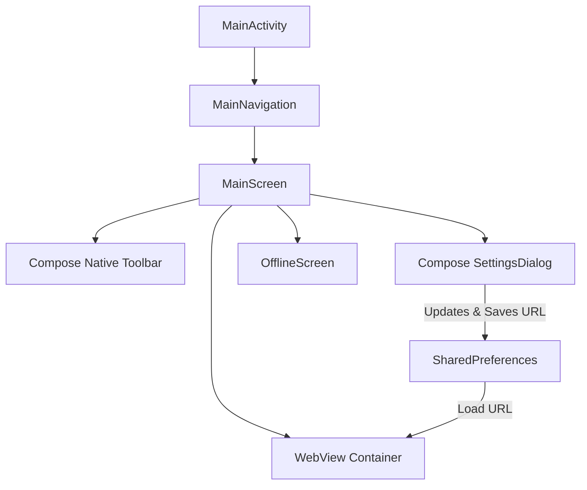
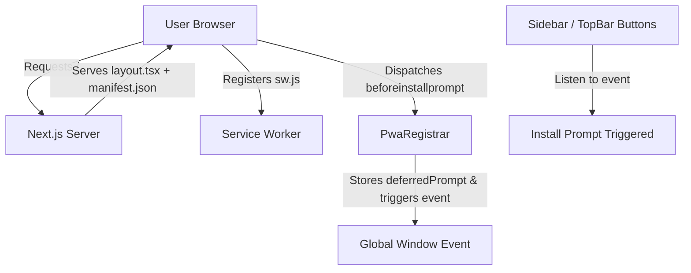

# Design Specification: Android App Customization & PWA Integration

This document specifies the architecture, UI design, and technical details for extending the Sensei Hub project with a polished, user-friendly Android interface and Progressive Web App (PWA) installation features.

## 1. Overview & Goals

The goal is to deliver a seamless learning experience across native Android environments and standard web browsers.
- **Android App:** Improve usability by wrapping the Next.js WebView with a native Compose Toolbar containing navigation buttons (Back, Forward, Refresh) and a Server Settings dialog (to configure target host URLs).
- **Progressive Web App (PWA):** Enable direct installation of the web dashboard on mobile and desktop systems by creating a Web Manifest, configuring a Service Worker for offline support, and adding dedicated "Download App" buttons in the dashboard sidebar and header.

---

## 2. Component Design & Architecture

### A. Android App Architecture (Hybrid Wrapper)

#### 1. Native Toolbar
*   **Back/Forward Controls:** Native buttons mapping directly to `webView.canGoBack()` and `webView.canGoForward()`.
*   **Reload Button:** Triggers `webView.reload()`.
*   **Title:** Sleek monospace font "SENSEI HUB" in purple/cyan accent.
*   **Settings Icon:** Opens the Server Settings Dialog.

#### 2. Server Settings Dialog
*   **Storage:** Reads/writes to Android `SharedPreferences` (file: `sensei_hub_prefs`, key: `server_url`, default: `http://10.0.2.2:3000`).
*   **UI:** Jetpack Compose `AlertDialog` with a validated `OutlinedTextField` for the URL, and Cancel/Save buttons.
*   **Reload Action:** Saving updates the stored value, hides the dialog, and calls `webView.loadUrl(newUrl)`.

#### 3. Back Navigation Integration
*   Overrides back-press behavior using `BackHandler`. If the WebView has back history (`canGoBack()`), it navigates within the web app instead of exiting the Android application.

---

### B. Progressive Web App (PWA) Integration

#### 1. Web App Manifest (`public/manifest.json`)
Defines the PWA identity so it is recognized as installable.
*   **Theme Color:** `#030014` (matching the deep space look).
*   **Orientation:** `portrait` (for consistent mobile layout).
*   **Display:** `standalone` (removes browser address bar and controls).
*   **Icons:** Links to `/images/sensei-mascot.png` (sizes: `192x192`, `512x512`).

#### 2. Service Worker (`public/sw.js`)
Handles offline page load fallbacks and asset caching.
*   **Caching Strategy:** Cache static assets during installation. Use network-first fetch with a cache fallback.

#### 3. Client Prompt Handler (`components/pwa-registrar.tsx`)
*   Mounts globally in `RootLayout`.
*   Saves the native `beforeinstallprompt` event to `window.deferredPrompt` and dispatches a custom event (`pwa-prompt-active`).

#### 4. UI Install Buttons
*   **Sidebar Button:** Positioned above the brand footer, visible on desktop/tablet.
*   **TopBar Button:** Next to utility items (language selector, notifications), visible on mobile.
*   **Behavior:** Hidden by default. Becomes visible when the `pwa-prompt-active` event fires. Clicking triggers `window.deferredPrompt.prompt()` and handles the user's install approval.

---

## 3. Data Flow & State Management

### Android App
- **Server URL:** Initialized from `SharedPreferences`. Injected into the Compose `WebView` component.
- **WebView State:** Tracks loading progress (0-100) to render a top-border linear progress bar.
- **Error State:** WebView client intercepts load errors (`onReceivedError`) and toggles the native `OfflineScreen` layout.

### Next.js PWA
- **Install Prompt Event:** Stored globally on `window.deferredPrompt`.
- **Install State:** Synchronized with the local component state using custom window events.

---

## 4. Verification Plan

### Automated Verification
- **Compilation Check:** Run `./gradlew assembleDebug` inside WSL to verify successful compilation of all Kotlin code.
- **Linter & Type Checking:** Execute `npm run lint` or `pnpm build` in the dashboard workspace to ensure zero compile errors.

### Manual Verification
1.  **Android App:**
    *   Deploy APK to Android Emulator.
    *   Verify the splash screen finishes and load starts.
    *   Click Settings, change URL to an invalid IP, verify the native `OfflineScreen` renders.
    *   Change URL back to `http://10.0.2.2:3000` (or running host), verify connection restores.
    *   Check back/forward and refresh buttons in the toolbar.
2.  **PWA Integration:**
    *   Launch the Next.js server locally.
    *   Open Chrome DevTools, inspect the **Application** tab, verify **Manifest** is parsed successfully, and **Service Worker** is registered and active.
    *   Use Chrome's responsive view to check sidebar (desktop) and TopBar (mobile) download buttons.
    *   Simulate offline mode and verify fallback resources load.
