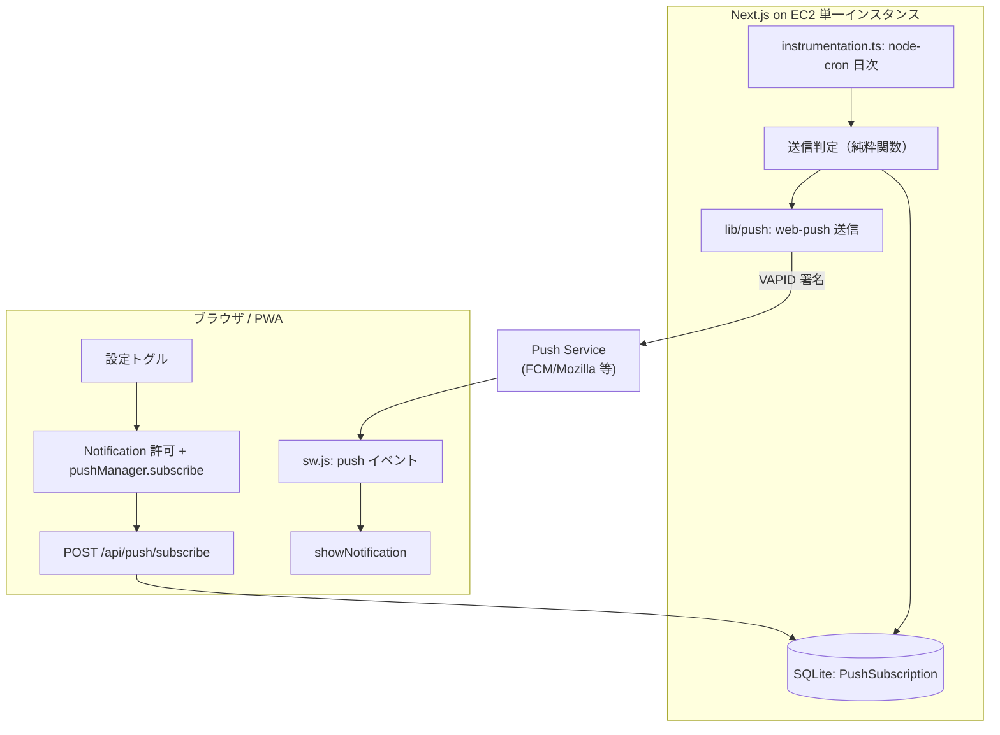

# 設計: Web Push による学習リマインド（バックグラウンド通知）

> 作成日: 2026-06-23 / ステータス: レビュー待ち
> 関連負債: goal.md「🟡 web-push（学習リマインド・アプリ終了時）」

## 1. 目的とスコープ
アプリを閉じている状態でも「今日まだ学習していない」ユーザーに 1 日 1 回
リマインド通知を送る。PWA（Service Worker）+ Web Push（VAPID）で実現する。

**スコープ内（v1）**
- 設定画面のトグルで購読/解除（許可リクエスト → Push 購読 → サーバー保存）。
- サーバー側の日次 cron が「今日未学習かつ本日未通知」の購読へ送信。
- 通知タップで `/` を開く（既存タブがあればフォーカス）。
- 多デバイス対応（1 ユーザー複数購読）。失効購読の自動削除。
- メッセージは利用者の言語（User.preferredLang）で出し分け。

**スコープ外（将来）**
- 時間帯のユーザー設定 UI、曜日指定、ストリーク連動の凝った文面。
- リッチ通知（画像・アクションボタン）。タイムゾーン厳密対応（§9 参照）。

## 2. 現状
- `public/sw.js`: `notificationclick` はあるが **`push` ハンドラが無い**。
- `components/streak-reminder.tsx`: **前面（同一セッション）限定**の `Notification`
  + `showNotification`。バックグラウンドには届かない。
- 購読の保存先・cron・VAPID は未整備。`web-push` 依存は未インストール。
- 認証は Clerk（`User.id` = Clerk userId）。DB は SQLite 単一インスタンス。

## 3. アーキテクチャ概要


## 4. データモデル（Prisma 追加）
```prisma
model PushSubscription {
  id             String   @id @default(uuid())
  userId         String
  user           User     @relation(fields: [userId], references: [id])
  endpoint       String   @unique
  p256dh         String
  auth           String
  lang           String   @default("vi") // 購読時点の言語（User.preferredLang を初期値に）
  lastNotifiedAt DateTime?                // 本日重複送信を防ぐ
  createdAt      DateTime @default(now())

  @@index([userId])
}
```
`User` 側に `subscriptions PushSubscription[]` を追加。マイグレーションは
`prisma migrate dev` ではなく本番は既存どおり `db push`（runtime entrypoint）で反映。

## 5. コンポーネント詳細

### 5.1 VAPID 鍵
- `npx web-push generate-vapid-keys` で生成。env に保存（コミットしない）:
  `VAPID_PUBLIC_KEY` / `VAPID_PRIVATE_KEY` / `VAPID_SUBJECT`(`mailto:...`)。
- 公開鍵のみクライアントへ渡す（`NEXT_PUBLIC_VAPID_PUBLIC_KEY` または
  `/api/push/public-key` で配布）。秘密鍵はサーバー専用。

### 5.2 クライアント（設定画面トグル）
- `app/settings` に「バックグラウンドのリマインド」トグルを追加（i18n 3 言語）。
- ON: `Notification.requestPermission()` → 許可なら
  `registration.pushManager.subscribe({ userVisibleOnly: true,
  applicationServerKey: urlBase64ToUint8Array(PUBLIC_KEY) })` →
  `POST /api/push/subscribe`（endpoint/p256dh/auth/lang）。
- OFF: `subscription.unsubscribe()` → `POST /api/push/unsubscribe`（endpoint）。
- 状態は `pushManager.getSubscription()` で初期表示。拒否時は理由を表示。

### 5.3 Service Worker（`public/sw.js`）
- `push` イベント追加: `event.data?.json()` → `showNotification(title, {
  body, icon: "/icon-192.png", badge: "/icon-192.png", data: { url } })`。
- 既存 `notificationclick`: `data.url` を `clients.openWindow` / 既存タブ
  `focus()`。アイコンはブランドロゴ（mascot ではなく `/icon-192.png`）。

### 5.4 API ルート
- `POST /api/push/subscribe`（要 Clerk 認証）: body から endpoint/p256dh/auth/lang
  を受け、`upsert`（endpoint 一意）。userId は `auth()` から。
- `POST /api/push/unsubscribe`: endpoint で該当購読を削除。
- いずれも rate-limit 適用（既存 `checkRateLimit`）。

### 5.5 送信ロジック `lib/push.ts`
- `web-push` を `setVapidDetails` で初期化。
- `sendReminder(sub, lang)`: `webpush.sendNotification(sub, payload)`。
  - 失敗が `statusCode` 404/410 → 失効。DB から該当購読を削除。
- ペイロード: `{ title, body, url: "/" }`。文面は §8 の i18n から。

### 5.6 Cron（`instrumentation.ts`）
- Next の `register()`（サーバー起動時 1 回）で `node-cron` を開始。
- スケジュール: 毎日 `REMINDER_HOUR`（env、既定 20 時・サーバー TZ）。
- 処理:
  1. 全 `PushSubscription` を取得。
  2. ユーザーごとに「今日学習したか」を判定（§6）。
  3. 「未学習 かつ `lastNotifiedAt` が今日より前」の購読へ送信。
  4. 送信成功で `lastNotifiedAt = now` を更新。失効購読は削除。
- 単一インスタンス前提（多重起動ロックは不要）。スケール時の注意は §9。

## 6. 「今日学習したか」の判定（純粋関数・テスト対象）
- サーバー側の学習痕跡は `LessonProgress.lastViewed`（進捗同期で更新）。
- `studiedToday(lastViewedMax: Date | null, now: Date): boolean`
  = `lastViewedMax >= 当日 0:00`。
- `shouldNotify(lastViewedMax, lastNotifiedAt, now): boolean`
  = `!studiedToday(...) && (lastNotifiedAt == null || lastNotifiedAt < 当日0:00)`。
- この 2 関数を `lib/push-policy.ts` に切り出し、`tests/unit/push-policy.test.ts`
  で境界（深夜・当日跨ぎ・既通知）を検証する。

## 7. データフロー（購読→通知）
1. ユーザーが設定で ON → 許可 → 購読 → `/api/push/subscribe` が DB 保存。
2. 日次 cron が判定 → 対象購読へ `web-push` 送信。
3. Push Service 経由で SW の `push` 発火 → `showNotification`。
4. タップ → `/` を開く。

## 8. i18n（文面）
`lib/i18n` に追加（EN/JA/VI）:
- `push.reminder.title` = "Sensei Hub"
- `push.reminder.body` = 例) JA「今日の学習はまだです。少しだけ進めましょう 🔥」/
  VI「Hôm nay bạn chưa học. Học một chút nhé 🔥」/ EN「You haven't studied today. Keep your streak 🔥」
- 設定トグルのラベル/説明、許可拒否時メッセージも 3 言語。
文面は購読の `lang`（購読時の preferredLang）で選択。

## 9. セキュリティ・制約
- VAPID 秘密鍵・送信は**サーバー専用**。クライアントへは公開鍵のみ。
- 購読は Clerk 認証必須。endpoint は一意・ユーザー紐付け。
- 失効（404/410）購読は送信時に削除し肥大化を防ぐ。
- **タイムゾーン**: v1 はサーバー TZ 固定で送信。利用者ローカル時刻に厳密対応
  するには購読に `tz`/UTC オフセットを保存し判定する（将来）。本制約は明記。
- **単一インスタンス前提**: in-process cron は 1 プロセスで動く。水平スケール時は
  外部スケジューラ + 送信ロックが必要（現状の SQLite 制約と同じ・ドキュメント済み）。
- 再起動で cron は再登録される（状態は DB の `lastNotifiedAt` が担保）。

## 10. テスト
- `push-policy.test.ts`: `studiedToday` / `shouldNotify` の境界。
- `lib/push` 送信は `web-push` をモックし、404/410 で削除されることを検証。
- 手動 E2E: 実機で購読 → cron を手動トリガ（dev 用エンドポイント or 関数直叩き）
  → 通知受信 → タップで `/`。

## 11. 導入手順
1. 依存追加: `pnpm add web-push node-cron`（+ `@types/web-push @types/node-cron`）。
2. Prisma に `PushSubscription` 追加 → `db push`。
3. env に VAPID 三点 + `REMINDER_HOUR` を設定（ローカル `.env` / EC2）。
4. `instrumentation.ts`・`sw.js`・API・設定 UI・i18n を実装。
5. 実機検証 → 既存の前面 `StreakReminder` と役割整理（前面=即時、push=背景）。

## 12. 受け入れ条件
- [ ] 設定トグルで購読/解除でき、再読込後も状態が正しい。
- [ ] アプリを閉じた状態で、未学習日に 1 日 1 回だけ通知が届く。
- [ ] 学習済みの日は通知が来ない。通知タップで `/` が開く。
- [ ] 複数デバイスで各々購読でき、失効購読は自動削除される。
- [ ] `push-policy` のユニットテストが緑。秘密鍵がクライアントに漏れない。
