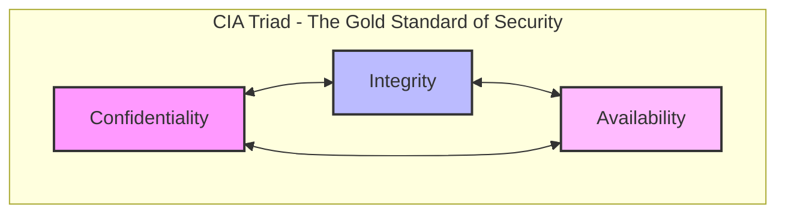
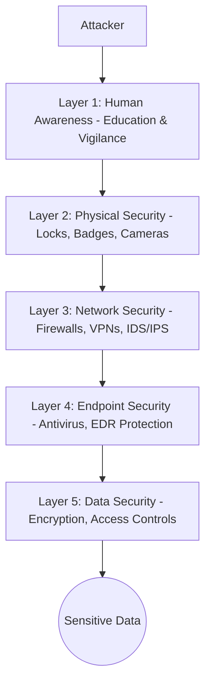
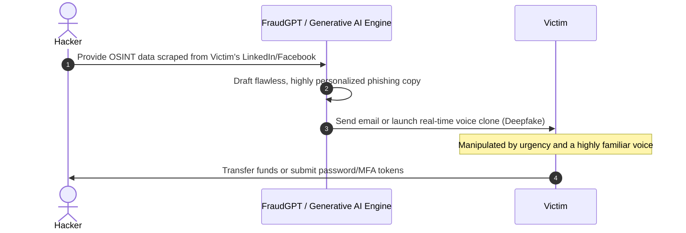

# Day 1: Information Security Overview & The Threats of Social Engineering

Welcome to the first day of your **Cybersecurity Awareness** journey.

Many people, from casual internet users to junior developers, often operate under dangerous misconceptions: *"I am not famous, I am not wealthy, and I have nothing on my computer worth hacking!"* or *"I have installed the best antivirus software, so I am completely secure."*

These are some of the most dangerous myths of the digital age. Today, we will dismantle these misconceptions, analyze the foundational architecture of information security, and confront the most formidable weapon in a hacker's arsenal: **Human Psychology**.

---

## 1. The Security Triad: CIA Triad

To evaluate whether a system is secure, cybersecurity professionals worldwide rely on a gold standard called the **CIA Triad** (a tripartite model representing three key security pillars, completely unrelated to the US Central Intelligence Agency).

The model consists of three inseparable elements:

### C - Confidentiality
*   **Definition:** Ensuring that sensitive information is accessed only by authorized individuals or systems.
*   **Real-world Scenario:** A company's payroll database and personal employee records must only be visible to the CEO and the HR department. If a junior IT intern or an external vendor can access and read this data, the system has suffered a critical breach of Confidentiality.
*   **Defensive Measures:** Implement strict access control mechanisms (Access Control Lists), apply strong encryption algorithms (Encryption) for data-at-rest and data-in-transit, and enforce Multi-Factor Authentication (MFA).

### I - Integrity
*   **Definition:** Ensuring that data is not altered, tampered with, or deleted by unauthorized entities throughout its lifecycle. Data arriving at its destination must match the source exactly (100% parity).
*   **Real-world Scenario:** You transfer $1,000 to a family member via online banking. As the transaction packet travels across the internet, a hacker intercepts and alters the destination routing to their own bank account. If the bank processes the transaction without detecting this modification, the system's Integrity is compromised.
*   **Defensive Measures:** Use secure cryptographic hashing functions (Hashing like SHA-256) to verify data consistency, enforce digital signatures (Digital Signatures), and record tamper-proof system audit logs (Audit Logs).

### A - Availability
*   **Definition:** Ensuring that authorized users have continuous, uninterrupted access to systems, networks, and data whenever they need them. A highly secure system that is inaccessible to legitimate users is a failed system.
*   **Real-world Scenario:** A rival business hires a botnet to launch a Distributed Denial of Service (DDoS) attack against an e-commerce website. By flood-routing millions of fake requests simultaneously, they exhaust server bandwidth and crash the host, preventing real customers from making purchases. This directly violates Availability.
*   **Defensive Measures:** Design redundant infrastructure (Redundancy, Load Balancing), perform regular automated data backups (Backups), and deploy secure web application firewalls (e.g., Cloudflare WAF).

---

## 2. The Greatest Threat: The Human Link & "Defense in Depth"

Do you remember the massive security breach that shook Twitter (now X), where high-profile accounts of figures like Barack Obama, Elon Musk, and Bill Gates simultaneously posted Bitcoin scams?

People assumed the attackers deployed supercomputers executing advanced cryptographic cracks. The reality was shockingly simple: The attacker was a 17-year-old teenager. He called Twitter technical support desks, impersonated an IT administrator from another branch facing system downtime, and tricked staff into handing over root administrative credentials.

> 💡 **Core Maxim:** You can spend millions of dollars building steel firewalls and deploying state-of-the-art cryptographic algorithms, but it all becomes useless if an employee willingly opens the front door for an intruder.

In security, humans are universally considered **the weakest link**. Consequently, modern organizations apply a layered security framework called **Defense in Depth**:

If one defensive layer is breached (e.g., an employee is tricked into giving away a password), other security layers (such as MFA, network segmentations, and least-privilege policies) must trigger automatically to prevent the attacker from reaching core database stores.

---

## 3. Social Engineering: The Art of Psychological Manipulation

Hackers do not always search for vulnerabilities in operating system kernels; they exploit bugs in the human brain. This methodology is known as **Social Engineering**. It relies on manipulating primal human emotions: **Curiosity, Fear, Greed, and Trust**.

Here are the most dangerous vectors of Social Engineering:

### 3.1. Phishing (Mass Deception)
The most common vector. Attackers blast bulk emails or text messages masquerading as trusted institutions (banks, tax authorities, Facebook, Netflix) demanding immediate action.
*   **Scenario:** *"Your bank account has detected suspicious transactions. Click here to verify your identity and cancel the transaction within 5 minutes."*
*   **The Trap:** Panic-stricken victims click the link, landing on a cloned portal that looks 99% identical to the authentic site, and hand over their credentials to the attacker.

### 3.2. Spear Phishing (Targeted Attack)
Instead of bulk spamming, attackers target a specific individual (e.g., Chief Financial Officer, Head of IT Infrastructure).
*   **Methodology:** The attacker spends weeks scraping open-source intelligence (OSINT) from social platforms (Facebook, LinkedIn, GitHub) to learn the target's hobbies, family details, and active business partners. They draft a highly customized, extremely convincing email that bypasses the victim's suspicion.

### 3.3. Baiting (Dangled Incentives)
This exploits human curiosity or greed.
*   **Digital Bait:** Free downloads masquerading as *"Adobe Photoshop 2026 Full Crack.zip"* or *"Company Payroll Q2.xlsx.exe"*. In reality, they are Trojans.
*   **Physical Bait:** An attacker leaves a USB drive labeled "HR Confidential" in the corporate lobby. A curious employee picks it up and inserts it into an office workstation to view the contents, unknowingly executing a worm that spreads across the local network.

### 3.4. Pretexting (Concocted Scenarios)
The attacker creates a fabricated scenario (a pretext) to play a role and demand sensitive information.
*   **Scenario:** An attacker calls pretending to be a law enforcement officer, claiming your phone line was linked to an international money-laundering ring. They demand you temporarily wire your assets to an "escrow account" to prove your innocence.

---

## 4. An Unequal Battle: Phishing in the AI Era (2026)

In 2026, Artificial Intelligence (AI) has weaponized social engineering to unprecedented levels. We can no longer rely on looking for poor grammar or spelling mistakes to identify a scam.

### Real-Time Deepfake Video & Audio
Attackers scrape video and audio snippets of you or your family from platforms like TikTok or YouTube. They deploy generative AI models to launch real-time Deepfake video and voice clone calls.
*   **High-Profile Breach:** A financial executive at a Hong Kong branch was tricked into wiring **$25 million** to scammers after attending a video conference call. Everyone on the Zoom call—including the corporate CFO and other regional colleagues—was a real-time AI-generated Deepfake.

### Automated AI Phishing
Dark web AI engines (such as security-unlocked models like FraudGPT) can instantly generate millions of highly customized, personalized phishing emails based on social media datasets, matching the victim's profile to maximize the success rate.

---

## 5. Security Playbook: Building a Personal "Zero Trust" Mindset

To defend against advanced AI-driven scams, the ultimate defense is applying the core principle of **Zero Trust (Never Trust, Always Verify)** to your daily digital life.

1.  **Enforce a 10-Second Pause on Urgency:** Phishing attacks rely on artificial panic (*"Account locked", "Claim rewards immediately"*). When pressured to act fast, pause, take a breath, and evaluate the request logically.
2.  **Use Out-of-Band Verification:** If you receive a message from a friend, parent, or boss demanding an urgent money transfer: **Stop**. Reach out to them via an independent secondary communication channel (e.g., dial their physical telephone number directly, do not call them back on the application where the message was sent) to verify.
3.  **Inspect URLs Rigorously:**
    *   Read URLs from right to left to identify the true Root Domain.
    *   *Example:* In `https://vietcombank.com.vn.security-login.net`, the actual domain is `security-login.net`, not `vietcombank.com.vn`. The attacker is using subdomains to deceive you.
4.  **Practice Skepticism with Attachments:** Never open attachments from untrusted sources. In Office documents (Word, Excel), never click "Enable Content" or "Enable Macros" unless you are 100% certain of the sender's identity.

---

## Summary of Day 1

Today, we shattered the myth that "Cybersecurity is only about technology and hardware."
1.  A robust system must preserve the **CIA Triad: Confidentiality, Integrity, and Availability**.
2.  **Humans** represent the weakest link in any information security pipeline.
3.  **Social Engineering** exploits psychological vulnerabilities: curiosity, fear, greed, and trust.
4.  The **2026 AI Era** brings advanced threats like **multi-modal Deepfakes** that are highly challenging to spot.
5.  Always maintain a **Zero Trust** mindset: Pause - Skepticism - Independent Verification.

---

## 📝 Hands-on Assignment

1.  Open your personal email inbox and navigate to the spam folder.
2.  Locate a suspicious marketing email or potential phishing attempt.
3.  Analyze the email and write down:
    *   Which emotional trigger is the sender trying to exploit (greed, fear, or curiosity)?
    *   What technical anomalies can you spot (inspect the sender's domain after the `@` symbol, analyze the destination of links hidden under buttons)?
4.  Share your findings with a friend or family member to help raise their security awareness!
