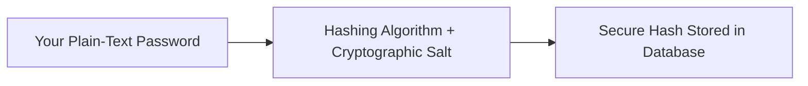
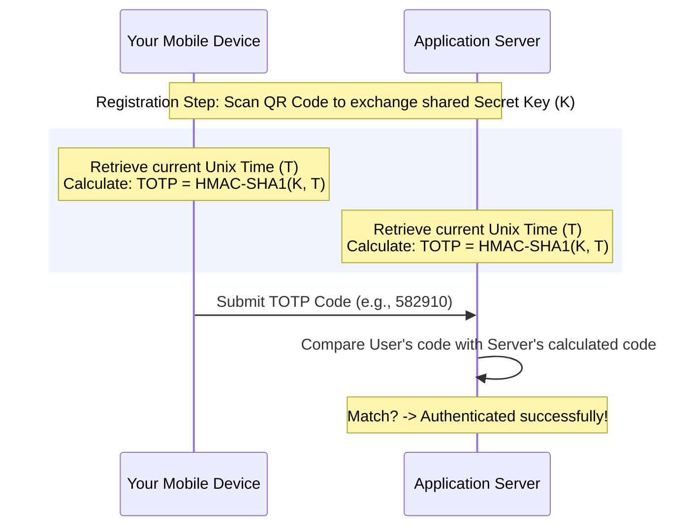
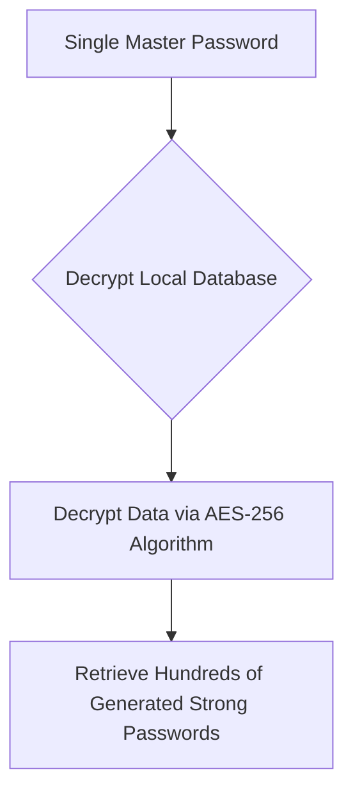
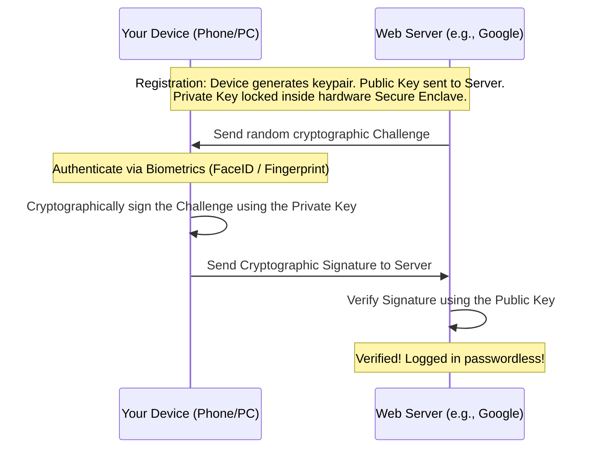

# Day 2: Identity & Access Management - The Passwordless Era

Welcome back! Yesterday, we established that humans represent the weakest link in information security. But where do attackers most frequently initiate their breach attempts? The answer is simple: **The Authentication Portal**.

In 2026, relying on default passwords like `123456` or `Password123` is no longer a sign of technical naivety; it is digital suicide. Today, we will explore the technical underpinnings of identity verification, how attackers crack these defenses, and how to construct impregnable fortresses using modern authentication technologies.

---

## 1. Passwords and How Hackers "Crack" Them

From a technical perspective, when you enter a password on a website, a secure server never stores your actual plain-text password. Instead, it stores a cryptographic **Hash** generated by passing your password through a secure, one-way hashing algorithm (such as bcrypt or Argon2).

When you attempt to log in, the application hashes the password you entered and compares it against the stored hash in the database. If they match, access is granted.

However, attackers do not need to understand the complex internal math of these algorithms to compromise your account. They employ far more brutal, highly efficient methodologies:

### 1.1. Brute Force Attacks
Attackers deploy specialized, high-performance computing rigs to systematically test every possible character combination (e.g., aaaa, aaab, aaac... until a match is found).
*   **The 2026 Paradigm:** Powered by hyper-threaded Graphics Processing Units (GPUs) and distributed quantum-resistant computing networks, hash-cracking speeds routinely reach billions of guesses per second. An 8-character password containing uppercase, lowercase letters, and digits can be cracked in **less than 0.5 seconds**.
*   **Defensive Strategy:** Increasing your password length to 12 characters exponentially inflates the minimum cracking timeline to approximately **100 years**. Therefore, **LENGTH** is significantly more critical than **COMPLEXITY** (such as mixing special characters).

### 1.2. Dictionary Attacks & Rainbow Tables
Rather than wasting compute on random combinations, attackers test lists of precompiled "dictionaries" containing hundreds of millions of common passwords leaked in previous breaches (e.g., `password123`, `qwerty`, `admin123`).
*   **Rainbow Tables:** These are massive databases containing billions of precomputed cryptographic hashes paired with their corresponding plain-text passwords. If a database is breached and did not employ **Salting** (appending a unique, random string of bytes to each password prior to hashing), an attacker can perform database-wide lookups using Rainbow Tables to reverse hashes into plain-text passwords instantly.

### 1.3. Credential Stuffing
This is the direct consequence of the dangerous habit of **using the same password across multiple services**.
1.  An attacker breaches a small, vulnerable website (e.g., a pet store forum you registered for back in 2018). Due to lax security, the hacker dumps a database of emails and passwords.
2.  The attacker deploys automated credential stuffing bots (such as Sentry MBA) to rapidly inject those email/password pairs into thousands of major services (such as Gmail, Facebook, Binance, and PayPal).
3.  If you reused that password, the attacker gains access to your critical financial assets starting from a completely unrelated minor forum breach.

---

## 2. Multi-Factor Authentication (MFA/2FA): Anatomizing Defensive Shields

Because traditional passwords are prone to leakage, enforcing a secondary defensive layer is mandatory. **Multi-Factor Authentication (MFA)** requires users to present at least two of the three primary factors:
1.  **Something you KNOW (Knowledge):** Password, PIN, security questions.
2.  **Something you HAVE (Possession):** A mobile device receiving OTPs, a physical hardware token.
3.  **Something you ARE (Inherence):** Biometrics (fingerprints, facial recognition/FaceID).

However, not all 2FA methodologies are created equal. Let us analyze them from weakest to strongest:

### Level 1: SMS OTP (Weak Security - High Risk)
The verification code is sent via standard cellular SMS text messages.
*   **SIM Swapping Vulnerability:** An attacker uses open-source intelligence to harvest your phone number, date of birth, and identity credentials. They contact your telecommunication provider, impersonate you, report a "lost phone," and request a SIM replacement. Once the provider activates the new SIM on the attacker's phone, your legitimate device loses signal. All subsequent banking OTP codes are delivered directly to the attacker.

### Level 2: TOTP (Time-based One-Time Password - Moderate-High Security)
Uses localized software authenticator apps like Google Authenticator, Microsoft Authenticator, or Bitwarden.

*   **Advantages:** The one-time password code is calculated entirely offline on your device, relying on the current real-time clock and a shared **Secret Key** exchanged during setup via a QR code. It requires no cellular network signal, making it entirely immune to SIM swap attacks.
*   **Vulnerability:** TOTP is still susceptible to sophisticated Phishing. If you are tricked into entering your TOTP token into a cloned phishing website, the attacker's automated script grabs it and logs into the legitimate service before the 30-second window expires.

### Level 3: FIDO2 / Security Keys (Absolute Security)
Dedicated hardware security keys (such as YubiKey) plugged into USB ports or connected via NFC.
*   **WebAuthn Mechanism:** Built on public-key cryptography. During authentication, the web browser passes the domain name (origin) of the current site down to the physical security key. The key checks this domain against the origin stored in its secure cryptographic enclave. If it detects a mismatch (e.g., `faceb00k.com` instead of `facebook.com`), it refuses to sign the cryptographic challenge.
*   **Advantages:** 100% phishing-resistant. Even if you are completely deceived by a fake site and try to submit the credentials, the physical key will block the transaction at the protocol layer.

---

## 3. Password Managers: Outsourcing Complexity to Machines

Humans are biologically incapable of remembering hundreds of long, random, unique keys like `*uR8&pA$vW2!pQ`. Let technology handle this burden.

Reputable applications such as **1Password**, **Bitwarden** (open-source and free), and **Dashlane** operate as hyper-secure digital vaults:

*   **Zero-Knowledge Architecture:** Every credential in your vault is encrypted locally using the military-grade **AES-256** cipher on your device before synchronization to the cloud. The decryption key is derived solely from your **Master Password**, which remains in your head. If the service provider's databases are hacked, attackers only get useless, unreadable blobs of encrypted data.
*   **Benefits:** You only need to remember one strong Master Password. All other accounts use randomly generated 20+ character passwords that autofill upon page navigation, preventing malicious Keyloggers from capturing keypress patterns.

---

## 4. Passkeys: Entering the Passwordless Era (2026)

Passwords are one of the worst designs in information technology history. In 2026, technology giants (Apple, Google, Microsoft) in alliance with the FIDO Alliance have begun deprecating traditional passwords entirely in favor of **Passkeys**.

### How Passkeys Work
Passkeys are built on the foundations of **Asymmetric Cryptography** (Public-Key Cryptography):

1.  **Public Key:** Stored openly on the application server's database.
2.  **Private Key:** Locked securely inside the physical hardware cryptographic chip (**Secure Enclave**) on your phone or computer. The private key never leaves your device under any circumstances.
3.  **Frictionless Authentication:** Logging in is as simple as scanning your face (FaceID) or tapping a fingerprint sensor. The private key signs the server's challenge locally, and you are authenticated in a fraction of a second.

### Why Passkeys Offer Flawless Protection
*   **Immune to Phishing:** Because there is no string of text to type, you cannot be tricked into entering it on a phishing site. Your device only signs the challenge if the browser's cryptographic domain matches the registered site's origin.
*   **Resistant to Server Breaches:** If Facebook or Google's databases are breached, hackers only steal Public Keys. These are completely useless without the matching Private Keys stored physically on your personal device.

---

## 5. Mandatory Rules of Password Hygiene

While the world transitions to Passkeys, you will continue to use traditional passwords on many platforms. Adhere strictly to the following hygiene rules:

1.  **Zero Reuse:** Every single account must have a unique password. Never use your primary email password on Facebook, banking portals, or forums.
2.  **Use Passphrases:** Instead of setting hard-to-remember complex passwords like `B@0m@t!123`, string together 4 or more random words: `water-bench-green-dancing`. This passphrase is 26 characters long, requiring billions of years to brute-force, yet remains effortlessly memorable due to visual association.
3.  **Audit for Data Breaches:** Check the database of security researcher Troy Hunt at `haveibeenpwned.com`. Enter your email address to audit if your credentials have been leaked in past global breaches, allowing you to proactively update compromised passwords.

---

## Summary of Day 2

1.  The length of your password (Passphrase) is exponentially more critical than its complexity.
2.  **Credential Stuffing** exploits password reuse to cause chain-compromises across multiple accounts.
3.  **MFA** is mandatory; **TOTP** (Authenticator apps) and **FIDO2** (Hardware security keys) are the gold standards.
4.  A **Password Manager** utilizes **Zero-Knowledge** architectures to securely generate and store unique credentials.
5.  **Passkeys** employ asymmetric cryptography to eliminate passwords entirely, offering flawless resistance against Phishing.

---

## 📝 Hands-on Assignment

1.  Download and install **Bitwarden** (free version) on your mobile device or computer.
2.  Establish a strong Master Password using the **Passphrase** methodology (stringing 4-5 random words together, e.g., `teacup-coffee-airplane-beautiful`). Write this Master Password down in a physical notebook and store it safely offline (never store it in plain text on your digital devices).
3.  Choose one of your critical social media accounts, generate a 24-character random password using Bitwarden, and update your credentials.
4.  Activate two-factor authentication (2FA) using an Authenticator app, scan the QR setup code, and securely store the emergency **Backup Codes** provided.
