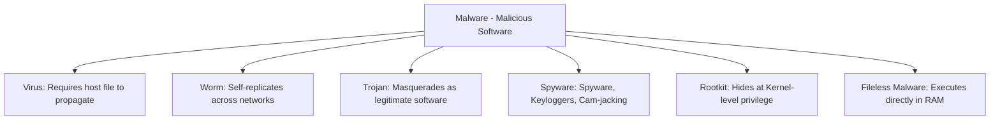
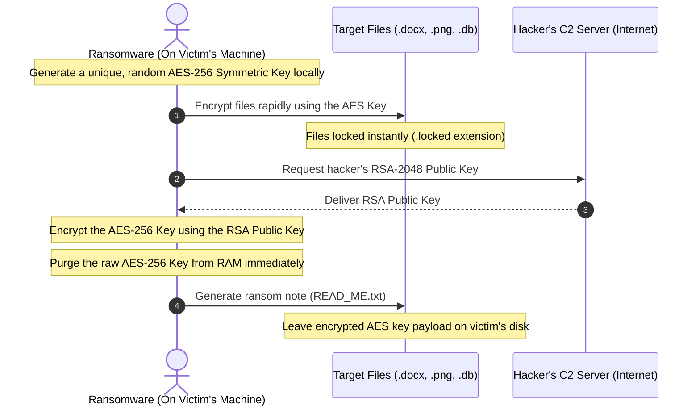
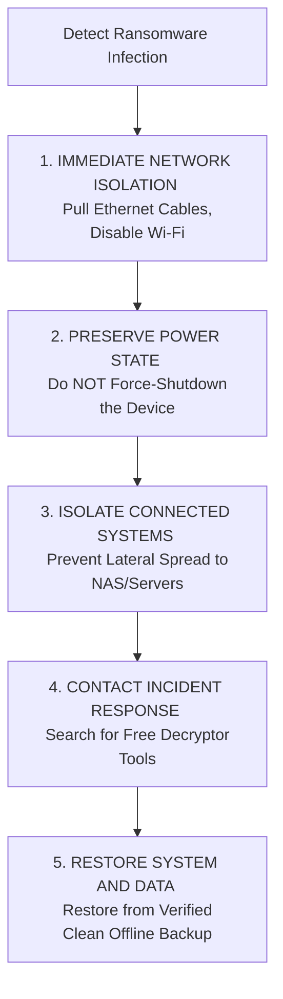

# Day 3: Malware & Ransomware - The Digital Extortion Pandemic

Welcome to Day 3! Today, we will discuss the highly destructive cyber-weapons deployed by attackers to compromise devices and network infrastructures: **Malware (Malicious Software)**.

In the modern digital age, malware is no longer designed merely to slow down PCs, display adware pop-ups, or crash operating systems "for fun." It has evolved into highly sophisticated, state-sponsored cyber-espionage tools that run silently under the OS kernel to exfiltrate intellectual property or hold corporate assets hostage for millions of dollars in cryptocurrency ransom.

---

## 1. What is Malware? Taxonomy of Malicious Entities

**Malware** is short for **Malicious Software**. It is an umbrella term representing any program, script, or executable code designed to compromise, disrupt, or damage computers, servers, mobile devices, or network infrastructures.

Let us dissect the most dangerous malware categories through a technical lens:

### 1.1. Viruses & Worms
*   **Virus:** A snippet of malicious code that requires a "host" (a valid executable or document format like `.exe`, `.docx`, or `.pdf`) to survive and execute. A virus remains dormant until a human user performs an action (such as double-clicking the infected file).
*   **Worm:** Far more dangerous than a virus. A worm is a standalone, self-replicating program that exploits system network vulnerabilities (such as the infamous EternalBlue exploit) to propagate laterally to other computers across LAN or Wi-Fi networks without requiring any human interaction.

### 1.2. Trojans & Backdoors
Derived from Greek mythology, a **Trojan Horse** masquerades as safe, benign utility software (e.g., game cracks, free video editors, or PDF invoices). Once executed, the Trojan quietly establishes a **Backdoor** on the system, granting the remote attacker root-level administrative access to command the machine without detection.

### 1.3. Spyware
Operates entirely in the shadows to monitor user actions:
*   **Keyloggers:** Record every keystroke pressed on the physical keyboard. Attackers deploy Keyloggers to capture credentials, credit card details, and sensitive communications as they are typed.
*   **Cam-jacking:** Quietly hijacks the device's webcams and microphones to record visual and audio feeds of the victim, which are subsequently exfiltrated for espionage or blackmail.

### 1.4. Rootkits: The Unseen Ghosts
A Rootkit is an elite, highly elusive class of malware. It installs itself deep inside the operating system's **Kernel**. From this ultra-privileged Ring-0 execution layer, the Rootkit can modify OS system calls, hide its own running processes, files, and network sockets. Standard user-space antivirus scanners are completely blind to Rootkit activities.

### 1.5. Fileless Malware
This represents the cutting-edge frontier of system exploitation. Unlike traditional malware which writes executable binaries to the local hard drive, Fileless Malware exploits native, trusted system administrative utilities (such as Windows PowerShell or WMI) to inject payload code directly into **RAM**. Because no files are written to the disk, signature-based antivirus scanners are completely bypassed.

---

## 2. Ransomware: Dissecting Hybrid Encryption & Extortion

**Ransomware** represents the single most severe financial cyber-threat to businesses and individuals globally. Once inside a system, Ransomware scans local drives and shared network directories to encrypt (lock) all vital data files (documents, databases, source code, media) into unreadable scrambled formats.

### 🛠️ The Cryptographic Pipeline of Ransomware: Hybrid Encryption
How can Ransomware lock terabytes of enterprise data in minutes using encryption so secure that even top-tier cryptographers cannot crack it without paying the ransom? The secret lies in a highly optimized process called **Hybrid Encryption**:

1.  **Fast Symmetric Encryption:** The Ransomware generates a random **AES-256 symmetric key** on the victim's machine. Symmetric encryption is highly performant, allowing the malware to lock millions of files in minutes before the user notices system performance degradation.
2.  **Robust Asymmetric Key Protection:** To prevent the victim from extracting the raw AES key from memory, the malware encrypts the AES key using the hacker's **RSA-2048 public key** (which is either hardcoded inside the malware or fetched dynamically from a Command and Control (C2) server).
3.  **Destructive Purge:** The raw AES key is permanently purged from the victim's RAM. The symmetric key is now trapped inside the RSA ciphertext. Only the corresponding **RSA Private Key** (which never leaves the hacker's secure remote servers) can unlock the AES key to rescue the files.

---

## 3. Incident Response Playbook: Reacting to Ransomware Infections

If your screen suddenly turns black and presents a Bitcoin ransom notice, maintain composure and immediately execute this emergency Incident Response protocol:

1.  **IMMEDIATE NETWORK ISOLATION (Disconnect Network/Wi-Fi):** This is the critical first step. Once ransomware finishes locking the local drive, it scans the LAN subnet to spread laterally to network-attached storage (NAS), other workstations, and active directory controllers. Pulling the network cord immediately contains the blast radius.
2.  **DO NOT FORCE-SHUTDOWN THE COMPUTER:** Many victims panic and hold down the physical power button. Doing so flushes the RAM, destroying the memory space where the running malware resides. Incident response specialists often require a **RAM Dump** to extract the raw AES symmetric key before it is cleared.
3.  **Never Pay the Ransom:**
    *   Paying guarantees nothing; attackers frequently take the money and never send the decryptor.
    *   Paying flags your organization as a lucrative target for future extortion campaigns.
    *   You directly fund organized cyber-criminal syndicates, facilitating the development of advanced malware.

---

## 4. Disaster Recovery: The 3-2-1 Backup Strategy & Immutable Backups

The ultimate defense against ransomware extortion is establishing a mathematically sound data recovery model: **The 3-2-1 Backup Rule**.

*   **3 (Maintain 3 copies of your data):** 1 production copy (active files) and at least 2 separate backup copies.
*   **2 (Store backups on 2 different media types):** For example, store one copy on an external solid-state drive (SSD) and another copy on a secure cloud object store (AWS S3, Google Cloud Storage) to guard against local hardware failures.
*   **1 (Keep at least 1 backup copy completely OFFLINE - Air-gapped):** The offline backup must be physically disconnected from the network and internet. If a backup drive is permanently plugged into your computer, Ransomware will detect and encrypt the backup alongside your primary files.
*   **Immutable Backups:** In enterprise infrastructures, deploy cloud storage solutions with WORM (Write Once, Read Many) capability enabled. Once data is written to an immutable backup, it cannot be modified, overwritten, or deleted by any user account (including a compromised administrator account) for a preconfigured duration.

---

## Summary of Day 3

1.  **Malware** comes in diverse classes: Viruses (require hosts), Worms (self-replicate over networks), Trojans (masquerade as clean), Spyware (Keyloggers, Cam-jacking), Rootkits (Kernel-level evasion), and Fileless Malware (RAM execution).
2.  **Ransomware** deploys a **Hybrid Cryptographic pipeline (AES-256 + RSA-2048)** to encrypt local data files rapidly while securing the decryption key beyond retrieval on the hacker's servers.
3.  Upon detecting an active infection, your primary action must be **Immediate Network Isolation** to safeguard local network resources.
4.  The **3-2-1 Backup Strategy with an Air-gapped Offline copy** is the only guaranteed immunization against ransomware disasters.

---

## 📝 Hands-on Assignment

1.  Audit your most critical files (family photos, academic documents, graduation projects, or source code repositories).
2.  Prepare a dedicated physical storage medium (a USB flash drive or an external HDD/SSD).
3.  Copy all identified critical files onto this physical drive.
4.  Once the backup process completes, perform a secure **Eject** in the OS, **UNPLUG THE DRIVE**, and store it safely in a desk drawer. You have successfully implemented an **Air-gapped Offline backup** protecting your critical digital assets!
