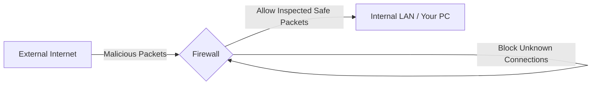

# Day 4: Network Security & VPNs - Protecting Data-in-Transit

Welcome to Day 4! After learning how to protect the "internal" state of your computer against malware (Day 3) and secure your digital credentials (Day 2), today we step out into the wider world: **Securing data as it travels across the Internet**.

Every time you access a website, send a chat message, or perform an online banking transaction, your data does not fly directly to its destination. It is broken down into small packets (Packets) and routed through dozens of intermediate hops: from the local cafe's Wi-Fi router, through the Internet Service Provider's (ISP) infrastructure, to global routing servers. Without robust network security layers, your data can be intercepted, altered, or stolen mid-transit.

---

## 1. Threats of Public Wi-Fi & Mid-Transit Attacks

Free Wi-Fi networks at airports, hotels, or coffee shops are highly insecure environments where attackers can easily deploy packet interception traps.

### 1.1. Man-in-the-Middle (MitM) Attacks
The attacker positions themselves between your device and the destination internet gateway to eavesdrop on or alter the data stream in transit.

```mermaid
graph TD
    User[Your Mobile Device] -->|Send Passwords & Card Info| Hacker[Hacker's PC <br> Man-in-the-Middle]
    Hacker -->|Forward Modified Data| Web[Legitimate Banking Web Server]
    Web -->|Return Transaction Response| Hacker
    Hacker -->|Forward Response| User
    Note over Hacker: Hacker intercepts and reads all sensitive plain-text data
```

*   **Rogue Access Points (Evil Twins):** An attacker configures a rogue Wi-Fi access point and assigns it a name identical to the establishment's legitimate Wi-Fi (e.g., `Cafe_Guest_Free`). When you connect your device, all data packets travel through the attacker's laptop before hitting the broader internet, allowing them to capture your browsing history, cookies, and credentials.
*   **ARP Spoofing:** Even if you connect to the legitimate Wi-Fi router, an attacker sitting next to you can deploy specialized software to flood the network with fake Address Resolution Protocol (ARP) packets, tricking the router into believing the attacker's MAC address is associated with your IP. Consequently, the router routes all packets intended for you straight to the attacker's machine.

### 1.2. Packet Sniffing
Using specialized network analysis software (such as **Wireshark**), attackers can capture raw data packets floating through the airwaves from nearby wireless devices. If the website you access uses unencrypted protocols (HTTP instead of HTTPS), your credentials, chat logs, and active session cookies are fully visible as plain text.

---

## 2. Firewalls: The Gatekeepers of Network Perimeters

A **Firewall** acts as a strict security guard stationed at the border of your system or network, inspecting every inbound and outbound data packet against a predefined set of security policies.



There are three primary categories of firewalls deployed in network security:
*   **Packet Filtering Firewalls:** The most basic tier. They inspect header-level data such as source IP addresses, destination IPs, and target service ports. If a packet originates from a blacklisted IP address, it is dropped immediately.
*   **Stateful Inspection Firewalls:** A highly intelligent tier that tracks the state of active network connections. They only permit inbound packets from the external internet if the traffic represents a valid response to an outbound session initiated by your internal device.
*   **WAF (Web Application Firewall):** Specialized firewalls operating at the Application Layer (Layer 7 of the OSI model). WAFs parse the payload contents of HTTP/HTTPS packets to detect and mitigate application-specific exploits, such as SQL Injection and Cross-Site Scripting (XSS).

---

## 3. VPNs (Virtual Private Networks): Constructing Secure Encrypted Tunnels

A **VPN** represents the ultimate solution to secure your data when you are forced to access untrusted network environments (like public Wi-Fi).

### Network Routing: VPN vs. Non-VPN Architectures

```mermaid
graph TD
    subgraph WITHOUT A VPN
        User1[Your Computer] -->|Plain Text / HTTPS easily leaks real IP| ISP1[ISP / Cafe Hacker]
        ISP1 -->|Eavesdrop on browsing history| Web1[Destination Website]
    end

    subgraph WITH A VPN ENABLED
        User2[Your Computer] -->|1. Strong End-to-End Encryption| Tunnel[ENCRYPTED VPN TUNNEL]
        Tunnel -->|2. Traverses ISP/Hacker securely| VPN[VPN Server]
        VPN -->|3. Decrypts & Obfuscates real IP| Web2[Destination Website]
    end
    
    style Tunnel fill:#e1f5fe,stroke:#039be5,stroke-width:2px
```



When you activate a VPN:
1.  **Tunneling Protocol:** The VPN client establishes a direct point-to-point connection, encapsulating your native IP packets inside a highly secure network transmission protocol.
2.  **End-to-End Encryption:** Your data is encrypted locally on your device before transmission. Along the routing path, network sniffers and your local ISP only see undecipherable cryptographic ciphertext.
3.  **IP Obfuscation:** When the ciphertext packet reaches the VPN server, the server decrypts the data and forwards it to the destination website. The destination web server only sees the IP address and geological coordinates of the VPN server, fully masking your real physical location and identity.

### Leading VPN Protocols in 2026:
*   **WireGuard (Highly Recommended):** The state-of-the-art VPN protocol. It features an incredibly clean, lightweight codebase (~4,000 lines of code compared to OpenVPN's 100,000+ lines), making it highly performant, battery-efficient on mobile, and secure by utilizing modern cryptography (Curve25519, ChaCha20).
*   **OpenVPN:** The legacy industry standard. Extremely flexible and secure, but significantly heavier and slower than WireGuard.
*   **IPsec (IKEv2):** Built natively into most mobile platforms, offering excellent reconnection reliability when switching between cellular towers and Wi-Fi access points.

---

## 4. HTTPS, SSL/TLS & The Post-Quantum Era (2026)

Most modern websites enforce the secure **HTTPS** protocol (instead of legacy HTTP), marked by the padlock icon in your browser's address bar. The **S** stands for **Secure**.

HTTPS operates on top of the **SSL/TLS** protocol (specifically TLS 1.3). When you initiate a connection, your browser and the web server execute a **TLS Handshake** to exchange digital certificates, verify the server's identity, and securely negotiate a unique session key for symmetric encryption.

### 🛡️ The 2026 Turning Point: Post-Quantum Cryptography (PQC)
Why are technology giants and global cybersecurity standards agencies aggressively replacing standard HTTPS encryption algorithms (like RSA and ECC) in 2026?

*   **The Quantum Threat:** Practical Quantum Computers are developing rapidly. Utilizing Shor's algorithm, a sufficiently powerful quantum computer can break standard public-key cryptography (RSA, ECDH) in minutes.
*   **"Harvest Now, Decrypt Later" Campaigns:** Adversarial threat groups are actively intercepting and archiving terabytes of encrypted HTTPS traffic from governments, financial systems, and corporations today. Although they cannot decrypt it now, they store this ciphertext until quantum computers mature enough to break it.
*   **The Kyber (ML-KEM) Solution:** In 2026, modern browsers (Chrome, Firefox) and Content Delivery Networks (Cloudflare) have integrated **Kyber (ML-KEM)**, a quantum-resistant cryptographic algorithm, into the standard TLS handshake. This ensures that data encrypted today remains absolutely secure against the quantum decryption capabilities of tomorrow.

---

## Summary of Day 4

1.  **Public Wi-Fi** is highly vulnerable to sniffing and routing exploits like **Man-in-the-Middle (MitM)** and **Packet Sniffing**.
2.  **Firewalls** filter malicious packets at the network boundary, while **WAFs** secure web applications at the application layer.
3.  **VPNs** establish encrypted tunnels to protect data-in-transit and mask your IP address, with the **WireGuard** protocol standing as the top standard in 2026.
4.  **Kyber (ML-KEM)** is the newly adopted post-quantum cryptographic standard integrated into HTTPS to nullify the threat of "Harvest Now, Decrypt Later" campaigns.

---

## 📝 Hands-on Assignment

1.  Open your preferred web browser (Chrome, Edge, or Safari). Ensure that the **"Always use secure connections (HTTPS)"** or **"HTTPS-Only Mode"** setting is enabled in the browser's Security Settings.
2.  If you do not currently have a VPN service, download and install **ProtonVPN** or **Mullvad** (ProtonVPN offers an exceptionally reliable Swiss-based, free tier with no bandwidth limits).
3.  Navigate to an IP verification portal like `whatismyip.com` with the VPN disabled, and note down your public IP address and ISP-reported geographic location.
4.  Activate your VPN client, connect to a server in a different country (e.g., Singapore or Japan), and refresh the `whatismyip.com` page. Confirm that your public IP has changed completely and your real physical location is successfully hidden!
