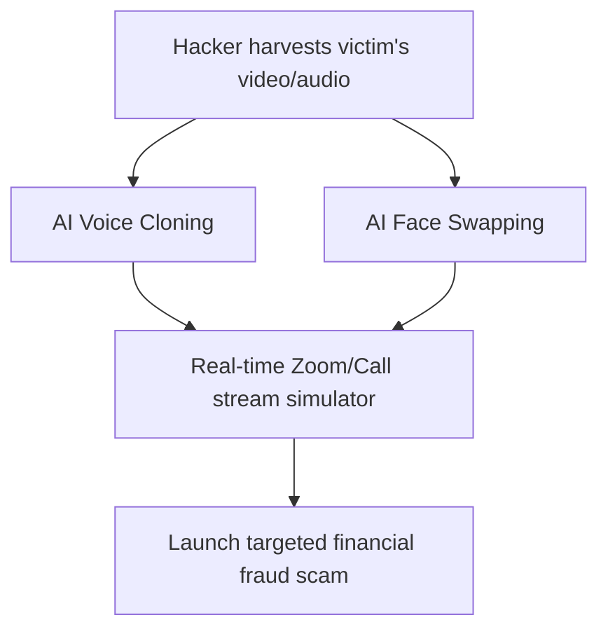
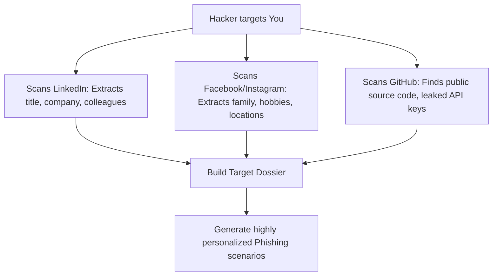
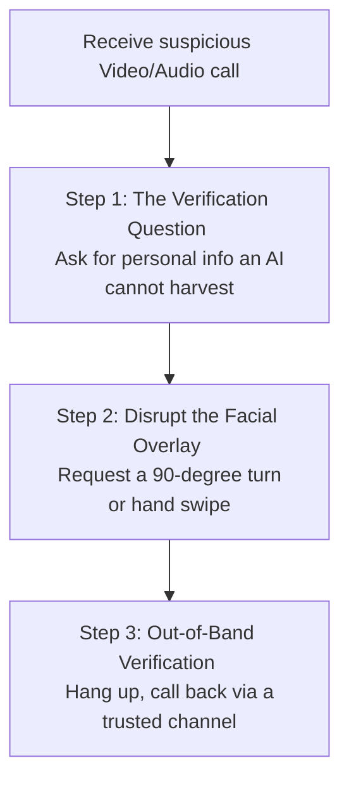

# Day 5: Advanced Social Engineering & AI-Powered Phishing

Welcome to Day 5! On Day 1, we introduced the concept of Social Engineering—the psychological manipulation of human behavior. Today, we step into a far more advanced domain: **Exploring how threat actors weaponize Generative Artificial Intelligence (AI) and Open Source Intelligence (OSINT) to execute unbelievably sophisticated phishing operations in 2026**.

In this era, phishing emails are no longer clumsily drafted or riddled with spelling errors. Impersonation calls are no longer awkward voice-acting attempts. Attackers can now perfectly mimic the face, biometric speech patterns, and mannerisms of your CEO, a family member, or a business partner to construct flawless traps.

---

## 1. Anatomy of Real-Time AI Deepfake Scams

**Deepfake** technology (powered by generative AI deep learning models) has turned threat scenarios that once existed only in science fiction movies into real-world vectors.

### 1.1. AI Voice Cloning
With a raw audio snippet of just 3 to 5 seconds of a person speaking publicly (extracted from a TikTok video, Facebook Reel, YouTube short, or a spam survey call), an AI can synthesize a highly convincing clone of that person's voice.
*   **The Vector:** Threat actors utilize cloned voices to call parents claiming their child was in an emergency accident, or impersonate a CEO ordering a corporate accountant to initiate a wire transfer. The tone, breathing patterns, and speech cadences match the original target with up to 99% accuracy.

### 1.2. Real-Time Video Hijacking (Live Video Deepfakes)
Beyond voice cloning, next-generation generative models allow attackers to overlay (overlay) a synthetic facial representation of another person over their own face in real-time during live video calls via Zoom, Microsoft Teams, or messaging apps.
*   **The Vector:** You receive a video call from your CEO requesting urgent approval for a highly confidential project budget. You see the CEO's face moving on your screen, and you hear their authentic voice speaking directly to you. You comply with the transfer. It is only when you later cross-check with your actual manager that you realize you were interacting with an AI face puppeted by a remote attacker.

---

## 2. Highly Targeted Phishing Vectors in Enterprises

To pull off multi-million dollar corporate heists, hackers do not rely on generic spam emails. Instead, they target the most influential human nodes in an organization using highly personalized tactics:

### 2.1. Spear Phishing
A highly targeted attack directed at a specific individual. Spear phishing emails are meticulously crafted using your personal details, mimicking the exact terminology and communication style of your internal department, and embedding attachments directly relevant to your active real-world projects.

### 2.2. Whaling
A specialized variant of spear phishing targeting **"Whales"**—high-profile corporate executives such as the CEO, CFO (Chief Financial Officer), or Chief Accountant.
*   **Scenario:** Threat actors impersonate high-level government auditors sending a highly confidential notice demanding the CEO supply internal financial ledgers to aid an investigation, threatening immediate corporate suspension upon non-compliance.

### 2.3. Smishing & Vishing
*   **Smishing (SMS Phishing):** Phishing attacks executed via standard SMS text messages or mobile messaging platforms (Zalo, Telegram, WhatsApp, Viber). Common scenarios include fraudulent bank balance updates, prize alerts, or urgent loan requests from family members claiming their main accounts are locked.
*   **Vishing (Voice Phishing):** Phishing scams carried out over direct voice calls, frequently integrated with AI Voice Cloning to spoof law enforcement officers or personal acquaintances.

---

## 3. OSINT: How Attackers Harvest Your Footprint to Set Traps

How do attackers find out what you like to eat, where you are vacationing, or where you work to draft such flawless phishing emails? They leverage **OSINT (Open Source Intelligence)**.

OSINT is the process of collecting, analyzing, and synthesizing information gathered from public, open-source resources across the internet (such as social media, public directories, corporate websites, and news media).

### Flow of Hacker's OSINT Data Gathering:

### 🚨 Unintentional Information Leaks We Gift to Attackers:
1.  **Image Metadata (EXIF Data):** When you take a photo with a smartphone and upload it raw to social platforms, the file often contains embedded EXIF metadata. This metadata records the camera hardware, timestamps, and crucially, **the precise GPS coordinates** of where the photo was shot. Attackers only need to download the image and extract the metadata to discover your home address or workplace location.
2.  **Verbose Corporate Job Postings:** A company posts a software developer vacancy stating: *"Must be fluent in AWS, Kubernetes configuration, and PostgreSQL database management"*. Unwittingly, the enterprise has mapped out its entire internal tech stack for attackers, who can now search for exploits targeting those specific systems.
3.  **Sharing Badges and Workspace Photos:** Posting a photo checking in at a new workspace, showing a computer screen displaying active code or sticky notes with passwords, or displaying a clear shot of an employee ID badge. Attackers can scan and duplicate the barcode on the badge to attempt physical intrusion.

---

## 4. Shielding Up: The 3-Step Defense Playbook Against Deepfakes & AI Phishing

To remain secure against the high-tech threat vectors of 2026, you must enforce a strict validation protocol for yourself and your family members:

### 📌 Step 1: Enforce the "Verification Question"
If you receive an urgent call from a loved one begging for money in a voice that sounds exactly like them: Ask a highly specific, personal question that only you two would know (e.g., *"What did we have for dinner last night?"* or *"What was the name of our first family pet?"*). An AI deepfake engine scanning social media profiles cannot retrieve these intimate offline details.

### 📌 Step 2: Disrupt the AI Facial Overlay Model
If you are on a video call and suspect the person on the other end is a live deepfake:
*   **Request the caller to turn their head 90 degrees sideways:** Current real-time facial overlay algorithms struggle immensely with processing profile angles. When the face turns completely sideways, the synthetic overlay will glitch, lag, or reveal visual anomalies at the boundary of the ear and neck.
*   **Request them to swipe their hand directly across their face:** The motion of a physical hand crossing the face blocks the AI's facial landmarks (landmark points), causing the synthetic face to warp, distort, or break momentarily.

### 📌 Step 3: Out-of-Band Verification
*   Immediately hang up the call.
*   Do not call back using the "Call Back" button on the same app (since the target's social account may have been fully hijacked by the attacker).
*   Manually dial their standard cellular telephone number (carrier network) or use an entirely separate secure communication platform to verify the request directly.

---

## Summary of Day 5

1.  **AI Deepfakes** can clone biometric voices and synthesize real-time video feeds, posing a direct threat to corporate financial transactions.
2.  **OSINT** harvests open internet footprint data to build targeted profiles, weaponizing your everyday online shares.
3.  Avoid sharing raw images containing **embedded GPS metadata** or posting granular details of your organization's internal technologies.
4.  Defend against suspicious calls by applying: **Personal Verification Questions ➔ Sideways 90-Degree Turns ➔ Out-of-band Verification**.

---

## 📝 Hands-on Assignment

1.  Inspect your smartphone's camera settings (iOS or Android). **Disable location/GPS permissions** for your native Camera app to prevent your device from embedding precise GPS coordinates into the EXIF metadata of future photos.
2.  Select any photo you have taken previously, and upload it to an online metadata viewer (such as `exifdata.com` or similar tools). Check if the image exposes your hardware model, exact time, and physical GPS location.
3.  Have a brief family talk (especially with parents and elder family members). Warn them about the rise of real-time AI deepfake scams and agree on **A SECRET FAMILY PASSPHRASE** (a random, memorable phrase) to verify identities during any urgent call requesting financial assistance.
