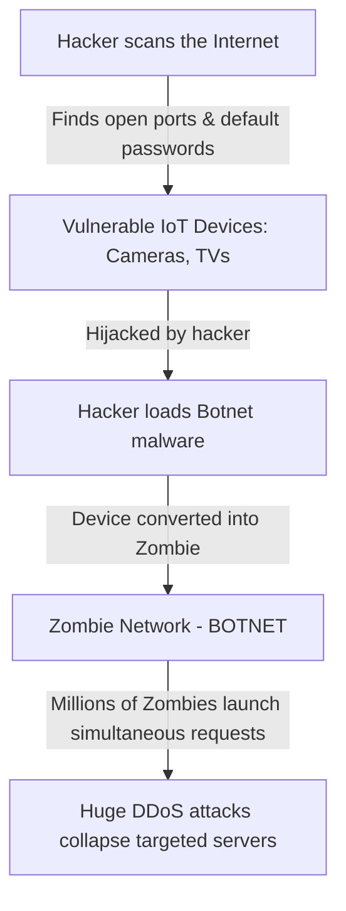
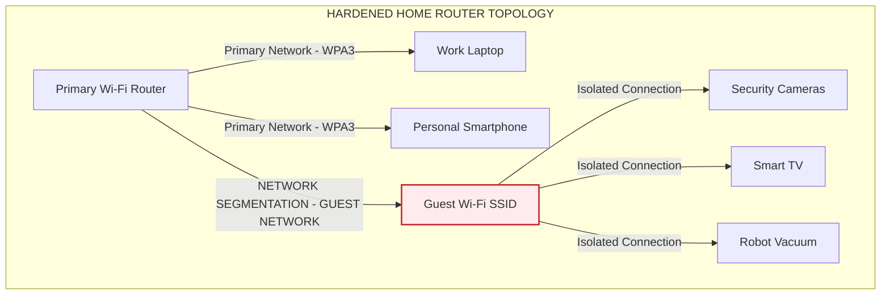

# Day 6: Mobile & IoT Security in the Smart Home Era

Welcome to Day 6! In this modern era, the traditional boundaries of the corporate office have completely dissolved. We work remotely, connect to enterprise servers from our personal smartphones, and set up our workstations within a home network crowded with smart devices (Smart Home) ranging from security cameras and smart light bulbs to robotic vacuum cleaners.

Threat actors understand that launching a direct attack against your work computer—which is typically protected by robust, enterprise-grade security software—is exceptionally difficult. Therefore, they choose a smarter path: **Targeting your personal mobile devices or vulnerable IoT endpoints in your home as entry points to pivot deeper into your private local network**. Today, we will learn how to lock down these avenues of leakage.

---

## 1. Security Risks on Mobile Platforms (iOS & Android)

Your smartphone holds your entire digital life: from mobile banking apps and corporate emails to multi-factor authentication (MFA) codes. However, mobile operating systems present unique security challenges:

### 1.1. The App Permission Trap
When installing a new application, many users habitually tap "Allow" on every permission prompt without a second thought.
*   **Adopting a Skeptical Mindset:** Why does a basic calculator app or a free flashlight utility require access to your **Contacts, SMS inbox, and background Location**?
*   **The Risk:** If you grant these excessive permissions, a malicious spyware app can silently harvest your SMS traffic (which contains banking OTP codes) and exfiltrate it to remote control servers.

### 1.2. The Sideloading Threat (Installing Apps Outside Official Stores)
On Android (and recently on iOS in specific markets), users can manually download and install application files directly from the web (modded `.apk` or `.ipa` files, cracked games).
*   **The Attack Vector:** Attackers modify the source code of a popular mobile game and inject a highly sophisticated **Banking Trojan** (such as the GoldDigger malware family). When you sideload this cracked application, the malware silently initiates in the background, monitors your financial apps, captures screenshots when you input passwords, and executes unauthorized automated wire transfers during the night.

---

## 2. IoT (Internet of Things) Devices: The Soft Underbelly of Your Home Network

IoT devices represent physical hardware connected to the internet to provide convenient life services: surveillance cameras, smart bulbs, robot vacuums, smart TVs, or fire alarms.

### Why are IoT Devices Exceptionally Vulnerable?
1.  **Hardcoded Default Passwords:** Many low-cost surveillance cameras ship with factory-default administrator credentials such as `admin`, `123456`, or `password`. Users plug them in and run them without ever altering the credentials. Attackers use automated port scanners to discover these endpoints and view private feeds from tens of thousands of home cameras worldwide.
2.  **No Firmware Updates:** Manufacturers of cheap IoT devices often abandon product support shortly after release. Security vulnerabilities in the device firmware are rarely patched, turning them into perpetual low-hanging fruit for threat actors.
3.  **Fueling Destructive Botnets:** Attackers do not care about how your robot vacuum cleans your floor. They want to hijack millions of these weak IoT devices to convert them into **Zombies**. They aggregate these zombies into a coordinated network called a **Botnet** (such as the infamous Mirai botnet) to launch massive Distributed Denial of Service (DDoS) attacks that can cripple global internet infrastructure.

---

## 3. Home Network Hardening: Best Practices for Remote Professionals

To protect your primary work machine against compromised smart endpoints in your house, you must "harden" your home Wi-Fi router configuration using professional networking rules:

### 📌 Rule 1: Set Up an Isolated Guest Network
This is the most critical defense tactic. Almost all modern consumer Wi-Fi routers support creating a secondary, isolated Wi-Fi SSID (a Guest Network).
*   **Action:** Create a dedicated Guest Network. Connect **ALL** of your smart home IoT devices (cameras, bulbs, smart TVs, vacuums) to this guest SSID. Keep only your work laptop, personal smartphone, and trusted tablets on your primary Wi-Fi network.
*   **The Benefit:** The Guest Network is configured with strict AP isolation. Even if an attacker successfully compromises a smart bulb or security camera, they are fully sandboxed within the Guest Network. They cannot scan or pivot into your primary network to access your work computer containing valuable proprietary source code or data.

### 📌 Rule 2: Disable WPS (Wi-Fi Protected Setup)
WPS is a protocol designed to simplify connections by pressing a physical button on the router or entering a static 8-digit PIN code.
*   **The Risk:** The 8-digit WPS PIN is highly vulnerable to brute-force attacks using automated mobile tools, which can crack it in just a few hours. Access your router's administration panel and **Disable WPS immediately**.

### 📌 Rule 3: Update Default Router Administrative Credentials
ISP-provided routers often have a label stuck on the back detailing their gateway IP (e.g., `192.168.1.1`) alongside standard default admin credentials (`admin` / `admin`).
*   **Action:** Log into the router configuration portal and change the default administrative password to a strong, unique passphrase. Furthermore, upgrade your Wi-Fi encryption standard from legacy **WPA2** to **WPA3** (if supported by your hardware) to mitigate offline Wi-Fi password cracking attempts.

---

## Summary of Day 6

1.  **Mobile app permissions** must be strictly regulated using the principle of least privilege. Strictly avoid installing apps from unofficial sources (**Sideloading**).
2.  **IoT devices** are prime targets for threat actors looking to recruit nodes into massive **Botnets** due to unpatched firmware and default credentials.
3.  **Network Segmentation** (isolating all IoT devices on a dedicated **Guest Network**) is your primary shield for safeguarding your work-from-home workstation.
4.  **Disable WPS** and change default router admin passwords to block unauthorized external access into your local wireless network.

---

## 📝 Hands-on Assignment

1.  Pick up your smartphone and access your system settings (App Permissions). Review the list of applications that currently possess access to your **Location, Microphone, Camera, and SMS messages**. Revoke permissions for any app that does not realistically require that data to function.
2.  Locate the physical label on the back of your home Wi-Fi router to find your administrative gateway address and default login credentials.
3.  Using a laptop or smartphone, navigate to the router gateway page (typically `192.168.1.1` or `192.168.0.1` in your browser).
4.  Perform these three essential hardening operations:
    *   Change the default admin console password.
    *   Find and **Disable WPS**.
    *   Enable the **Guest Network** feature, configure a unique guest Wi-Fi password, and migrate your Smart TV, smart speaker, or any smart home appliance to this isolated network!
