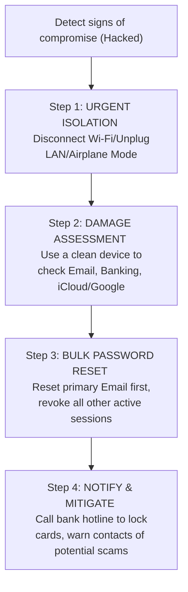

# Day 7: Incident Response & The Path to Professional Security

Congratulations! You have successfully completed the first leg of your **Cybersecurity Awareness** journey. The past six days have equipped you with a robust "shield of awareness" to protect yourself against daily sophisticated social engineering and technical scams.

Today, on the final day of our fundamental security awareness track, we will study a life-or-death skill: **How to keep calm and manage a security breach when the worst-case scenario occurs**. At the same time, we will unlock the gateway into the advanced technical world of information security—where, starting tomorrow, you will learn to program and design systems to defend against real-world threat actors!

---

## 1. Incident Response Playbook: What to Do If You Are Hacked

In cybersecurity, there is a classic saying: *"There is no such thing as absolute security, only systems that have not yet been hacked"*. When an incident occurs, you must act swiftly and calmly according to the following response playbook:

### 🛡️ Step 1: Isolate
Immediately cut off all internet connections to the device suspected of being infected by malware or accessed by attackers. Unplug the Ethernet (LAN) cable, turn off Wi-Fi, and put your mobile phone into airplane mode. This step is critical because:
*   **Blocks C2 (Command & Control) Traffic:** It breaks the link between the malware active on your machine and the attacker's remote command server, preventing them from sending further remote execution commands.
*   **Stops Data Exfiltration:** It halts the silent compression and uploading of your sensitive files, credentials, photos, and personal information to the attacker's cloud storage.
*   **Prevents Lateral Movement:** It stops the malware from scanning the local subnet IP range and spreading to other computers, servers, or smart IoT devices in the same office or home network.

### 🛡️ Step 2: Assess
Never log into any of your accounts from the compromised device. Instead, use a completely clean, trusted alternative device (e.g., another smartphone that has never run sideloaded apps, or a trusted family member's tablet) to assess the status of your critical assets:
1.  **Primary Email Account:** This is your ultimate fortress. If an attacker gains control of your email, they can request password resets to hijack your social media profiles, cloud vaults, and banking portals.
2.  **Financial Portals:** E-banking apps, digital wallets, stock trading accounts, and cryptocurrency wallets.
3.  **Cloud Identity Providers:** iCloud or Google accounts, which store your contact backups, messages, and sensitive photos.

### 🛡️ Step 3: Reset
On the clean, trusted device, initiate password resets for all of your critical accounts.
*   **Prioritize the Primary Email First:** Establish a completely new, strong password (using random passphrase groups as studied on Day 2).
*   **Enforce Session Revocation:** When successfully resetting the password, always check the option to **"Sign out of all other active sessions"** (Kick-out feature) to immediately terminate the attacker's unauthorized active sessions.
*   **Request Emergency Locks:** If your account passwords have already been changed and the attacker has enabled their own multi-factor authentication (MFA) methods, immediately locate the service provider's emergency compromise reporting links to request a temporary freeze.

### 🛡️ Step 4: Notify
Do not remain silent out of fear, anxiety, or embarrassment. Delayed reporting gives the attacker a larger window of opportunity to exploit the breach:
*   **Alert Friends & Family:** Use an alternative communication channel (or ask a family member to post a notice) warning your contacts that your profile has been compromised. Advise them to ignore any cash borrow requests or suspicious links sent from your handle in the interim.
*   **Contact Your Bank's Hotline:** Call the emergency numbers of all financial institutions you use. Request immediate locks on your credit cards and suspend internet banking transactions to protect your capital before automated transfers can occur.

---

## 2. Delineating the Hacker Ecosystem: White, Black, and Grey Hats

As you prepare to venture into technical system defense, you must understand your opponents and allies on the cybersecurity battlefield:

*   **Black Hat Hackers:** Threat actors who exploit computer systems without authorization for malicious purposes. Their motivations are typically financial gain (demanding ransomware payouts, selling exfiltrated databases), industrial sabotage, or espionage.
*   **White Hat Hackers:** Also known as Ethical Hackers or Security Professionals. They deploy advanced hacking methodologies to discover security vulnerabilities in corporate systems, reporting them responsibly so they can be patched before exploitation. They work to make the digital world safer.
*   **Grey Hat Hackers:** Individuals operating in a legal and ethical grey zone. They may compromise a system without authorization (violating laws), but they do not execute destructive payloads or demand extortion fees. Instead, they notify the affected organization of the exploit, sometimes requesting a modest bug bounty reward.

---

## 3. Professional Cybersecurity Career Roadmap

If you enjoy decoding systems, solving puzzles, and want to build a highly lucrative career in one of the most in-demand fields of IT, here is your path:

*   **Establish Technical Foundations (Months 1–6):** Master computer networks (understanding TCP/IP, DNS, and HTTP/HTTPS protocols), gain fluency in **Linux** command-line utilities (particularly within Kali Linux), and learn a programming language (Python or Go are ideal).
*   **Hands-on Security Training (Months 7–12):** Study professional penetration testing tool suites (Nmap, Burp Suite, Wireshark), participate in Capture the Flag (CTF) security competitions, and hunt for real bugs on public Bug Bounty platforms (HackerOne, Bugcrowd).
*   **Valuable Professional Certifications:**
    *   *CompTIA Security+:* Globally recognized baseline certification for core information security principles.
    *   *CEH (Certified Ethical Hacker):* Practical introduction to core penetration testing tools and methodologies.
    *   *OSCP (Offensive Security Certified Professional):* Highly prestigious, hands-on, and notoriously difficult practical penetration testing certification.

---

## 4. Life-Saving Security Principles to Carry Forever

Keep these five immutable security principles at the core of all your online activities:
1.  **Pause Before You Click:** A split-second click can lead to a lifetime of compromised data. Always maintain a healthy skepticism toward unexpected links.
2.  **MFA is Mandatory:** Even the strongest passwords can leak during third-party data breaches. Two-factor authentication is your final, essential line of defense.
3.  **Software Updates are Crucial:** Never postpone operating system or application updates. These patches resolve active vulnerabilities that threat actors exploit daily.
4.  **Enforce Offline Backups:** Your data is only truly yours if you maintain at least one copy on an external physical drive that is disconnected from the internet.
5.  **Adopt a Zero Trust Mindset:** Always operate under the assumption that the network or device you are connected to may already be compromised. Always verify before trusting.

---

## 🚀 The Gate is Open!

Our fundamental track for end-user security awareness concludes here. But as a software engineer or system administrator, the most exciting and technical journey is just beginning!

Starting tomorrow (**Day 8**), you will transition from a passive defender to a **Security Fortress Architect**. We will enter the domain of **Deep Web Application Security**. You will get to:
*   Examine vulnerable source code exploited by hackers to destroy databases using **SQL Injection**.
*   Learn to code defensive checkpoints preventing account hijackings via **XSS** and **CSRF** exploits.
*   Implement enterprise-grade federated identity architectures using **OAuth 2.0** and **JWT**.
*   Write automated vulnerability scanners integrated into your **DevSecOps** build pipelines.

Rest up, prepare your mind, and get ready. Tomorrow, the real high-tech engineering battle begins! 🛡️💻

---

### 📝 Preparation Assignment for Tomorrow:
Ask yourself: Have you ever heard of the **OWASP Top 10** directory? If not, perform a quick web search to see what the three most prevalent web security vulnerabilities are today!
