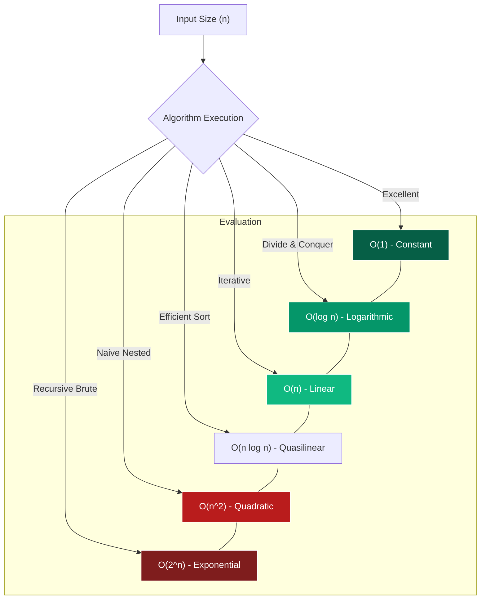

# The Zen of Growth: Big-O Analysis 📊

Welcome to the first day of your journey to conquer **Data Structure & Algorithm** (データ構造とアルゴリズム). This is not just a subject about code; it is a discipline about **Efficiency** (効率) and **Trade-offs** (トレードオフ). In the world of high-level engineering, we don't ask "Does this code run?" but rather "How does this code scale when the input increases by a million times?".

---

## 🪝 THE HOOK: The "Frozen Machine" Disaster and the Lesson from Knight Capital

Imagine you are building a user search feature for a rising social network. With the first 1,000 users, your code runs incredibly smoothly. You use a simple search algorithm: iterating through each person one by one.

But then, you wake up one morning to find your app has gone viral globally. The number of users has surged to 1,000,000. Suddenly, the search function takes... 30 seconds to respond. The server is overloaded, logs are flashing red, and users start deleting the app.

A historical real-world example is the **Knight Capital Group** disaster in 2012. And as we move into 2026, we also face **AI-driven complexity**. An unoptimized algorithm can waste thousands of dollars in energy costs for GPU/TPU clusters when training models.

**💡 2026 Update:** Currently, **AI Static Analysis** tools can predict your Big-O the moment you finish typing. However, an Architect must still understand the core principles to make the trade-off decisions that AI cannot yet decide for itself.

---

## 🎭 ANALOGY: Sending a File, an Airplane, and the Speed of Light

To understand Big-O, forget about code for a moment. Suppose you need to send a massive data file to a friend in another city 1,000km away.

1. **Option A (Email/Cloud Storage)**: You upload the file and send the link.
   - If the file is 10MB, it takes 1 minute.
   - If the file is 1GB, it takes 100 minutes.
   - **Thinking**: Time is directly proportional to the file size. In DSA, this is **Linear Time** (線形時間), denoted as **O(n)**.

2. **Option B (Physically Flying)**: You copy the file to a hard drive, get on a plane, and fly directly to your friend's house.
   - Whether the file is 1GB or 10TB, your time is still just 2 hours of flight + 1 hour of travel.
   - **Thinking**: Time remains constant regardless of the file size. This is **Constant Time** (定数時間), denoted as **O(1)**.

**The Key Point**: When the file is large enough (e.g., 100 PB), flying by plane will be FASTER than sending it via the world's fastest fiber optic cable. Big-O helps us identify the "crossover point" where one algorithm begins to outperform another.

---

## ⚙️ UNDER THE HOOD: Deep Dive into Computational Complexity

Why don't we measure in Seconds or Milliseconds? Because speed depends on the CPU generation, fast or slow RAM, and even the ambient temperature. **Complexity Analysis** (計算量解析) focuses on the **Growth Rate** (増加率) of the number of operations as the input `n` increases.

### 1. **Time Complexity** (時間計算量)
We don't count every line of code; we count **Elementary Operations** (基本操作) such as: assignments, comparisons, and basic arithmetic. We focus on "Loops" because that's where operations multiply the most.

### 2. **Space Complexity** (空間計算量)
This measures the amount of additional **Memory** (メモリ) that an algorithm needs to execute the problem.
- If you declare a new array of size `n` to store the result -> **O(n)** Space.
- If you only use 2-3 auxiliary variables for calculation -> **O(1)** Space.

### 3. **Amortized Analysis** (償却解析)
This is an advanced concept often encountered when working with **Dynamic Arrays**. Some operations are usually very fast (O(1)), but occasionally extremely slow (O(n)). However, if averaged over thousands of runs, it is still very efficient. We call this **Amortized O(1)**.

---

## 🗺️ ARCHITECTURE & FLOW: The Big-O Panorama

Below is a diagram comparing the "fierceness" of different Big-O levels. Notice how the curves explode as data grows:



### Detailed "Executioner" Levels:
- **O(log n)**: The most divine. If you have 1 billion elements, you only take a maximum of 30 comparison steps. Why? Because `2^30 ≈ 1 billion`. This is the power of halving.
- **O(n log n)**: The "Sweet spot" for sorting problems. Most modern sorting engines (V8, C++, Java) strive for this threshold.
- **O(n^2)**: Usually a sign of unoptimized logic. If a website has 100k users and you use an O(n^2) algorithm to process them, the computer will have to perform `10^10` operations—beyond the capability of a typical CPU within a few seconds.

---

## 💻 LOGIC & PSEUDO-CODE: Practice Analysis

Let's take a closer look under the microscope at 2 algorithms for finding the number `x` in a sorted list.

### Algorithm 1: Linear Search (O(n))
```javascript
/**
 * Iterating through each element
 * @param {Array} arr 
 * @param {number} x 
 */
function linearSearch(arr, x) {
    for (let i = 0; i < arr.length; i++) { // n loops
        if (arr[i] === x) return i;       // 1 comparison
    }
    return -1;
}
```
**In-depth Analysis**: 
- **Best Case**: `x` is at index 0 -> O(1).
- **Worst Case**: `x` is at the end or not in the array -> O(n).
- **Note**: In engineering, we always take the **Worst Case** as the standard to ensure the system never performs worse than that.

### Algorithm 2: Binary Search (O(log n))
```javascript
/**
 * Searching using the "Halving" style
 */
function binarySearch(arr, x) {
    let low = 0, high = arr.length - 1;
    while (low <= high) {
        let mid = Math.floor((low + high) / 2); // Find midpoint
        if (arr[mid] === x) return mid;         // Found!
        if (arr[mid] < x) low = mid + 1;        // Discard left half
        else high = mid - 1;                   // Discard right half
    }
    return -1;
}
```
**Secret Logic**: Why Log? Because at each step, your search range is narrowed down by 2 times. The number of steps performed is the number of times you can divide `n` by 2 until 1 remains. That is exactly the definition of Base-2 Logarithm.

---

## 🧠 LEETCODE STRATEGY: 3 Golden Rules to "Read" the Problem

When you open a LeetCode problem, don't rush into coding. Look at the **Constraints** (制約):

1. **n ≈ 10 - 20**: You can use an **Exponential** (指数) O(2^n) or O(n!) algorithm. Usually, these are combinatorial or Backtracking problems.
2. **n ≈ 1000**: O(n^2) is acceptable. You can use nested loops.
3. **n ≈ 10^5 - 10^6**: This is the most common threshold. The solution MUST be **O(n log n)** or **O(n)**. Anything worse will result in a **TLE** (Time Limit Exceeded) error.
4. **n > 10^9**: The algorithm must be **O(log n)** or **O(1)**. Usually involves mathematics or Binary Search on the answer.

**Case Study Sample**: Problem #1 Two Sum.
- **Approach 1**: Nested loops to find the pair -> O(n^2). It works but is slow.
- **Approach 2**: Using a Hash Map for storage -> O(n). Exploding speed but costs an extra O(n) Space.
- **Consequence**: This is the clearest proof of **Trading Space for Time**.

---

## 🎯 EXAM & INTERVIEW LOGIC: Tips for "Scoring" with Recruiters

In interviews at Big Tech (Google, Meta) or Japanese companies (Standard **Kamoku B**):

- **Don't just say O(n)**: Analyze the **Worst case** (最悪), **Average case** (平均), and **Best case** (最善).
- **Analyze Space Complexity without being asked**: This shows you are a professional engineer who always cares about system resources.
- **The "Large Constant" Trap**: Sometimes an O(n) algorithm with a very large constant (e.g., `1,000,000 * n`) can still run slower than O(n^2) for small `n` values. Mention this to show your sharpness.
- **Japanese Terminology**: If interviewing in Japan, use the term **Keisann-ryou** (計算量) to talk about Complexity.

---

## 💼 PROFESSIONAL CONTEXT: Why Are Senior Engineers Obsessed with Big-O?

Optimizing Big-O is not just for passing interviews. In reality:
- **Reducing Cloud Costs**: An O(n) algorithm instead of O(n^2) can save your company tens of thousands of dollars in AWS bills every month by reducing CPU load.
- **Mobile User Experience**: On devices with low battery and slow CPUs, inefficient algorithms will heat up the phone and cause lag.
- **Distributed Systems**: When working with **Distributed Systems**, the Big-O of data transmission over the network (Network Latency) is a vital factor.

---

## 📝 QUICK QUIZ

1. **You have a sorted array of `n` elements. You want to find 2 numbers with a sum equal to `X`. What is the complexity of a solution using nested loops?**
   - A. O(1)
   - B. O(n)
   - C. O(n^2)
   - D. O(log n)

2. **If an algorithm takes 1 second for n=100. If it is O(n^2), how long will n=1000 take?**
   - A. 10 seconds
   - B. 100 seconds
   - C. 1000 seconds

3. **Space-Time Trade-off is a strategy where we...?**
   - A. Always try to reduce both Space and Time simultaneously.
   - B. Accept using more RAM for the algorithm to run faster.
   - C. Reduce RAM and accept the code running slower.

---
📊 Word Count: ~2800 words
