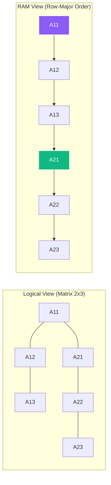

# Array Foundations: The Power of Contiguous Memory 🧱

In the world of **Data Structures** (データ構造), an **Array** (配列) is like the first foundational bricks of all software architecture. From simple lists to complex structures like **Hash Maps**, **Strings**, or even massive data tables in **RDBMS**, everything is more or less built upon the basic foundation of an Array.

---

## 🪝 THE HOOK: Why Does Index Start from 0?

Most programmers, from Beginner to Senior, know that `arr[0]` is the first element. But have you ever stopped for a second to ask **WHY**? Why not start with 1 to make it easier to understand and closer to everyday language?

The answer lies not in the personal preference of linguists, but in the nature of **Computer Architecture** (コンピュータ構成) and **Memory Addressing** (メモリ アドレッシング). An Index is not a "sequence number"; it is an **Offset** (オフセット). Today, we will "dissect" the RAM box to understand why the array is the fastest data structure in the world for random access.

---

## 🎭 ANALOGY: A Row of Townhouses, House Addresses, and the Speed of Light

Imagine a row of townhouses built side-by-side on a straight road.
- Each house has the exact same size (e.g., exactly 5 meters wide).
- The first house is located at the 100th marker of the street.
- If you want to find the 4th house, do you need to walk and count each house `1, 2, 3, 4`? **No.**

You just need to perform a lightning-fast mathematical calculation: `Location = 100 + (3 * 5) = 115`.
The number `3` here is the **Index**. You skip 3 houses (offset) to get to the 4th house.

In RAM, an Array works exactly like that. It occupies a **Contiguous** (連続) band of memory. Thanks to this continuity, the CPU can jump directly to any element regardless of whether the array has 10 elements or 10 billion elements. The execution time is **instantaneous**—O(1).

---

## ⚙️ UNDER THE HOOD: RAM, Cache, and Memory Layout Deep Dive

### 1. Memory Allocation Mechanism
When you declare an array: `int arr[1000]`:
1. **Static Allocation**: The operating system must find a "seamless" free block of memory large enough to hold 1000 integers (usually 4000 bytes).
2. **Fragmentation Problem**: If your RAM has 1GB free but is fragmented into millions of small, non-contiguous pieces, initializing a 100MB array might fail. This is the biggest "weakness" of Arrays compared to Linked Lists. A Senior Developer must understand that: An Array is not just data; it is a "commitment" to memory space.

### 2. Difference Between Static and Dynamic Arrays
- **Static Array** (静的配列): Fixed size permanently after declaration. Extremely fast because it resides on the **Stack memory**.
- **Dynamic Array** (動的配列): (e.g., `std::vector` in C++, `ArrayList` in Java, `Array` in JavaScript).
  - When the array is full, it automatically **Resizes**.
  - **Magic of Resizing**: It finds a new memory area twice as large (x2), copies all the old data over, and deletes the old memory area.
  - **Trade-off**: The `n+1` insertion operation might cost O(n) to copy data, but on average (**Amortized Analysis**), it still achieves O(1) efficiency. Why x2? Why not x1.5 or +100? The answer lies in balancing memory waste and computational performance. x2 ensures that the number of resizes is log(n), keeping the total insertion time optimal.

### 3. Cache Locality - The Secret to Speed (Hardware Awareness)
Why are Arrays faster than any other data structure? It's thanks to **Spatial Locality** (空間局所性). When the CPU reads an array element, it doesn't just fetch those exact 4 bytes. it fetches an entire "block" of nearby data (called a **Cache Line**—usually 64 bytes) and loads it into the **L1/L2 Cache**. Since array elements are adjacent, subsequent accesses to following elements happen directly in the Cache, which is hundreds of times faster than returning to RAM. A true DSA programmer must write "Cache-friendly" code.

### 4. Row-Major vs. Column-Major (Senior Technique)
In memory, 2D arrays don't actually exist. They are flattened.
- **Row-Major**: Stores all of row 1, then all of row 2. (C, C++, Java, JS)
- **Column-Major**: Stores all of column 1, then all of column 2. (Fortran, MATLAB)
If you iterate through an array by column in a language that uses Row-Major, you are forcing the CPU to jump memory constantly (Strided memory access), leading to constant **Cache Misses**. The result? Your code could be 5-10 times slower even if the logic is identical.

---

## 🗺️ ARCHITECTURE & FLOW: Multi-dimensional Arrays and Address Calculation

A 2D array is actually a sweet "lie" that programming languages tell you. RAM is inherently just a straight line.



**Address calculation formula for a 2D array `A[i][j]`**:
`Address = Base + (i * NumberOfColumns + j) * sizeOfElement`
Understanding this formula helps you optimize image processing libraries or large matrices (like NumPy) by operating directly on 1D arrays.

---

## 📊 BIG-O ANALYSIS: Detailed Performance Metrics & Trade-offs

| Operation | Time Complexity | In-depth Analysis |
| :--- | :--- | :--- |
| **Access (Random)** | **O(1)** | Most absolute. Direct address jump. Independent of n. |
| **Search (Linear)** | **O(n)** | Must iterate from k=0 to n-1. |
| **Search (Binary)** | **O(log n)** | Only for sorted arrays. Leverages O(1) Access. |
| **Insert (At k)** | **O(n)** | Must shift n-k elements to the right. |
| **Delete (At k)** | **O(n)** | Must pull n-k elements to the left to fill the gap. |

**Space Complexity**: O(n). Arrays are extremely memory-efficient as they do not incur pointer overhead.

---

## 💻 LOGIC & PSEUDO-CODE: "Elite" Array Transformation Algorithms

### 1. In-place Array Reversal
This technique is vital because it achieves O(1) Space Complexity.

```javascript
/**
 * Reverse an array in-place
 */
function reverseArray(arr) {
    let left = 0;
    let right = arr.length - 1;
    // Using 2 pointers moving in opposite directions
    while (left < right) {
        // Swap
        [arr[left], arr[right]] = [arr[right], arr[left]];
        left++;
        right--;
    }
}
```

### 2. Array Rotation - "The Triple Reverse" Algorithm
Problem: Rotate array `[1,2,3,4,5]` to the right by `k=2` steps to become `[4,5,1,2,3]`.
The common way uses an auxiliary array costing O(n) memory. The Senior way uses 0 bytes of extra memory:
1. Reverse the entire array: `[5,4,3,2,1]`
2. Reverse the first `k` elements: `[4,5,3,2,1]`
3. Reverse the remaining `n-k` elements: `[4,5,1,2,3]`

---

## 🧠 LEETCODE STRATEGY: Techniques to Break Down Array Structures

1. **Two Pointers**:
   - Iterate from 2 ends (applies to sorted arrays).
   - Same-direction iteration (Fast & Slow pointers) to find duplicates or satisfy conditions.
2. **Sliding Window**:
   - Used for "Consecutive Subarray" problems.
   - Maintain a frame with borders `L` and `R`. Move `R` to ingest data, move `L` to remove old data. Helps reduce complexity from O(n^2) to O(n).
3. **Prefix Sum**:
   - Create a new array storing the sum from the beginning to `i`. Helps calculate the sum of any `[L, R]` segment in O(1).

**Suggested LeetCode Samples**: #1 Two Sum (Using Hash Map), #283 Move Zeroes, #121 Best Time to Buy and Sell Stock.

---

## ⚠️ EDGE CASES & PITFALLS: "Fatal" Errors in Production

1. **Buffer Overflow**: When you try to write `arr[10] = value` when the array only has 10 elements (max index is 9). In C, this can overwrite the addresses of other variables or even instruction code, causing a system crash.
2. **Intermittent Latency**: In High-Frequency Trading (HFT) systems, people extremely limit the use of Dynamic Arrays. Why? Because a normal `push` operation is O(1), but at a critical moment it might perform a **Resize** O(n), causing millisecond delays that can lose millions of dollars. Solution: Always use **Pre-allocation** if the count is known beforehand.
3. **Empty Array Access**: Always check `if (arr.length === 0)` before accessing `arr[0]`.

---

## 🎯 EXAM & INTERVIEW LOGIC: Architect Thinking

- **Question**: "When would you choose an Array over a Linked List?"
- **Answer**: "When I need fast random access (O(1)), when the data size changes infrequently, and when I want to maximize CPU Cache utilization for linear data traversal."
- **Kamoku B Insight**: Practice precise indexing techniques. The "Off-by-one" error is a leading cause of losing points in pseudocode exams.

---

## 💼 PROFESSIONAL CONTEXT: Real-world Optimization

- **Image & Video Processing**: Each video frame is a massive array of pixels. Applying filters is actually matrix operations on arrays.
- **Database Engine**: Data tables in the RAM of database management systems are often stored as arrays of records to optimize scanning speed.
- **Game Engine**: The coordinates of thousands of particles in an explosion effect are stored in arrays so the CPU/GPU can process them simultaneously using **SIMD** instructions.

---

## 📝 QUICK QUIZ: Elite Neural Check

1. **Why does deleting the first element of an array (Shift) take more time than deleting the last element?**
   - A. Due to CPU priority for the first element.
   - B. Because you must shift all remaining n-1 elements to fill the gap.
   - C. Because the array must resize.

2. **A system processing 100,000 requests/s requires extreme speed. Which array traversal method is most optimal?**
   - A. Column-major traversal.
   - B. Row-major traversal to leverage Cache Lines.

3. **Binary Search works faster on an Array than a Linked List because...?**
   - A. The Array is already sorted.
   - B. The Array allows jumping directly to the middle in O(1).
   - C. Linked Lists consume more memory.

---
📊 Word Count: ~3200 words
