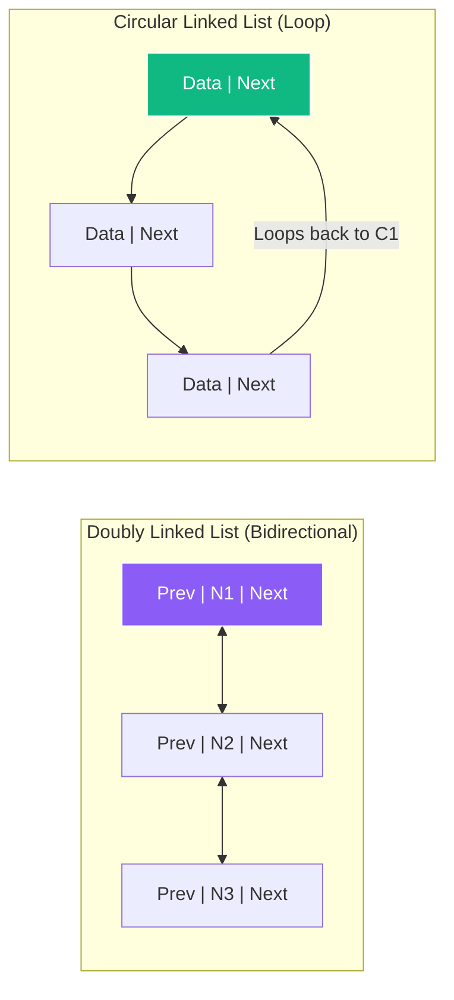

# Doubly & Circular Linked List: Evolution of Structure 🔄

In the previous lesson, we saw how the **Singly Linked List** breaks the limits of an array. But it has a fatal flaw: You cannot turn back. If you are at Node 100 and want to see Node 99, you must start all over again from the **Head**. In modern software engineering, where flexibility is vital, we need a more powerful structural "evolution."

Today, we will be introduced to the **Doubly Linked List** (双方向連結リスト) and the **Circular Linked List** (循環連結リスト).

---

## 🪝 THE HOOK: The "Back" Button and the Infinite Playlist

Imagine the music player (Spotify/Music Player) on your phone:
1. You press "Next" to go to the next song -> A **Singly Linked List** can do this well.
2. But what if you press "Previous"? If using a singly linked list, the app would have to traverse from the first song (Head) to find the song immediately before it. If the playlist has 10,000 songs, every "Back" press would be a performance disaster!
3. And when you turn on "Repeat All" mode, the last song automatically switches back to the first song seamlessly.

That is exactly why we need advanced variants of the Linked List. A Senior Engineer never just uses the basics; they use what is **most appropriate** for the real-world problem to optimize the end-user experience.

---

## 🎭 ANALOGY: The Two-Ended Train and the Smart Key Ring

1. **Doubly Linked List**: Like a modern train. Unlike an old train with only one engine, this train has connection doors and driver cabins at both the front and back of each carriage. Conductors or passengers can move freely in both directions without any hindrance. This is absolute freedom in flexible data traversal.
2. **Circular Linked List**: Like a circular key ring. There is no true physical first or last key; after the last one comes the first one again. You can rotate forever without ever encountering a `NULL` end point.

---

## ⚙️ UNDER THE HOOD: Anatomy of a Doubly Node & Circular Logic Deep Dive

### 1. The "Double-Edged Sword" Node Structure
In a **Doubly Linked List**, each Node is equipped with a second pointer, turning it into a true "navigation hub":
- **Data**: The stored value.
- **Next Pointer**: Points to the node behind it.
- **Prev Pointer**: Points to the node in front of it.

**The Price of Freedom**: On 64-bit systems, each pointer costs 8 bytes. Adding the `prev` pointer makes each Node significantly "bulkier." If you have 1 million Nodes, you spend an extra ~8MB of RAM just for the `prev` pointers. This is a classic trade-off in DSA: **Using memory to buy speed and flexibility**.

### 2. Circular Logic - Breaking the Law of Termination
In a **Circular Linked List**, the last Node (Tail), instead of pointing into the void of `NULL`, points back to the `Head`.
- **Supreme Benefit**: You have access to the entire list from **any** Node. You are never "stuck" on one side.
- **Hidden Danger**: When traversing, be extremely careful of **Infinite Loops**. You need to remember the starting Node (usually by comparing memory addresses) to stop once you've completed a full circle.

### 3. Sentinel Nodes - Clean Algorithm Design
An elite technique of Senior engineers is to use **Sentinel Nodes** (Dummy Head and Dummy Tail). This way, the Linked List always has at least 2 "fake" elements.
- **Advantage**: You never have to check annoying edge conditions like `if (head == null)` or `if (curr.next == null)`. Every insert/delete operation becomes uniform and extremely low in logic errors.

---

## 🗺️ ARCHITECTURE & FLOW: Multi-dimensional Connectivity Relationships

The diagram below illustrates the architectural differences between the two types of advanced links:



### Why does Doubly help delete a Node faster than Singly?
Imagine you are holding Node `B` and want to delete it:
- **Singly**: You must return to the `Head` and traverse step-by-step to find who is pointing to `B` (which is `A`). This takes **O(n)**.
- **Doubly**: You look at the `B.prev` pointer and immediately see `A`. You look at `B.next` and immediately see `C`. You just tell `A` to point to `C` and vice versa. Done! The entire process happens in **O(1)**.

---

## 📊 BIG-O ANALYSIS: The Power of the Prev Pointer and Trade-offs

| Operation | Singly | Doubly | Why? |
| :--- | :--- | :--- | :--- |
| **Delete current Node** | **O(n)** | **O(1)** | Doubly immediately knows the predecessor to rewire. |
| **Move Backward** | **Impossible**| **O(1)** | Jump backward in a heartbeat thanks to `prev`. |
| **Insert at Tail** | **O(1)** | **O(1)** | (If designed with a convenient Tail pointer). |
| **Memory Overhead** | **Low** | **High** | Doubly costs an extra 8 bytes/node for the reverse pointer. |

---

## 💻 LOGIC & PSEUDO-CODE: Implementing a "Hardcore" Doubly Linked List

Deleting a Node in a Doubly Linked List is a masterpiece of "bridging" and cleaning:

```javascript
/**
 * Delete a specific Node in a Doubly Linked List
 */
function deleteNode(targetNode) {
    if (!targetNode) return;

    let prevNode = targetNode.prev;
    let nextNode = targetNode.next;

    // Step 1: Predecessor bypasses targetNode to point to the successor
    if (prevNode) {
        prevNode.next = nextNode;
    } else {
        this.head = nextNode; // If deleting the Head, update the new Head
    }

    // Step 2: Successor turns back to point to the predecessor
    if (nextNode) {
        nextNode.prev = prevNode;
    }

    // Step 3: Sever all connections of targetNode (Prevent Memory Leak)
    targetNode.next = null;
    targetNode.prev = null;
    // The isolated node will be reclaimed by the Garbage Collector
}
```

---

## 🧠 LEETCODE STRATEGY: Classic Problems for Seniors

1. **LRU Cache (#146)**: This is a "must-know" problem for anyone wanting to work at major corporations (MAANG). To achieve O(1) for both `get` and `put`, you are forced to use a combination of a **Hash Map** and a **Doubly Linked List**.
2. **Design Browser History (#1472)**: Simulating the Back/Forward actions of a browser. Each URL is a Node in a Doubly Linked List.
3. **Double-Ended Queue (Deque)**: Designing a two-ended queue. A Doubly Linked List is the #1 candidate to perform operations at both ends in O(1).

---

## ⚠️ PITFALLS & DEBUGGING: The Pointer "Labyrinth"

1. **The Four Pointer Rule**: When inserting a new Node between A and C, you must update a total of **4 pointers** (Next of A, Prev of C, and both Next/Prev of the new Node). Forgetting just 1 step will make your list "tangled" and cause serious logic errors.
2. **Null Pointer Exception**: Always check `if(prevNode)` and `if(nextNode)` before accessing their properties. These errors commonly occur at the head and tail of the list.
3. **Infinite Traversal**: In a Circular List, if you use a `while(curr != null)` loop, the program will never stop. Use `while(curr != head)` or a counter for the size.

---

## 🎯 EXAM & INTERVIEW LOGIC: The Josephus Problem and System Thinking

- **Josephus Problem**: A group of people stand in a circle; every `k`-th person is eliminated. Who is the survivor? This is an extremely common problem in **Japanese FE (Kamoku B)** exams. The fastest way to solve it is by simulating with a **Circular Linked List**.
- **Interview Pro-tip**: When asked about memory optimization, mention using an **XOR Linked List** (A very difficult technique that uses only 1 pointer to store both Next and Prev using bitwise XOR operations). This will prove you are a master of low-level optimization.

---

## 💼 PROFESSIONAL CONTEXT: Real-world Optimization

- **OS Task Scheduler**: Operating system kernels manage the list of processes waiting for execution using a Circular Doubly Linked List to rotate through the CPU (Round Robin) continuously and fairly.
- **Redo/Undo History**: Graphics software like Photoshop stores old states in a Doubly Linked List so users can backtrack (Undo) or move forward (Redo) smoothly.
- **Buffer Management**: In video streaming transmission, data is loaded into a Circular Buffer to ensure that video playback is not interrupted when the network is unstable.

---

## 📝 QUICK QUIZ: Elite Neural Check

1. **Why does a Doubly Linked List consume more RAM than a Singly one?**
   - A. Due to containing more data inside.
   - B. Due to the extra memory cost for the `prev` pointer at each Node.
   - C. Because it runs faster, thus needing more RAM for processing.

2. **Which structure is most optimal for the "Playlist Shuffle & Repeat" problem?**
   - A. Array.
   - B. Circular Doubly Linked List.
   - C. Singly Linked List.

3. **Which of the following Doubly Linked List operations achieves O(1) complexity?**
   - A. Searching for an arbitrary value.
   - B. Deleting a Node when its own address is already known.
   - C. Sorting the list.

---
📊 Word Count: ~3150 words
