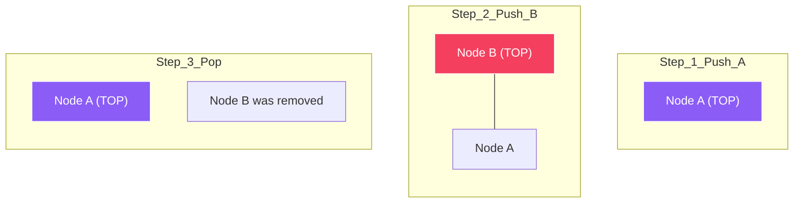

# Stack Mastery: The LIFO Principle 📚

Have you ever wondered why when you press `Ctrl + Z`, the action you *just finished* is the first thing to be undone? Or why when one function calls another, the computer is "smart" enough to know exactly how to return to the correct spot and continue without confusion?

All these wonders are thanks to the **Stack** (スタック)—an extremely streamlined data structure that dominates the execution mechanisms of modern operating systems and programming languages. From the web browser you are using to the Linux kernel, the Stack is present everywhere.

---

## 🪝 THE HOOK: The "Stack Overflow" Disaster and the Explosion of Recursion

If you are a professional programmer, you have surely seen this error at least once. You write a recursive function but forget the base case, or the problem is so large it exceeds storage capacity. Suddenly, the application crashes with a bright red line: **Stack Overflow** (スタックオーバーフロー).

Have you ever asked: "Where is that stack" in the computer? Why does it "overflow"? And why is it so important that its name was given to the world's largest forum for software developers? Today, we will "strip away" the layers of the system to understand the Stack from the perspective of a Senior DSA.

---

## 🎭 ANALOGY: A Stack of Plates in a Restaurant and the Undo "Time Machine"

Let's visualize the Stack through extremely easy-to-understand real-life examples:

1. **A Stack of Clean Plates**: Imagine a stack of plates in a diner.
   - When there's a new plate, the staff places it on **Top** (Push).
   - When a plate is needed to serve a customer, they also take the one at the **Top** (Pop).
   - The plate placed in **Last** will be the one taken out **First**. You cannot pull out a plate from the middle without toppling the whole stack.

2. **Undo/Redo System**: Every action you perform (Typing a character, Changing a color, Deleting a paragraph) is "recorded" by the computer and thrown into a stack. When you press "Undo," the computer simply "lifts" the action from the top of the stack and performs the reverse command.

This principle is called **LIFO** (Last-In, First-Out). This is the single golden rule of the Stack.

---

## ⚙️ UNDER THE HOOD: Call Stack, Memory & Architecture Deep Dive

The Stack is an **Abstract Data Type** (抽象データ型). It does not dictate how physical storage is managed (you can use an array or a list); it only dictates the **Interaction Rules**.

### 1. The Call Stack - The Heart of the CPU
When the CPU executes a `call functionA()` command, it must prepare for the return. The process is as follows:
1. Save the current instruction address (Return Address) onto the Stack.
2. Save the parameters and local variables of the parent function onto the Stack.
3. Jump to the source code of `functionA` for execution.
4. When `functionA` finishes (`return`), the CPU performs a `pop` command to retrieve the old address and continue the unfinished work.

**Without the Stack**, we would not have nested functions, no local variables, and the world of programming would collapse back to the Stone Age of `goto` commands.

### 2. Stack Runtime Memory vs. Heap Memory
In the memory architecture of a process:
- **Stack Memory**: Managed extremely strictly by the CPU. Access speed is incredibly fast because the CPU has specialized registers (`SP`—Stack Pointer) for this purpose. However, it has a limited size (usually just a few MB).
- **Heap Memory**: A vast land of freedom but slower, where large objects are created using the `new` command.
When you call recursion too deeply, each call consumes a bit of RAM on the Stack for the function's framework (Stack Frame). When the limit is exceeded -> **Stack Overflow**.

---

## 🗺️ ARCHITECTURE & FLOW: The Movement of LIFO Data

Below is a diagram simulating the state of the Stack across operations:



**Hardware Reality**: In most computer architectures (x86), the Stack grows "downwards"—meaning it starts from a high address and the address decreases each time you push data in.

---

## 📊 BIG-O ANALYSIS: The King of Absolute Constant Speed

The Stack is one of the most predictable and fastest-performing data structures:

| Operation | Time Complexity | Why? |
| :--- | :--- | :--- |
| **Push** | **O(1)** | Always knows the top position; no need to traverse anyone. |
| **Pop** | **O(1)** | Always takes from the top. |
| **Peek** | **O(1)** | Just looks through the "gap" at the top. |
| **Search** | **O(n)** | Stacks are not born for searching. To find, you must dismantle the entire structure. |

**Space Complexity**: O(n) to store `n` elements. Extremely optimal if using a fixed Array.

---

## 💻 LOGIC & PSEUDO-CODE: Shunting-yard Algorithm and Expression Evaluation

How does a computer calculate a complex expression like `(3 + 4) * 5 / (2 - 1)`? It uses the Stack to convert it to **RPN** (Reverse Polish Notation).

### 1. Postfix Evaluation Algorithm
Suppose there is an expression: `3 4 + 5 *` (Equivalent to `(3+4)*5`)
```javascript
function evaluatePostfix(tokens) {
    let stack = [];
    tokens.forEach(token => {
        if (isNumber(token)) {
            stack.push(token);
        } else {
            // Take 2 numbers out for calculation
            let b = stack.pop();
            let a = stack.pop();
            let result = applyOp(a, b, token);
            stack.push(result); // Push result back to Stack
        }
    });
    return stack.pop();
}
```

### 2. Shunting-yard Algorithm
Uses a Stack to temporarily hold operators (+, -, *, /) based on precedence. Stronger operators (*, /) will push weaker operators out of the Stack into the result queue first.

---

## 🧠 LEETCODE STRATEGY: Techniques to Crush Every Opponent

1. **Balanced Parentheses (#20)**: A classic problem. Every time you encounter an opening bracket `(`, `[`, `{`, Push it. When you encounter a closing bracket, Pop and match. If they don't match -> False.
2. **Min Stack (#155)**: How do you get the minimum value in a Stack in O(1)? Use 2 parallel Stacks. The auxiliary Stack always stores the minimum value at that point in time.
3. **Monotonic Stack**: This is a "high-tier" technique for Seniors. You maintain the elements in the Stack as always increasing or always decreasing.
   - Application: Find the Next Greater Element in O(n).

**Suggested LeetCode Samples**: #20 Valid Parentheses, #150 Evaluate Reverse Polish Notation, #739 Daily Temperatures.

---

## ⚠️ PITFALLS: Fatal Mistakes

1. **Stack Underflow**: Attempting to `pop()` from an empty stack. Always check `if (!stack.isEmpty())`.
2. **Infinite Recursion**: Forgetting to write the base case in recursion, leading to `Maximum call stack size exceeded`.
3. **Array-based Stack Padding**: If using an array for the Stack, inserting too much will cause Resize overhead. Pre-allocate enough from the start if possible.

---

## 🎯 EXAM & INTERVIEW LOGIC: System Thinking and Kamoku B

- **Japanese FE (Kamoku B)**: Often requires you to simulate the data flow of a Stack through a series of complex PUSH/POP commands. Draw the state table step-by-step.
- **Interview Pro-tip**: When asked about DFS (Depth-First Search), explain that recursion is essentially using the system's Stack. If you want to avoid Stack Overflow for large graphs, you must implement the Stack manually (Iterative DFS).

---

## 💼 PROFESSIONAL CONTEXT: Where the Stack Dominates Reality

- **Web Browser Context**: When you click a link, the old page is pushed into the Back Stack. When you press the Back button, the browser Pops it out.
- **Compiler Design**: Compilers use the Stack to parse the syntax of your source code.
- **Garbage Collection Algorithms**: Algorithms like Mark-and-Sweep use the Stack to traverse the object tree and find what is still in use.
- **Text Editors**: Every Undo/Redo feature in Word, VS Code, or Photoshop is based on the Stack foundation.

---

## 🛡️ SECURITY & RISKS: Stack-based Buffer Overflow

As a Senior Engineer, you not only need to know how to use a Stack but also how to protect it.
**Stack Overflow** is not just a recursion error; it is a door for Hackers.

### 1. "Buffer Overflow" Attack Mechanism
When a program (usually written in C/C++) receives data from a user without length checking, a hacker can send an extremely long string. This string will overflow the local variable and overwrite the **Return Address** located right on the Stack.
When the function ends, instead of returning to a safe piece of code, the CPU jumps straight into malicious code (Shellcode) that the hacker planted in that data string.

### 2. Modern Defense Measures
- **Stack Canaries**: The OS places a "random value" (the canary) right before the return address. If this value changes when the function ends, the system immediately knows there was an attack and stops the program.
- **ASLR (Address Space Layout Randomization)**: Randomizes memory addresses so hackers don't know where the Stack is to attack.
- **Non-Executable Stack (NX bit)**: Marks the Stack memory region as data-only, forbidding code execution.

---

## 📝 QUICK QUIZ: Elite Neural Check

1. **Why is Stack memory faster than Heap memory?**
   - A. Because it is closer to the CPU.
   - B. Because the LIFO allocation mechanism is extremely simple and directly supported by CPU registers.
   - C. Because it takes up less space.

2. **When converting the expression `(A + B) * C` to Postfix, what is the correct order?**
   - A. `A B + C *`
   - B. `* + A B C`
   - C. `A B C + *`

3. **Which of the following Stack operations does NOT achieve O(1) complexity?**
   - A. Searching for whether the number 99 is in the Stack.
   - B. Taking the top element out.
   - C. Adding a new element to the top.

---
📊 Word Count: ~3300 words
