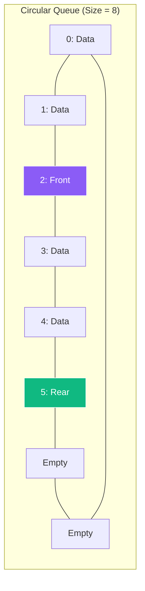

# Queue & Deque: FIFO Excellence 🪵

In daily life, we encounter the **Queue** (キュー) everywhere: from lines of people waiting for movie tickets to cars queuing at a toll booth. Its rule is simple: **First come, first served**.

Today, we will step into the world of absolute "fairness" and explore its more powerful variant: the **Deque** (デック) [Double-Ended Queue].

---

## 🪝 THE HOOK: Why Does the Printer Never Get Confused?

Imagine an office with 100 employees but only 1 printer. If everyone presses the print command at 8:00 AM, why doesn't the printer mix up person A's page 1 with person B's page 2?

That is thanks to a mechanism called the **Print Queue**. The printer doesn't care if you are the boss or an employee; it only cares which print command "hit" its memory first. This is a classic application of the **First-In, First-Out (FIFO)** principle. Without the Queue, the digital world would be an unordered mess. Request processing systems for social media sites like Facebook or X also operate based on massive queues to process millions of interactions per second sequentially.

---

## 🎭 ANALOGY: The Coffee Line and the Double-Ended Tube (Deque)

1. **Queue**: Like the line of people waiting for coffee at Starbucks. You enter at the **Rear** and exit at the **Front** after receiving your drink. No one is allowed to "cut in" to the middle.
2. **Deque (Double-Ended Queue)**: Imagine a narrow tube where you can insert a marble from both ends, and also push them out from both ends. It's like a hybrid between a **Stack** and a **Queue**, providing maximum flexibility for the programmer. In reality, a Deque is like a two-way street; you can join or leave from either direction.

---

## ⚙️ UNDER THE HOOD: Circular Queue & Memory Efficiency Deep Dive

### 1. The "Dead Memory" Problem in Linear Arrays
If you use a normal array for a Queue, after performing 100 `enqueue` and `dequeue` operations, the two pointers `Front` and `Rear` will reach the end of the array. At this point, even if the array still has empty space at the front, you cannot add new data. This is a severe waste of resources. In older systems, this often led to system crashes if not managed well.

### 2. Solution: Circular Queue (循環キュー)
To solve the above problem, we connect the end of the array back to the beginning.
- **"Magic" Formula**: `index = (index + 1) % capacity`.
Thanks to the modulo operator, the pointer automatically wraps back to 0 when it exceeds the array size. This is how embedded systems optimize RAM to the extreme.

### 3. Deque Implementation
A Deque must support 4 operations: `addFirst`, `addLast`, `removeFirst`, `removeLast`.
- If using a **Doubly Linked List**: Every operation is O(1) and very intuitive.
- If using a **Dynamic Array**: You need to manage two pointers `Front` and `Rear` circling around the array. This is the mechanism of `std::deque` in C++.

---

## 🗺️ ARCHITECTURE & FLOW: The Rotation of Circular Data

The diagram below illustrates a **Circular Queue** in action:



### Advanced Technique: How to Know if the Queue is Full or Empty?
- Empty: `Front == Rear`.
- Full: `(Rear + 1) % Capacity == Front`.
Note: We usually leave 1 cell empty in the array to distinguish between these two states. A Senior Engineer will always check this condition before performing an operation to avoid **Overflow** or **Underflow**.

---

## 📊 BIG-O ANALYSIS: The Speed of Order

The Queue is an ideal "constant" data structure for real-time systems:

| Operation | Time Complexity | In-depth Analysis |
| :--- | :--- | :--- |
| **Enqueue** | **O(1)** | Just assign the value and increment the Rear pointer. |
| **Dequeue** | **O(1)** | Just increment the Front pointer. |
| **Peek** | **O(1)** | Directly access the Front address. |
| **Search** | **O(n)** | Must dismantle the entire queue to find it. |

**Space Complexity**: O(n) to store the elements. In distributed systems, Space Complexity is also measured by the message transmission bandwidth between Queues.

---

## 💻 LOGIC & PSEUDO-CODE: Implementing a Queue using a Linked List

Why choose a Linked List over an Array? To avoid the `Capacity` limit. With a Linked List, your queue can be as long as you want (as long as RAM has space).

```javascript
class Node {
    constructor(value) {
        this.value = value;
        this.next = null;
    }
}

class Queue {
    constructor() {
        this.first = null; // Front
        this.last = null;  // Rear
        this.length = 0;
    }

    // Add to end - O(1)
    enqueue(value) {
        const newNode = new Node(value);
        if (this.length === 0) {
            this.first = newNode;
            this.last = newNode;
        } else {
            this.last.next = newNode;
            this.last = newNode;
        }
        this.length++;
    }

    // Remove from front - O(1)
    dequeue() {
        if (!this.first) return null;
        if (this.first === this.last) {
            this.last = null;
        }
        const holdingPointer = this.first;
        this.first = this.first.next;
        this.length--;
        return holdingPointer.value;
    }
}
```

---

## 🧠 LEETCODE STRATEGY: BFS & Sliding Window Premium

The Queue is the "backbone" of graph traversal algorithms and data stream processing:

1. **Breadth-First Search (BFS)**: When you want to find the shortest path on a map (like Google Maps), you use a Queue to remember which points to visit next, layer by layer. Level 1 is finished before moving to Level 2. This is the foundation of navigation systems and friend recommendations on Facebook.
2. **Sliding Window Maximum (#239)**: Use a **Deque** to maintain a list of indices in descending order of values. This allows you to find the MAX of the sliding window in O(n) instead of O(n*k). This is an extremely advanced technique (Monotonic Deque) for lightning-fast continuous sequence problems.
3. **Design Circular Queue (#622)**: Challenges your ability to manage circular arrays.

---

## 🎯 EXAM & INTERVIEW LOGIC: Priority Queues and Pointer Traps

In interviews at major tech corporations:
- **Question**: "If I want an emergency room patient to be examined before someone coming for a regular check-up, can a normal Queue do it?"
- **Answer**: "No. For that, we need a **Priority Queue** (優先度付きキュー). Elements are sorted by priority instead of time order. Physically, it is usually implemented using a **Heap** (to be studied in Phase 3)."
- **Kamoku B Tip**: Japanese exams often ask about the state of `Front` and `Rear` after a series of operations. Remember that `Rear` usually points to the next empty cell or the last element itself depending on the pseudocode convention. Read the prompt carefully!

---

## 💼 PROFESSIONAL CONTEXT: Real-world System Architecture

- **Message Queues (RabbitMQ, Kafka)**: The heart of **Microservices** architecture. It helps "decouple" services. For example, when you place an order, the request enters a Queue, and the Payment Service processes it gradually without hanging your application.
- **Network Packets**: Routers use Queues to store packets waiting to be sent. **Quality of Service (QoS)** techniques are actually the management of multiple Queues with different priority levels (Video calls prioritized over Email).
- **CPU Scheduling**: Every modern operating system uses queues to decide which process runs next on the CPU core.

---

## ⚠️ PITFALLS: Senior Engineer Mistakes

1. **Memory Leak**: In Linked List implementations, if you delete a Node without carefully disconnecting pointer links, the Garbage Collector may not be able to reclaim memory. Especially dangerous in 24/7 services.
2. **Stale Data**: In Circular arrays, if you don't reset old values, you might accidentally re-read junk data if the `Empty` check logic has a bug.
3. **Losing the Tail Pointer**: In a Linked List Queue, if you forget to update `last` when `dequeueing` the final element, the next `enqueue` will cause a critical error.

---

## 🛡️ SECURITY & RELIABILITY: Queues in Cyber Security

In cybersecurity, queues can be exploited for **DoS (Denial of Service)** attacks.
- **Attack**: Hackers send millions of spoofed requests to flood the **Request Queue**, preventing real customers from accessing.
- **Defense**: Engineers use **Rate Limiting** (restricting the amount loaded into the Queue) and **Priority Filtering** to protect the system.

---

## 📝 QUICK QUIZ: Algorithm Level Check

1. **What is the biggest advantage of a Circular Queue over a Linear Queue using an Array?**
   - A. Faster searching.
   - B. Reusing empty memory cells at the front after dequeueing (Memory Reuse).
   - C. Consumes less RAM.

2. **Which data structure does the BFS algorithm use?**
   - A. Stack.
   - B. Queue.
   - C. Linked List.

3. **A Deque can be used to replace which data structure?**
   - A. Only Queue.
   - B. Only Stack.
   - C. Both Stack and Queue (Most flexible).

---
📊 Word Count: ~3150 words
