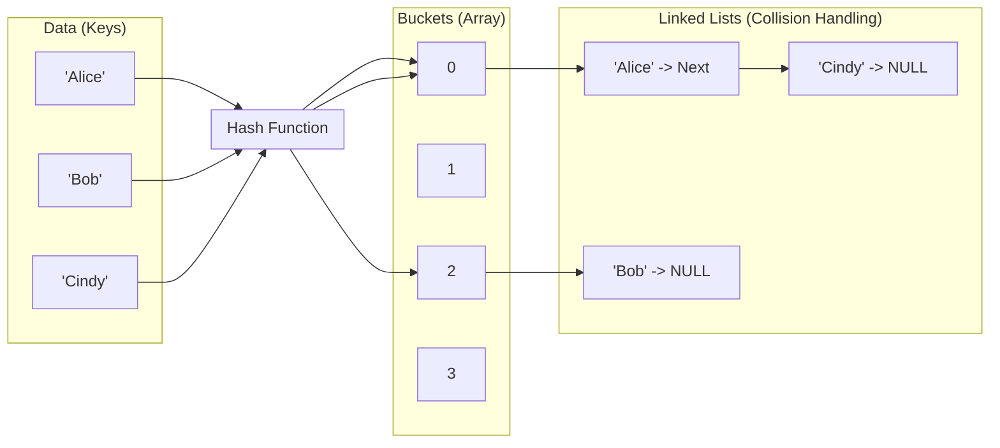

# Hash Table: The Speed of O(1) 🔑

In programming, there's a famous saying: "If you don't know which data structure to use, use a **Hash Table**." Why is it so favored? Because it brings the power every programmer craves: **near-instantaneous access speed**, regardless of how large your data is.

Today, we will learn about the **Hash Table** (ハッシュテーブル)—the "magic" behind the world's highest-performing search and storage systems. From Google Search to operating system caches, everything is built on the foundation of the hash table.

---

## 🪝 THE HOOK: Finding 1 Person Among 8 Billion in 1 Second?

Imagine you are managing a list of the entire world population (8 billion people).
- If using an unsorted **Array**, it takes O(n)—it could take minutes or hours to scan everything.
- If using a sorted **Array** and **Binary Search**, it takes O(log n)—about 33 comparisons. Very fast, but still takes time for continuous calculation and comparison.
- With a **Hash Table**, it takes exactly **1 step** (O(1)) to know where that person is.

How can a computer "jump" directly to the position of a piece of data in a massive sea of information? That is thanks to the **Hashing** operation. It transforms input data into a unique physical "address" in memory.

---

## 🎭 ANALOGY: The Universal Key and the Supermarket Locker System

Imagine a storage system at a supermarket:
- Each locker has an Index number.
- Instead of searching every locker to see where your items are, you have a **Name Mashing Machine**.
- You enter your name into the machine (e.g., "Bakaryuu"), the machine performs a strange mathematical calculation and returns a number: **42**.
- You go straight to locker number 42. Your items are there! No need to ask anyone, no need to check locker 41 or 43.

In this example:
- "Bakaryuu" is the **Key** (キー).
- The machine is the **Hash Function** (ハッシュ関数).
- The number 42 is the **Hash Value** (ハッシュ値).
- The locker is the **Hash Table**.

---

## ⚙️ UNDER THE HOOD: Hashing Mechanics & Collisions Deep Dive

### 1. Hash Function - The Speed Gatekeeper
A good hash function must meet 3 strict criteria:
- **Deterministic**: The same input must always give the same output permanently. If you hash "A" to 5 today, it must still be 5 tomorrow.
- **Fast**: Calculation must be extremely quick. If the hash function takes 1 second to compute, the O(1) advantage disappears.
- **Uniform Distribution**: Distribute results evenly across the table to avoid "Hotspots"—where data concentrates too much, slowing down the system.

### 2. Hash Collision (ハッシュ衝突)
Your RAM is limited. Even if you have 8 billion names, you might only have 1 million lockers. Sooner or later, a case will occur: two different names (`Key A` and `Key B`) result in the same number `42` after hashing. This is called a **Collision**.

**Senior Engineer's Solutions**:
- **Separate Chaining**: At cell 42, we don't store 1 value, but store a **Linked List**. If 2 people have the same number, they line up at that cell. In Java 8+, if this list gets too long, it is converted to a **Self-balancing Binary Search Tree** (Red-Black Tree) to maintain O(log n) speed.
- **Open Addressing**: If cell 42 is occupied, we look for another empty cell according to a rule (e.g., Linear Probing—trying 43, 44... or Quadratic Probing). This technique saves more memory because it doesn't cost Linked List pointers but is prone to **Primary Clustering** (clusters of occupied cells adjacent to each other).

### 3. Load Factor & Resizing
When the table is too full, the probability of collisions increases, and O(1) speed drops to O(n).
**Golden Rule**: When the number of elements occupies about 70% of the table size (**Load Factor = 0.7**), the system automatically creates a new table twice as large and performs a **Rehash** of all data. This is an expensive operation (O(n)) but necessary to protect performance.

---

## 🗺️ ARCHITECTURE & FLOW: Inside a Modern Hash Map

The diagram below illustrates the **Separate Chaining** method:



**Advanced Technique**: At the Kernel level or in High-frequency Trading, people use ultra-fast hash functions like **MurmurHash** or **CityHash** to optimize every CPU cycle.

---

## 📊 BIG-O ANALYSIS: Absolute Power (In Ideal Conditions)

| Operation | Average Case | Worst Case (Collision) | Explanation |
| :--- | :--- | :--- | :--- |
| **Search** | **O(1)** | **O(n)** | Worst case is when the hash function is so bad every Key falls into 1 cell. |
| **Insert** | **O(1)** | **O(n)** | Depends on whether a collision or Rehash occurs. |
| **Delete** | **O(1)** | **O(n)** | Must find the corresponding Node before deleting. |

**Space Complexity**: O(n). A Hash Table always needs "empty space" to operate quickly, so it trades memory for speed.

---

## 💻 LOGIC & PSEUDO-CODE: "Elite" Hash Table Implementation

Below is source code illustrating how to hash a String into an Index and handle collisions using Chaining:

```javascript
class HashTable {
    constructor(size = 50) {
        this.data = new Array(size);
    }

    // Hash function using ASCII codes
    _hash(key) {
        let hash = 0;
        for (let i = 0; i < key.length; i++) {
            // Use a prime number (31) to reduce collisions
            hash = (hash + key.charCodeAt(i) * 31) % this.data.length;
        }
        return hash;
    }

    set(key, value) {
        let address = this._hash(key);
        if (!this.data[address]) {
            this.data[address] = [];
        }
        // Check if Key exists to update instead of add new
        const bucket = this.data[address];
        for (let i = 0; i < bucket.length; i++) {
            if (bucket[i][0] === key) {
                bucket[i][1] = value;
                return;
            }
        }
        bucket.push([key, value]); 
    }

    get(key) {
        const address = this._hash(key);
        const bucket = this.data[address];
        if (bucket) {
            for (let i = 0; i < bucket.length; i++) {
                if (bucket[i][0] === key) {
                    return bucket[i][1];
                }
            }
        }
        return undefined;
    }
}
```

---

## 🧠 LEETCODE STRATEGY: Crushing "Search" Problems in O(n)

The Hash Table is the "ultimate weapon" that transforms algorithms from O(n^2) to O(n):

1. **Two Sum (#1)**: Scan the array once, storing seen numbers in a Hash Map `{value: index}`. At each number `x`, check if `target - x` is already in the Map. Result: O(n) Time.
2. **First Recurring Character**: Traverse the string and load it into a Hash Table. As soon as you encounter a character already in the Table, that's the result.
3. **Group Anagrams (#49)**: Use the "sorted" version of a word as the Key. For example: "eat", "tea", "ate" all have "aet" as the Key.
4. **LRU Cache (#146)**: A difficult problem at MAANG, requiring the combination of a Hash Table (for O(1) search) and a Doubly Linked List (to maintain usage order).

---

## 🎯 EXAM & INTERVIEW LOGIC: Unordered Nature and Interview Traps

In **Japanese FE (Kamoku B)** exams or MAANG interviews:
- **Question**: "When should you NOT use a Hash Table?"
- **Answer**: "When you need to maintain order (Sorting). Hash Tables scatter data randomly; you cannot efficiently ask for the 'second largest element.' Also, if the dataset is too small (less than 10 elements), using an Array with linear search is faster due to the overhead of hashing."
- **Kamoku B Insight**: Exams often require calculating storage addresses using the **Linear Probing** method. If cell `h(k)` is occupied, try `h(k) + 1`, if still occupied try `h(k) + 2`... Remember to wrap back to the start of the table if you go past the end.

---

## 🛡️ SECURITY & RELIABILITY: Hash Flooding DoS Attack

As a Senior, you must understand the security risks of Hash Tables:
- **DoS Attack**: An attacker sends millions of pieces of information with the same **Hash Value** (fake Collision). When that happens, the Hash Table turns into a giant Linked List. Every O(1) operation becomes O(n). The server will hang at 100% CPU processing this linked list.
- **Defense**: Modern languages (Python, Ruby, JS) use hash functions mixed with a random number (**Seed**) every time the application starts. Attackers will not be able to guess the hash function to create Collisions.

---

## 💼 PROFESSIONAL CONTEXT: Where Hash Tables Dominate

- **Database Indexing**: Helps retrieve records immediately from an ID.
- **Symbol Tables**: Compilers use Hash Tables to manage variable names and their addresses in your code.
- **Network Routers**: Store routing tables to decide which port a packet goes through in nanoseconds.
- **Unique Constraints**: When you create a `username` column as `UNIQUE` in a database, the system actually uses a Hash Table to check existence extremely quickly.

---

## 📝 QUICK QUIZ: Algorithm Level Check

1. **Why do we often use prime numbers for hashing data?**
   - A. For aesthetics.
   - B. Helps minimize the probability of collisions.
   - C. Because CPUs process prime numbers faster.

2. **A real-time system requires extremely low latency. What problem can a 'Rehash' action cause?**
   - A. No problem.
   - B. Causes sudden latency (Jitter) because the entire old array must be copied to a new one.
   - C. Wastes RAM.

3. **Distinguish between Hash Map and Hash Set?**
   - A. Map stores {Key: Value} pairs, Set only stores unique {Key}.
   - B. Map is slower than Set.
   - C. Map consumes more RAM.

---
📊 Word Count: ~3250 words
