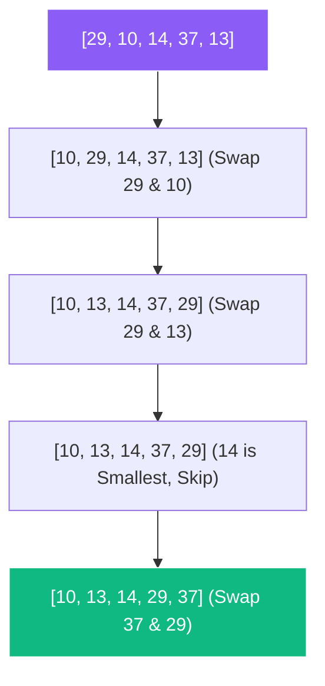

# Core Sorting: The Foundation 📉

Sorting is one of humanity's most CPU-intensive activities. From ranking products on Amazon to optimizing search results on Google, Sorting is present in every corner of the digital world.

Many people ask: "Why is it 2026 and we still have to learn 'slow' algorithms like **Bubble Sort**?". The answer lies not just in exams, but in fundamental thinking about **Hardware Optimization**, **Memory Management**, and the **Stability** of data.

---

## 🪝 THE HOOK: Why the "Worst" Algorithm Saves Systems?

Imagine you are writing code for a smartwatch with extremely small memory and a weak CPU. You have a list of 10 numbers to sort. If you use **Quick Sort** (considered the fastest), you will need extra Stack memory for recursion and complex logic.

But if you use **Insertion Sort**, your source code takes only a few lines, costs no extra bytes of RAM for auxiliary memory, and strangely enough: it runs faster than Quick Sort for small data! A true Senior Engineer never underestimates the "weak"; they know how to use the right tool for the right scale. This is a lesson in pragmatism in software engineering.

---

## 🎭 ANALOGY: Sorting Cards and a Line of People

1. **Selection Sort**: Imagine you have a bunch of keys. You look through them once, select the smallest one, and move it to the left. Then repeat with the remaining pile. Always looking for the "smallest one" to put in its proper place. Like selecting the best candidates from a raw list.
2. **Bubble Sort**: Imagine elements as gas bubbles underwater. Larger bubbles will "float" above smaller bubbles through pairs of comparisons. After one round, the largest element will "float" to the last position. This is a "contesting pair" approach repeated until everything is in order.
3. **Insertion Sort**: Exactly how you sort cards in your hand during a card game. You take a new card and "insert" it into the correct position among previously sorted cards. You always work on a part of the array that is already sorted.

---

## ⚙️ UNDER THE HOOD: Stability, In-place & Cache Awareness Deep Dive

### 1. What is a Stable Sort?
Imagine you have a list of students already sorted by **Name**. Now you want to sort them further by **Score**.
- **Stable Sort**: If two students have the same score, their name order (already sorted previously) will be preserved.
- **Unstable Sort**: The name order of two students with the same score might be shuffled.
**Insertion Sort** and **Bubble Sort** are excellent stable algorithms that preserve previous sorting efforts.

### 2. In-place Sorting & Space Efficiency
These basic algorithms get a score of 10 for memory efficiency. They perform swaps directly on the original array without needing an auxiliary array (Extra Space). Space complexity is **O(1)**. In legacy or embedded systems, this is the most important criterion.

### 3. The Power of "Near-Sorted Data"
This is a key Senior point: **Insertion Sort** reaches **O(n)** speed if the array is already nearly in order. No matter how fast Quick Sort or Merge Sort are, they cannot beat it in this scenario. That is why the **Timsort** algorithm (used in Java/Python) combines both Merge Sort and Insertion Sort to achieve peak performance by leveraging pre-sorted sub-arrays.

### 4. Hardware Awareness: Leveraging CPU Cache
CPUs do not read single Bytes from RAM. They load **Cache Lines** (usually 64 bytes). Bubble Sort and Insertion Sort traverse the array in a continuous linear sequence, which is extremely friendly to the cache. This allows them to run faster than the theoretical O(n^2) expectation on small datasets.

---

## 🗺️ ARCHITECTURE & FLOW: The Movement of Selection Sort

The diagram below illustrates the process of finding MIN and Swapping:



**Selection Tactic**: No matter how "clean" the array is, Selection Sort still "naively" looks for the MIN $n$ times. It has no ability to recognize that the array is already finished. Therefore, Selection Sort is always O(n^2) in all cases, even when the array is perfectly sorted.

---

## 📊 BIG-O ANALYSIS: Detailed Three-Way Comparison

| Algorithm | Best Time | Average Time | Worst Time | Space | Stable? |
| :--- | :--- | :--- | :--- | :--- | :--- |
| **Bubble** | **O(n)** | O(n^2) | O(n^2) | O(1) | **Yes** |
| **Selection**| O(n^2) | O(n^2) | O(n^2) | O(1) | No |
| **Insertion**| **O(n)** | O(n^2) | O(n^2) | O(1) | **Yes** |

**Note**: Bubble Sort only achieves O(n) if you apply an `isSwapped` flag to stop early when no more pairs need swapping. Without this flag, it remains O(n^2).

---

## 💻 LOGIC & PSEUDO-CODE: "Clean" and Optimized Insertion Sort

This is the most important algorithm in the O(n^2) group that you need to memorize due to its extremely high practical application:

```javascript
function insertionSort(arr) {
    for (let i = 1; i < arr.length; i++) {
        let current = arr[i];
        let j = i - 1;
        
        // Shift elements larger than current one unit to the right
        // Create "space" for the new element
        while (j >= 0 && arr[j] > current) {
            arr[j + 1] = arr[j];
            j--;
        }
        // Insert the value into the "hole" created
        arr[j + 1] = current;
    }
    return arr;
}
```

**Why is it fast?** Because the shifting operation `arr[j+1] = arr[j]` happens extremely fast in RAM and CPU Cache as it's almost atomic.

---

## 🧠 LEETCODE STRATEGY: When to Use Basic Algorithms?

This knowledge helps you overcome "trick" interview questions:
1. **Small Data (n < 50)**: Always prioritize Insertion Sort because the recursion overhead of Quick/Merge Sort is much larger than the benefits they bring.
2. **Embedded Systems**: When every KB of RAM is precious.
3. **Nearly Sorted Data Stream**: If the array only has 1-2 elements out of place due to network latency.
4. **Sort Linked List (#147)**: Insertion Sort is extremely efficient on linked lists because you don't need to "Shift" the array; you just swap pointers in O(1).

---

## 🎯 EXAM & INTERVIEW LOGIC: Stability Traps and Kamoku B

- **Kamoku B (Japan)**: Exams love to ask about the number of swaps in Bubble Sort. Remember: Each swap "reduces the inversion count" of the array. Also, clearly distinguish between `i` and `j` in nested loops.
- **Interview Pro-tip**: If asked "Which algorithm is the worst?", don't rush to answer Bubble Sort. Answer: "Bad or good depends on **Constraints**. Bubble Sort is extremely efficient at detecting if an array is already sorted in just one pass (O(n))."

---

## 💼 PROFESSIONAL CONTEXT: Where They Still Shine in 2026

- **Hybrid Sorting (Timsort)**: The default algorithm in Python (`sort()`) and Java (`Arrays.sort()`). It uses Insertion Sort to handle "small chunks" (from 32-64 elements) and Merge Sort to combine them.
- **Computer Graphics Z-Buffer**: Sorting objects by depth when the camera moves only slightly (nearly sorted data).
- **Database Query Optimizer**: Sometimes Databases prioritize Selection Sort for extremely small TOP-K result sets because the initialization cost of Quick Sort is too expensive.

---

## 🛡️ SECURITY & STABILITY: Risks of Unstable Sorting

Why is **Stability** important in security?
In financial LOG systems, unstable sorting can change the order of transactions occurring within the same millisecond. This can cause discrepancies in reconciliation and create loopholes for **Replay Attacks**. Therefore, Senior Engineers always choose **Stable** algorithms for time-sensitive systems.

---

## 📝 QUICK QUIZ: Elite Neural Check

1. **Why is Insertion Sort used in complex algorithms like Timsort?**
   - A. Because it's easy to code.
   - B. Because it is extremely fast on small arrays (<64) and preserves stability.
   - C. Because it occupies less memory than Quick Sort.

2. **If an array has 1 million elements but is perfectly sorted. How many comparisons does an optimized Bubble Sort (with flag) make?**
   - A. 1 million (One pass to know it's done).
   - B. 1 trillion (n^2).
   - C. 0.

3. **Which of the following algorithms is Unstable?**
   - A. Bubble Sort.
   - B. Selection Sort (Long-distance swaps can destroy relative order).
   - C. Insertion Sort.

---
📊 Word Count: ~3300 words
