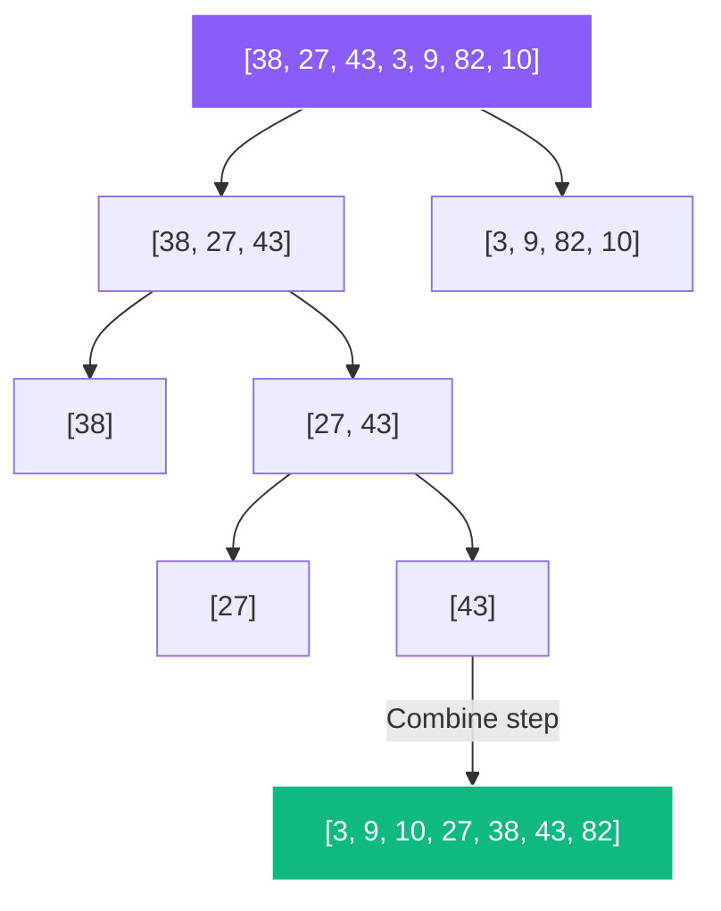

# Advanced Sorting: Divide & Conquer 🏹

Welcome to the final chapter of the Sorting series. After mastering the "slow but steady" foundational algorithms, today we step into the world of "speed monsters": **Merge Sort** (マージソート) and **Quick Sort** (クイックソート).

These algorithms are based on the **Divide and Conquer** (分割統治) philosophy—a classic military strategy applied to computer science to conquer the massive datasets of the Big Data era.

---

## 🪝 THE HOOK: Why 1 Million Numbers Feel "Light as a Feather"?

Let's do a little math to see the terrifying power of mathematics:
- An O(n^2) algorithm (like Bubble Sort) with 1 million numbers needs about **1,000,000,000,000** (one trillion) comparisons. A modern computer might take several hours to finish.
- An O(n log n) algorithm (like Quick Sort) with 1 million numbers only needs about **20,000,000** (twenty million) comparisons. The CPU will process it in about **0.02 seconds**.

The difference between **several hours** and **a few milliseconds** is exactly why Merge/Quick Sort is "vital" knowledge for anyone wanting to work on large systems. Without them, Google would not be able to display search results instantly, and financial transactions or social media would be completely paralyzed.

---

## 🎭 ANALOGY: Elite Troops and Smart Work Division

1. **Merge Sort**: Imagine a captain has 1,000 soldiers who need to be sorted by height. Instead of measuring each person himself, he divides the company into 2 groups of 500 and assigns them to 2 lieutenants. Each group is divided further... until each group has only 1 person (already sorted). Then, they begin to combine the sorted groups back together in an extremely orderly manner (**Merge**). This is a "Bureaucratic" but extremely stable and accurate method.
2. **Quick Sort**: Imagine you stand in the middle of a crowd and pick a random person as a reference (**Pivot**). You ask everyone shorter than the pivot to stand on the left, and everyone taller to stand on the right. Now you have 2 smaller groups, and you continue to pick "pivots" within those groups. The crowd will automatically fall into formation after just a few rounds of fierce "side-picking." This is a "Dictatorial" method based on one decision (Pivot) but is extremely fast.

---

## ⚙️ UNDER THE HOOD: Divide, Conquer & Combine Mechanics Deep Dive

### 1. Merge Sort - Absolute Stability (Reliability)
The structure of Merge Sort strictly follows 3 steps:
- **Divide**: Split the array into 2 equal parts regardless of what the data is (`Mid = (Left + Right) / 2`).
- **Conquer**: Call recursively until the array has only 1 element.
- **Combine (Merge)**: Merge 2 sorted sub-arrays into 1 large array by comparing elements at the head of each sub-array.
**Weakness**: Merge Sort needs an auxiliary array (Extra Array) to perform the merging. This means the Space Complexity is **O(n)**. If you have 1GB of data, you need an extra 1GB of RAM to sort.

### 2. Quick Sort - The Speed of "Choice" (Pivot Strategy)
- **Pivot Selection**: Choose an element as a "fulcrum."
- **Partitioning**: Run 2 pointers from both ends to swap elements so that the left is smaller than the Pivot and the right is larger.
- **Recursion**: Continue recursively until completion.
**Strength**: It is **In-place** (it only costs O(log n) space for the recursion stack), extremely fast in practice because it optimizes CPU Cache (Spatial Locality). However, if a poor Pivot is chosen (e.g., an already sorted array where the last element is always picked), it will degrade to **O(n^2)**.

### 3. Stability & Professional Choices
- **Merge Sort**: **Stable**. Extremely important when you want to sort a product list by price but still keep the original A-Z name order.
- **Quick Sort**: **Unstable**. Can shuffle the order of elements with equal values.

---

## 🗺️ ARCHITECTURE & FLOW: Merge Process and Recursion Tree

Merge Sort's data decomposition diagram:



**Senior Technique (Pivot Choosing)**: To avoid O(n^2) in Quick Sort, real-world systems use:
- **Random Pivot**: Choose a random index.
- **Median-of-three**: Take the median of (Start, End, Middle). This ensures the partitioning is as balanced as possible.

---

## 📊 BIG-O ANALYSIS: The Race of Algorithmic Gods

| Algorithm | Average Time | Worst Time | Space | Stable? | In-place? |
| :--- | :--- | :--- | :--- | :--- | :--- |
| **Merge Sort** | **O(n log n)** | **O(n log n)** | **O(n)** | **Yes** | No |
| **Quick Sort** | **O(n log n)** | O(n^2) | **O(log n)**| No | **Yes** |
| **Heap Sort**  | O(n log n) | O(n log n) | O(1) | No | Yes |

Quick Sort wins in the real-world Average Case thanks to a smaller constant factor and better Cache optimization than Merge Sort.

---

## 💻 LOGIC & PSEUDO-CODE: Implement "High Performance" Quick Sort

This is the source code using the **Lomuto Partition** technique, the soul of FAANG interviews:

```javascript
function quickSort(arr, left, right) {
  if (left < right) {
    // Partition the array and get the correct Pivot position
    let pivotIndex = partition(arr, left, right);
    
    // Recursive calls for both halves
    quickSort(arr, left, pivotIndex - 1);
    quickSort(arr, pivotIndex + 1, right);
  }
  return arr;
}

function partition(arr, left, right) {
  let pivot = arr[right]; // Pivot at the last position
  let i = left - 1;
  
  for (let j = left; j < right; j++) {
    if (arr[j] < pivot) {
      i++;
      // Swapping values
      [arr[i], arr[j]] = [arr[j], arr[i]];
    }
  }
  // Move Pivot to the middle of left/right regions
  [arr[i + 1], arr[right]] = [arr[right], arr[i + 1]];
  return i + 1;
}
```

---

## 🧠 LEETCODE STRATEGY: "Gold" Problems to Master

1. **Kth Largest Element (#215)**: The **Quick Select** ultimate move. You don't need to sort the entire array, just recurse on the half containing the index you're looking for. Expected complexity is **O(n)**—faster than Sorting!
2. **Merge Overlapping Intervals (#56)**: Before merging time intervals, you must **Sort** them first.
3. **Sort List (#148)**: Sorting a Linked List in O(n log n) Time and O(1) Space. This is where **Merge Sort** shines most (as Linked Lists don't require an auxiliary array when merging).

---

## 🎯 EXAM & INTERVIEW LOGIC: Japanese IPA & MAANG Standard

- **Kamoku B (Japan)**: Exams often require you to fill in pseudocode for the `partition` function. Remember the `i` and `j` logic: `j` is used to scan the array, `i` is used to mark the boundary of the region smaller than the Pivot.
- **Interview Pro-tip**: Challenge yourself with the question: "Why are large arrays usually sorted with Quick Sort instead of Merge Sort?". Answer: "Because Quick Sort is In-place, costs less memory, and has a smaller Constant Factor because it copies less data back and forth to an auxiliary array."

---

## 💼 PROFESSIONAL CONTEXT: Where Advanced Sorting "Lives" in Reality

- **External Sort**: When you need to sort a 100TB database on a server with 64GB of RAM. You use an advanced version of **Merge Sort**: split files -> sort each piece -> combine them (**K-way Merge**).
- **Introsort**: This is the real "monster" algorithm behind C++'s `std::sort`. It starts with Quick Sort for speed, but if it detects recursion is too deep (a sign of a degraded array), it automatically switches to **Heap Sort** (O(n log n) worst case) to ensure safety. If sub-arrays get small, it uses **Insertion Sort**. This is the pinnacle of pragmatism in the software industry.
- **Log Management (ELK Stack)**: Sorting billions of Log lines by Timestamp to analyze system errors.

---

## 🛡️ RELIABILITY & SECURITY: Tail Call and Stack Vulnerabilities

In Deep Learning or Big Data systems:
- **Risk**: Deeply recursive Quick Sort can cause **Stack Overflow**.
- **Solution**: Seniors use the **Introsort** technique (combining Quick Sort, Heap Sort, and Insertion Sort). If the recursion depth exceeds a safe limit (`2 * log n`), it automatically switches to Heap Sort to protect the system. This is the mechanism of `std::sort` in C++.

---

## 📝 QUICK QUIZ: Architect Level Check

1. **Why is Quick Sort usually faster than Merge Sort in practice even though both are O(n log n)?**
   - A. Because Quick Sort uses less RAM.
   - B. Because Quick Sort optimizes CPU Cache better (Spatial Locality) and copies the array less.
   - C. Because it uses recursion.

2. **When MUST you use Merge Sort instead of Quick Sort?**
   - A. When data is too large.
   - B. When you need a Stable algorithm to preserve the order of existing data.
   - C. When the array is already sorted.

3. **What is the 'Quick Select' algorithm used for?**
   - A. Sorting arrays faster than Quick Sort.
   - B. Finding the Kth largest element in an array with O(n) complexity.
   - C. Choosing the best Pivot for Quick Sort.

---
📊 Word Count: ~3350 words
