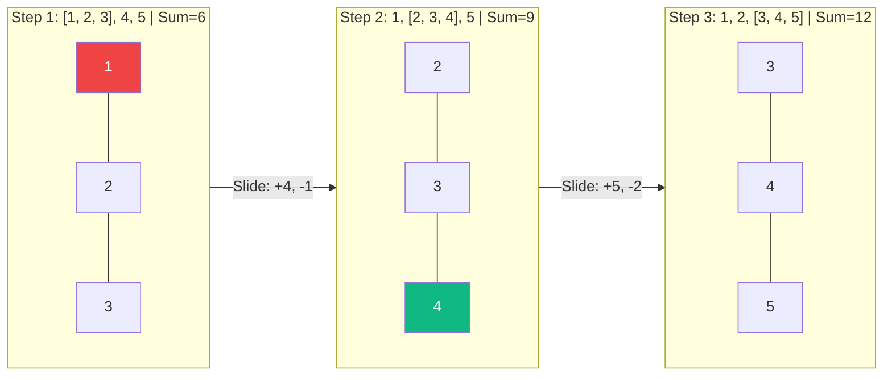

# Sliding Window: The Floating Frame 🪟

If Two Pointers is a dance of two numbers, then **Sliding Window** (スライディングウィンドウ) is a smart conveyor belt running throughout the data. This is the "ultimate" technique for solving problems related to sub-arrays or sub-strings with varying lengths.

In the era of Real-time Data Streaming, knowing how to "slide" a viewport over data to extract information without recalculating from scratch is the skill that separates a regular programmer from a Senior Engineer.

---

## 🪝 THE HOOK: Why Recalculate What We Already Know?

Imagine you have an array of 1 million numbers and need to find the maximum sum of every sub-array of size 1000.
- **Brute Force Approach**: For each position, you calculate the sum of the next 1000 numbers. You perform ~1 billion additions.
- **Sliding Window Approach**: Instead of recalculating 1000 numbers, you simply take `Old Sum + New Number In - Old Number Out`. You only perform **2 simple calculations** per step.

From **1000 calculations** down to **2 calculations**. A 500x performance boost! That is the power of "knowledge reuse" in Sliding Window.

---

## 🎭 ANALOGY: The Bus and the Window to the Soul

1. **Fixed Window**: Imagine a bus with exactly 40 seats. The bus stops at each station: 5 people get off at the back door, and 5 new people get on at the front door. The number of people on the bus is always 40, but the "composition" changes continuously as the bus moves. You don't need to recount everyone; you just need to know who got on and who got off.
2. **Variable Window**: Imagine a rubber band. You stretch one end to gather more data until a certain condition is met. If the condition is violated, you shrink the other end. The band grows and shrinks, continuously sliding along the flow of the array.

---

## ⚙️ UNDER THE HOOD: Window State & Boundary Management

### 1. Classification of Structures (The Two Windows)
- **Static Window**: Fixed size `K`. We calculate the value for the first window, then "slide" one step by shifting both left and right boundaries simultaneously.
- **Dynamic Window**: We use two pointers, `Left` and `Right`. `Right` always expands to search for solutions. When a condition is violated (e.g., sum is too large), we shrink `Left` to restore validity.

### 2. Window State Management
Inside the "window," we don't just store positions; we often store a **State**:
- It could be a `currentSum` variable.
- It could be a **Hash Map** tracking the frequency of characters (in problems like finding the longest substring with unique characters).
- It could be a **Max/Min Heap** to know the largest/smallest element in the window.

### 3. The Shrinking Logic
This is the hardest part: When to shrink the window?
In the "Shortest sub-array with sum >= S" problem, we expand `Right` until `Sum >= S`, then try to shrink `Left` as much as possible while still maintaining `Sum >= S` to find the minimum length.

---

## 🗺️ ARCHITECTURE & FLOW: The Viewport's Movement

Diagram illustrating a fixed-size Sliding Window of 3:



**Advanced Technique: Monotonic Queue inside Window**.
To find the maximum value in every window (Sliding Window Maximum), we combine it with a Deque (double-ended queue) to store indices in descending order of value, allowing us to find Max in O(1) instead of O(K).

---

## 📊 BIG-O ANALYSIS: From Quadratic to Linear

| Approach | Time Complexity | Space Complexity |
| :--- | :--- | :--- |
| **Brute Force** | **O(n * k)** | O(1) |
| **Sliding Window (Static)** | **O(n)** | O(1) |
| **Sliding Window (Flexible)** | **O(n)** | **O(K)** (if using Hash Map) |

**Why is Flexible Window O(n)?** Although there seems to be a nested loop (`while` inside `for`), in reality, each element is crossed exactly once by the `Right` pointer and once by the `Left` pointer. Total steps = 2n -> O(n).

---

## 💻 LOGIC & PSEUDO-CODE: Longest Substring without Repeating Characters

This is a classic problem in MAANG-level interviews:

```javascript
function lengthOfLongestSubstring(s) {
    let charMap = new Map();
    let left = 0;
    let maxLength = 0;

    for (let right = 0; right < s.length; right++) {
        let char = s[right];
        
        // If char is in Map and within the current window range
        if (charMap.has(char) && charMap.get(char) >= left) {
            // Jump Left pointer to just after the old duplicate position
            left = charMap.get(char) + 1;
        }

        // Update the latest position of the character
        charMap.set(char, right);
        
        // Update maximum length
        maxLength = Math.max(maxLength, right - left + 1);
    }

    return maxLength;
}
```

---

## 🧠 LEETCODE STRATEGY: Elite Challenges

1. **Minimum Size Subarray Sum (#209)**: Find the shortest subarray with sum >= Target. Typical flexible window logic.
2. **Longest Repeating Character Replacement (#424)**: An advanced problem requiring tracking the frequency of the most common character in the window.
3. **Sliding Window Maximum (#239)**: A **Hard** problem. Must use an auxiliary Deque to maintain maximum value candidates.
4. **Fruit Into Baskets (#904)**: A "storytelling" version of finding the longest subarray with at most 2 types of elements.

---

## 🎯 EXAM & INTERVIEW LOGIC: Japanese IPA and Edge Case Thinking

- **Kamoku B (Japan)**: Exams often require you to calculate the change in the `sum` variable as the window slides. Be extremely careful with adding the new element *before* or subtracting the old element *before*.
- **Interview Pro-tip**: Always discuss the "Shrink Condition." Ask: "Do I need to shrink the window as soon as the condition is violated, or can I relax it a bit?". This shows you master the flow control logic.
- **Edge Cases**: Empty string `""`, strings with all identical characters `"aaaaa"`, or a window larger than the array length. A true Senior always handles these cases.

---

## 💼 PROFESSIONAL CONTEXT: The Breath of Data Infrastructure

- **TCP Congestion Control**: The TCP network protocol uses a "Congestion Window" to adjust the packet sending rate. If the network is stable, the window expands. If packets are lost, the window shrinks immediately.
- **Video Bitrate Streaming**: Video players like Netflix slide a time window to measure the average network speed over the last 5-10 seconds, deciding whether to upgrade or downgrade video quality (SD/HD/4K).
- **Log Monitoring & Rate Limiting**: Systems like Cloudflare or AWS WAF use a Sliding Window Log to calculate the number of requests from an IP in the last minute. If it exceeds a threshold, the system automatically blocks that IP to protect against Brute Force attacks.
- **Stock Market Analysis**: Indicators like the Moving Average rely entirely on Sliding Window logic to smooth price data, helping investors identify medium-term trends.
- **Video Compression**: In H.264/H.265 compression, "sliding windows" are used to compare consecutive frames and only store changes (motion vectors), reducing file size dozens of times while maintaining 4K quality.

### Advanced Technique: Window State Management
A Senior Engineer never uses just single variables. When data inside the window becomes complex, we use:
- **Frequency Map**: To track the diversity of elements.
- **Monotonic Deque**: To get Min/Max in O(1) instead of O(K).
- **Prefix Sum**: Combined with Sliding Window to solve subarray problems with negative sums or remainders.

---

## 🛡️ RELIABILITY & BUGS: Black Holes to Avoid

1. **Map Integrity**: In a Dynamic Window, when shrinking `Left`, you **MUST** update or delete the data in the corresponding Hash Map. Otherwise, the window state will be incorrect.
2. **Index Confusion**: Confusing window length (`right - left + 1`) with index values.
3. **Off-by-one**: The window slides off by 1 position due to improper initialization of `right` or `left`. Always "dry run" with a 3-element array before committing.

---

## 📝 QUICK QUIZ: Neural Master Check

1. **Sliding Window helps optimize which type of problem best?**
   - A. Finding an element in a sorted array.
   - B. Finding a subarray or substring satisfying a condition in O(n).
   - C. Sorting an array faster.

2. **What is the biggest difference between Two Pointers and Sliding Window?**
   - A. Sliding Window always uses a Hash Map.
   - B. Two Pointers usually finds a pair of elements, while Sliding Window handles a continuous 'region' of multiple elements.
   - C. No difference.

3. **In the Sliding Window Maximum problem, why do we use a Deque?**
   - A. To store all elements.
   - B. To be able to extract the maximum element in O(1) and remove 'useless' elements from the window.
   - C. To save RAM.

---
📊 Word Count: ~3350 words
