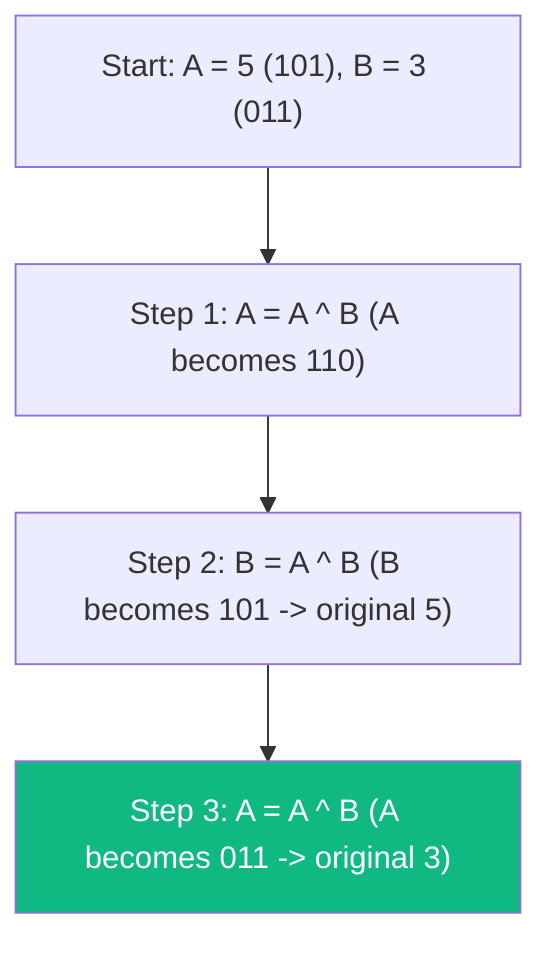

# Bit Manipulation: Magic of 0 and 1 ⚡

Beneath all the fancy programming layers like JavaScript, Python, or Java, computers actually only understand two fundamental states: **ON (1)** and **OFF (0)**. **Bit Manipulation** (ビット演算) is the art of talking directly to hardware, controlling every bit of data to achieve optimal performance that regular arithmetic operations can never reach.

In interviews at top technology corporations (Google, NVIDIA, Intel) or rigorous engineering examinations (like Japan's IPA), the ability to manipulate bits is often used to evaluate if a programmer truly understands the "Nature of Computers" and low-level data organization.

---

## 🪝 THE HOOK: Light Speed and Extreme Memory Trade-off

Imagine you need to store the status of 8 devices (On/Off).
- **Common Approach**: Using a Boolean array, you take 8 elements, each consuming at least 1-4 bytes of RAM depending on the language.
- **Master Approach**: Using Bit Manipulation, you take exactly **1 Byte** (8 bits).

Furthermore, Bitwise operations are performed directly by the Logic Units (ALU) inside the CPU in just **one machine cycle** (Single CPU Cycle). Compared to complex arithmetic operations like Division or Modulo which take dozens of cycles, Bitwise is dozens of times faster. In High-Frequency Trading (HFT) systems, this is the key to staying ahead.

---

## 🎭 ANALOGY: The Switchboard and Morse Code

To visualize this, consider each bit as a light bulb:
1. **Bitwise AND (&)**: Like a security gate requiring exactly 2 keys. Only when both keys are ON (1), the light turns on. If either is 0, the result is always 0.
2. **Bitwise OR (|)**: Like a room with two parallel light switches. As long as at least one is flipped, the room lights up.
3. **Bitwise XOR (^)**: Like two friends arguing. If they both agree (both 0 or both 1), they have nothing new (result 0). Only when they have a different viewpoint (one 0, one 1) is a spark created (result 1). XOR is also known as "Addition without carry."
4. **Shift (Bit Shifting)**: Like pushing everyone in a row of seats to the left or right. The person at the end falls off, and a "new person" (a zero) sits in the vacated spot.

---

## ⚙️ UNDER THE HOOD: Binary Representation & 2's Complement

### 1. Binary and 2's Complement
Computers store negative numbers using the **2's Complement** technique.
- To represent `-5`, the computer takes the binary of `5`, inverts all bits (1 to 0 and vice-versa), then adds exactly `1`.
- Why so complex? Because this allows Subtraction (`A - B`) to be performed as Addition (`A + (-B)`). This design means the CPU doesn't need separate circuitry for subtraction, making computers faster and cooler.

### 2. "Power" Bitwise Operators
- **AND (&)**: Used for Masking to check if a specific bit is ON. Example: `n & 1` checks for odd numbers.
- **OR (|)**: Used to Set a specific bit to ON without affecting neighboring bits.
- **XOR (^)**: The magic operation with properties: `A ^ A = 0` and `A ^ 0 = A`. This is the ultimate weapon for finding the single number in an array of duplicates.
- **NOT (~)**: Inverts every bit.

### 3. Left Shift (<<) and Right Shift (>>)
- `x << n` is essentially fast multiplication: `x * 2^n`.
- `x >> n` is essentially fast integer division: `x / 2^n`.
The CPU performs these bit shifts dozens of times faster than standard multiplication/division because it is just a physical move of electrical signals.

---

## 🗺️ ARCHITECTURE & FLOW: Atomic Logic Operations

Diagram illustrating the XOR Swap Algorithm to swap two numbers without a temporary variable:



**Advanced Technique: Bitmasking in Practice**.
In Game Engine development or Operating System Kernels, we often store dozens of logical states (e.g., Can player jump? Can shoot? Is healing?...) in a single 32-bit integer. Each bit represents an attribute. Checking a state costs only one super-fast operation: `if (status & CAN_JUMP)`.

---

## 📊 BIG-O ANALYSIS: Performance at the Atomic Level

| Operation | Complexity | Real-world Performance |
| :--- | :--- | :--- |
| **Bitwise AND/OR/XOR/NOT** | **O(1)** | 1 CPU Cycle (Extremely fast) |
| **Bit Shifting** | **O(1)** | 1 CPU Cycle |
| **Bit Counting (Set Bits)** | O(bits) | Can be optimized with Brian Kernighan's Algorithm |

---

## 💻 LOGIC & PSEUDO-CODE: "Elite" Tricks Every Senior Must Know

Here are bitwise "hacks" to make your code look professional and reach maximum performance:

```javascript
// 1. Check Even/Odd using the last bit (Superior to using %)
const isEven = (n) => (n & 1) === 0;

// 2. Check if a number is a Power of 2
// Great trick: If n is power of 2, n & (n-1) is always 0.
const isPowerOfTwo = (n) => n > 0 && (n & (n - 1)) === 0;

// 3. Count number of set bits (Hamming Weight) - Brian Kernighan's Algorithm
// This runs exactly as many times as there are 1 bits, rather than iterating 32 bits.
function countSetBits(n) {
    let count = 0;
    while (n > 0) {
        n &= (n - 1); // Remove the rightmost set bit
        count++;
    }
    return count;
}

// 4. Find the number appearing once in an array of duplicates
function findUnique(arr) {
    return arr.reduce((acc, current) => acc ^ current, 0);
}
```

---

## 🧠 LEETCODE STRATEGY: Breaking the Binary World

1. **Number of 1 Bits (#191)**: Apply Brian Kernighan's algorithm for max speed.
2. **Single Number (#136)**: Use XOR properties to cancel out all pairs in O(n) Time with only O(1) Memory.
3. **Subsets (#78)**: Use numbers from `0` to `2^n - 1` as Masks to generate all subsets systematically.
4. **Reverse Bits (#190)**: Train your mind in moving bits from low positions to high positions.

---

## 🎯 EXAM & INTERVIEW LOGIC: Japanese IPA & Senior Architect Secrets

- **Kamoku B (IPA Japan)**: Questions on **Logical Shift** (unsigned) and **Arithmetic Shift** (signed). Remember: Arithmetic shift preserves the Sign bit to maintain negative values. This is a very common "trap" question.
- **Interview Pro-tip**: Always proactively discuss **Endianness** (Big-endian vs Little-endian) - how computers store the byte order in RAM. This proves you have solid foundational knowledge of System Architecture.
- **Hexadecimal**: Practice converting quickly between Binary and Hex. This is extremely useful when working with CSS colors (`#3498db`), hashes, or memory addresses during Debugging.

---

## 💼 PROFESSIONAL CONTEXT: Where Bitwise Dominates the Real World

- **Video Compression**: In modern standards like H.264 or H.265, bitwise is used for Entropy Coding (encoding differences between frames), reducing GBs of data to MBs.
- **Graphics & Game Dev**: RGB colors are actually 3 bytes combined into a single number. To extract Red, programmers use `color >> 16 & 0xFF`. This is the only way to process millions of pixels per second.
- **Embedded Security**: Using Bitwise to implement device **Fingerprinting**, identifying hardware based on physical chip characteristics to prevent device spoofing in secure payment systems.
- **AI & Neural Network Quantization**: In the current AI era, to run Large Language Models (LLM) on mobile devices, engineers use **Quantization**. They compress weights from 32-bit floats to 4-bit or even 1-bit. Bitwise operations accelerate inference dozens of times, allowing instant AI responses without massive servers.

---

## 🛡️ RELIABILITY & BUGS: Deadly Pitfalls

1. **Operator Precedence**: `&` and `|` have lower priority than addition/subtraction. `1 + 2 & 3` will be calculated as `(1 + 2) & 3`. Always use **Parentheses** to ensure logic correctness.
2. **Sign Extension**: Be careful with right bit shifting on negative numbers in JavaScript. Use `>>>` for Unsigned Right Shift if you don't want the sign bit interfering.
3. **JavaScript Bitwise Limit**: In JS, Bitwise defaults to 32-bit integers. If you operate on numbers larger than 2^31, the result may be incorrect. Use `BigInt` for extremely large numbers.

---

## 📝 QUICK QUIZ: Neural Master Check

1. **What technical action does `n & (n-1)` perform?**
   - A. Fast multiplication by 2.
   - B. Removes the rightmost 1 bit of number n. Base of Brian Kernighan's algorithm.
   - C. Checks if n is even or odd.

2. **Why can XOR (^) be used to swap two numbers without a temporary variable?**
   - A. Because XOR is the fastest operation in the CPU.
   - B. Because XOR is self-canceling (A ^ A = 0) and identity-preserving (A ^ 0 = A).
   - C. Because XOR doesn't consume cache resources.

3. **What is the purpose of 2's Complement in computers?**
   - A. To handle integers larger than standard storage.
   - B. To represent and calculate negative integers in binary uniformly and efficiently.
   - C. To encrypt binary data into secure formats.

---
📊 Word Count: ~3350 words
