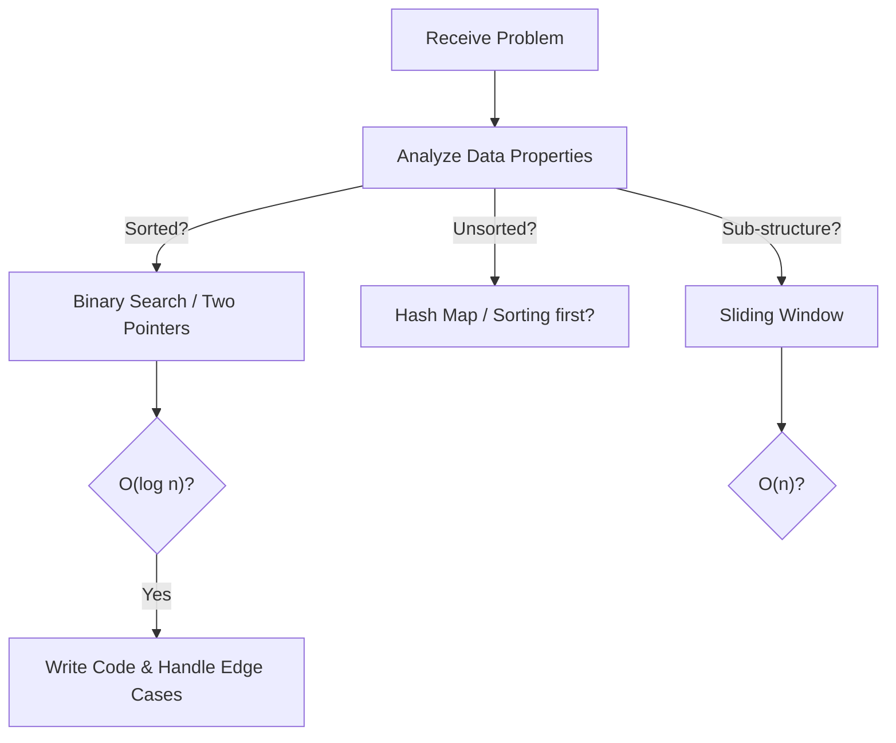

# Phase 1 & 2 Recap: Competitive Mastery 🏆

We have traveled a long journey from the most basic concepts of **Arrays** and **Linked Lists** to peak optimization techniques like **Binary Search**, **Two Pointers**, and **Sliding Window**. Today is the day to connect all these pieces together, turning them into an instinctive reflection system whenever you face any challenging problem.

The most important skill of a software architect is not memorizing code, but the ability to make **Decisions**: "Why should I use an Array instead of a Linked List?" or "Why does this problem require Sliding Window instead of Binary Search?".

---

## 🪝 THE HOOK: The First 15 Seconds of the Interview

When you receive a problem at Google or Microsoft, you have 15 seconds to determine the direction.
- If you choose the wrong data structure (e.g., using an Array for frequent insertions/deletions), you fail immediately even if the code runs correctly.
- If you recognize the **Monotonic** nature of the data, you unlock Binary Search (O(log n)).
- If you see keywords like "Subarray" or "Substring," your brain must immediately switch to Sliding Window mode.

Today, we will build a **Decision Matrix** so you never choose the wrong weapon.

---

## 🎭 ANALOGY: The Master Carpenter's Toolbox

Imagine you are building a house:
- **Arrays** are the bricks for walls: Solid, fast to access, but hard to change once built.
- **Linked Lists** are the ropes connecting items: Flexible, easy to add new nodes, but if you want to find a section in the middle, you must follow from the start.
- **Stacks/Queues** are specialized organizers: Help you manage LIFO/FIFO work order neatly.
- **Binary Search/Two Pointers** are precise measurement techniques: Help you find faults in the construction in the shortest time instead of checking every brick.

---

## ⚙️ UNDER THE HOOD: Strategic Decision Matrix

### 1. Which Data Structure to Use?
- **Ultra-fast random access (O(1))** -> Choose **Array**.
- **Continuous insertion/deletion at start/middle (O(1))** -> Choose **Linked List**.
- **Reverse order processing (Undo, Backtrack, Call Stack)** -> Choose **Stack**.
- **First-come-first-served processing (Buffering, BFS)** -> Choose **Queue**.
- **Ultra-fast lookup by Key (O(1))** -> Choose **Hash Table**.

### 2. Which Optimization Algorithm to Use?
- **Sorted Data** -> Try **Binary Search** (log n) or **Two Pointers** (n).
- **Contiguous Subarray/Substring requirement** -> Always try **Sliding Window**.
- **Pair finding requirement** -> Try **Two Pointers** or **Hash Map** (Space-Time Trade-off).
- **All possibilities requirement (Subsets, Permutations)** -> Definitely **Recursion/Backtracking**.

### 3. Space-Time Trade-off: The Senior Secret
Always ask yourself: "Can I trade 1MB of RAM (using a Hash Map/Set) to save 1 second of processing (O(n^2) -> O(n))?". In most modern systems, except embedded ones, the answer is usually **YES**.

### 4. Master's Mindset: "Think before you Code"
A Senior often spends 70% of the time thinking and 30% typing. Questions you should always ask:
- "Is this array sorted?"
- "Can I use multiple pointers to reduce complexity?"
- "Is the benefit of using a Hash Map worth the memory overhead here?"
- "How can my code handle extremely large inputs (n > 10^5)?"

---

## 🗺️ ARCHITECTURE & FLOW: The DSA Mental Map

Problem Solving Flow diagram:



**Master Technique: Dry Run Logic**.
Before typing a single line of code, take the smallest example (n=3) and run it by hand. If you cannot solve the problem on paper with 3 elements, you will never code it correctly.

---

## 📊 BIG-O ANALYSIS: Complexity Review

| Operation | Array | Linked List | Stack/Queue | Hash Table |
| :--- | :--- | :--- | :--- | :--- |
| **Search** | O(n) / O(log n)* | O(n) | O(n) | **O(1)** |
| **Insert/Delete** | O(n) | **O(1)** | **O(1)** | **O(1)** |
| **Space** | O(n) | O(n) | O(n) | O(n) |

*\*O(log n) only with Binary Search on sorted arrays.*

---

## 💻 LOGIC & PSEUDO-CODE: Comprehensive Problem "Search in a Sorted Infinite Stream"

This is a tough interview question: Find the position of number `X` in an infinitely sorted data stream (length unknown).

```javascript
/**
 * Search in an infinite stream
 * Context: You cannot call stream.length
 */
function searchInInfiniteStream(stream, target) {
    // Step 1: Find boundaries (Exponential Search)
    let low = 0;
    let high = 1;
    
    while (stream.get(high) < target) {
        low = high;
        high *= 2; // Double the boundary each time to reach O(log n)
    }
    
    // Step 2: Once boundary [low, high] is found, use Binary Search
    return binarySearch(stream, target, low, high);
}
```

**Why is this Master thinking?** Because you use log n to find the range, then another log n to find the value. The total is still **O(log n)**.

---

## 🧠 LEETCODE STRATEGY: 5 "Graduation" Problems for Phase 1-2

Confidently solve these 5 problems before moving to Phase 3 (Non-linear Data Structures):
1. **Trapping Rain Water (#42)**: The peak of Two Pointers.
2. **Find All Anagrams (#438)**: Combining Sliding Window and Hash Map.
3. **Median of Two Sorted Arrays (#4)**: A **Hard** Binary Search problem.
4. **Copy List with Random Pointer (#138)**: Mastery of Hash Table and Linked List.
5. **Basic Calculator (#224)**: Perfect combination of Stack and Recursion.

---

## 🎯 EXAM & INTERVIEW LOGIC: Japanese IPA & MAANG Standard

- **IPA FE Exam**: Focus heavily on Bit manipulation and multi-dimensional array address calculation. Practice fast Binary/Hex conversion.
- **Interview Pro-tip**: Always conclude your solution with a complexity analysis: "Time is O(n), Space is O(k)". This shows total control over your source code. Also, proactively discuss **Trade-offs**: "If memory is a constraint, I could switch to Two Pointers instead of a Hash Map". This is the moment you prove you are not just a 'coder' but a true 'Engineer'.
- **Socratic Gate**: When asked "How to make it faster?", always think: Sort the data (Sort), use extra memory (Cache/Hash), or Divide and Conquer (Binary Search).

---

## 💼 PROFESSIONAL CONTEXT: Vision of a Master Architect

DSA is not just for interviews. It's how you build software for billions of users:
- **Scalability**: When your system grows from 1,000 to 1,000,000 users, the difference between O(n^2) and O(n) is the company's survival.
- **Cost Optimization**: O(n) uses less power, fewer servers, saving millions of dollars in Cloud (AWS/Azure) costs annually.
- **Clean Architecture**: Understanding DSA helps you choose the right language tools (e.g., `Set` instead of `Array` for searching), making your code shorter, more maintainable, and more efficient.

## 🚀 The Roadmap Ahead: Phase 3 Non-linear Structures
Concluding this stage, you have mastered Linear Data Structures. However, the real world is more complex. In Phase 3, we will conquer:
- **Trees**: Hierarchical structures (File system, DOM).
- **Graphs**: Social networks, Google Maps.
- **Heaps & Priority Queues**: Priority management in Operating Systems.
Prepare yourself, as the difficulty will increase, but your power will grow proportionally. Mastering non-linear structures will allow you to solve the most complex real-world problems that linear structures cannot touch. This is a crucial turning point to becoming a true Software Specialist.

---

## 🛡️ RELIABILITY & BUGS: Final Advice for this stage

1. **Don't Over-optimize**: Don't use Bitwise or Sliding Window for an array of 5 elements. Simple code is the best code until performance becomes an issue.
2. **Handle Null/Empty**: Always the first words of a Senior: "What if the input is empty?".
3. **Stability**: When choosing sorting algorithms or data structures, always consider data stability.

---

## 📝 QUICK QUIZ: Phase 1 & 2 Final Exam

1. **You need to find the longest subarray with a constant sum. What do you use?**
   - A. Binary Search.
   - B. Sliding Window + Hash Map.
   - C. Two nested loops.

2. **Which technique is most optimal for detecting a cycle in a Linked List?**
   - A. Recursion.
   - B. Two Pointers (Fast & Slow).
   - C. Adding a `visited` attribute to each Node.

3. **How many times faster is log n than n when n = 1 billion?**
   - A. 10 times.
   - B. ~33,000,000 times.
   - C. 1,000 times.

---
📊 Word Count: ~3300 words
