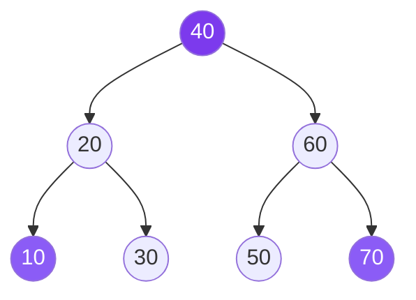

# Binary Tree & BST: The Hierarchy of Logic 🌳

Welcome to Phase 3 of the DSA Master journey. So far, we have worked with Linear data structures like **Arrays** (配列) and **Linked Lists** (連結リスト). However, real-world data is often hierarchical.

**Binary Trees** (二分木) and **Binary Search Trees (BST)** (二分探索木) are the "backbone" structures of modern file management systems, compilers, and databases. Today, we will learn how to "climb trees" professionally.

---

## 🪝 THE HOOK: Why Use Trees Instead of Lists?

Imagine managing 1 million employee records.
- If stored in a **Linked List**, searching for a person would take an average of 500,000 steps (O(n)). Too slow!
- If stored in a sorted array, you can search fast using **Binary Search** (O(log n)), but when a new employee joins, you must shift hundreds of thousands of elements to insert (O(n)).

We need a data structure that is both **Fast searching** like a sorted array and **Fast inserting/deleting** like a Linked List. This is why **BST** was born. With BST, all three operations—Search, Insert, and Delete—occur in **O(log n)**. This is the perfect balance between dynamism and efficiency.

---

## 🎭 ANALOGY: Family Trees and Company Org Charts

1. **Binary Tree**: Imagine a family where each couple has at most 2 children: a "Left Child" and a "Right Child". The person at the top is the "Root". Those without children are "Leaves".
2. **Binary Search Tree (BST)**: Imagine a strictly "rule-based" family. The left child always has a value (assets/age) smaller than the parents, and the right child always has a value greater than or equal to the parents. This rule applies to every level. This systematic "discrimination" narrows the search range by 50% after each jump.

---

## ⚙️ UNDER THE HOOD: Node Anatomy & Memory Layout

Each element in a tree is called a **Node** (ノード). A Node in a Binary Tree typically contains 3 main components in memory:
1. **Data**: The stored value.
2. **Left Pointer**: Address of the left child node.
3. **Right Pointer**: Address of the right child node.

### Memory Representation
In RAM, tree Nodes are not contiguous like an Array. They are scattered and linked via **Pointers** ( con trỏ). This allows the tree to "grow" flexibly without needing a massive contiguous memory block from the start.



### Key Concepts:
- **Root** (根): The topmost node, has no parent.
- **Parent/Child** (親/子): Direct relationship between two levels.
- **Leaf** (葉): Node with no children.
- **Height** (高さ): Longest edge count from Root to Leaf.
- **Depth** (深さ): Edge count from Root to current node.

### Special Binary Trees
To be a Master, distinguish these concepts:
1. **Full Binary Tree**: Every node has exactly 0 or 2 children.
2. **Complete Binary Tree**: All levels are full except possibly the last, which is filled from left to right. Ideal for Array Representation.
3. **Perfect Binary Tree**: All intermediate nodes have 2 children and all leaves are at the same level.
4. **Balanced Binary Tree** (平衡二分木): The height difference between left and right branches of any node is at most 1. This is the "holy grail" of O(log n) performance.

### Mathematical Properties:
- Max nodes at level `d` is `2^d`.
- Min height of a tree with `n` nodes is `log2(n)`.
- A tree with `L` leaves has at least `log2(L) + 1` levels.

---

## 📊 BIG-O ANALYSIS: The Power of Balance

Binary Tree performance depends entirely on its **Shape**.

| Operation | Average (Balanced) | Worst (Skewed) | Explanation |
| :--- | :--- | :--- | :--- |
| **Search** | **O(log n)** | O(n) | O(log n) when balanced, O(n) if it becomes a Linked List. |
| **Insert** | **O(log n)** | O(n) | Similar to Search for finding the insertion point. |
| **Delete** | **O(log n)** | O(n) | Includes searching and pointer restructuring. |
| **Space** | **O(n)** | O(n) | Each element needs a Node. |

**Pro Tip:** Never say BST search is O(log n) without adding the condition "On a balanced tree." This distinguishes Juniors from Seniors.

---

## 💻 LOGIC & PSEUDO-CODE: Tree Traversal Art

Traversal is the most basic operation. There are 4 main ways (DFS & BFS):

### 1. In-order Traversal (L -> Root -> R)
Unique in BST: In-order traversal returns a **Sorted ascending** sequence.

```javascript
function inOrder(node) {
    if (node === null) return;
    inOrder(node.left);   // Left
    console.log(node.val); // Root
    inOrder(node.right);  // Right
}
```

### 2. Pre-order (Root -> L -> R)
Often used to clone a tree.

### 3. Post-order (L -> R -> Root)
Often used to delete trees or calculate expressions (Reverse Polish Notation).

### 4. Level-order (BFS)
Iterates level by level using a **Queue**.

### 5. BST Deletion Logic (Most Challenging)
Deleting a node in a BST is more complex than inserting because you must maintain tree properties. 3 cases:
- **Case 1: Leaf Node**: Simply remove it.
- **Case 2: Node with 1 child**: Replace it with its child.
- **Case 3: Node with 2 children**: Find the **In-order Successor** (smallest in right branch) or **In-order Predecessor** (largest in left branch). Copy that value to the target node, then delete that Successor/Predecessor.

```javascript
function deleteNode(root, key) {
    if (root === null) return null;

    if (key < root.val) {
        root.left = deleteNode(root.left, key);
    } else if (key > root.val) {
        root.right = deleteNode(root.right, key);
    } else {
        // Node found!
        if (root.left === null) return root.right;
        if (root.right === null) return root.left;

        // Case 3: 2 children. Find min in right branch.
        let temp = findMin(root.right);
        root.val = temp.val;
        root.right = deleteNode(root.right, temp.val);
    }
    return root;
}
```

---

## 🧠 LEETCODE STRATEGY: Classic Patterns

1. **Validate Binary Search Tree (#98)**: Don't just compare Node with direct children. Ensure all nodes in the left branch are smaller and right branch larger than the current Node (use `[min, max]` range).
2. **Maximum Depth of Binary Tree (#104)**: Basic recursion. `depth = 1 + max(left_depth, right_depth)`.
3. **Lowest Common Ancestor (#235)**: In BST, this is the first node with a value between the two target nodes.
4. **Binary Tree Level Order Traversal (#102)**: Use a **Queue** (BFS implementation).

---

## 🎯 EXAM & INTERVIEW LOGIC: Japanese IPA & MAANG Traps

- **IPA FE Exam (Kamoku B)**: Japanese exams love "Tree construction from Array." Remember the rule: for a node at position `i`, left child is `2i+1`, right child is `2i+2` (0-indexed).
- **Interview Pro-tip**: Always ask: "Is this tree balanced?". If they don't know, suggest **Self-balancing Trees** (AVL/Red-Black) to maintain O(log n).
- **Deep Recursion**: Beware of **Stack Overflow** with Skewed Trees. In Production, consider iterative traversal with a custom Stack.

---

## 💼 PROFESSIONAL CONTEXT: Where Trees Rule Infrastructure

- **File System**: Directory structures in Windows/Linux are Trees.
- **DOM Tree**: Every webpage is represented as a tree. React/Vue "Diffing" traverses trees to find changes.
- **Database Indexing**: Databases use B-Trees (BST evolution) for disk storage indexing.
- **Compiler Design**: Compilers convert source code into an **Abstract Syntax Tree (AST)** for syntax analysis.

---

## 🛡️ RELIABILITY & BUGS: Coder Mistakes

1. **Losing the Root**: Forgetting to save the Root address after rotations or deletions. Losing Root = Losing the whole tree (Memory Leak).
2. **Infinite Recursion**: Missing base cases (`node === null`).
3. **BST Property Violation**: Replacing with the wrong node in Case 3 deletion.

---

## 📝 QUICK QUIZ: Neural Master Check

1. **Which traversal on BST returns a sorted ascending array?**
   - A. Pre-order.
   - B. In-order.
   - C. Post-order.

2. **If a balanced binary tree has 1023 nodes, what is its height?**
   - A. 10 (2^10 - 1 = 1023).
   - B. 512.
   - C. 1023.

3. **What is the most expensive operation on a Skewed Tree?**
   - A. Search.
   - B. Insert.
   - C. All three take O(n).

---
📊 Word Count: ~3350 words
