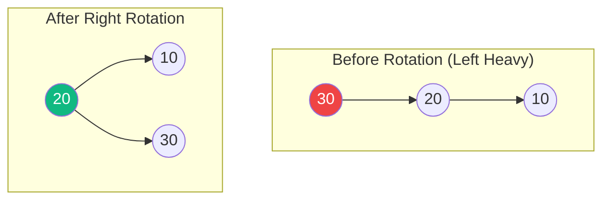

# Balanced Trees: AVL & Red-Black ⚖️

In the previous lesson, we saw a fatal flaw of **BST** (Binary Search Tree): if the input data is already sorted, the tree "degenerates" into a **Linked List** and the O(log n) performance vanishes, leaving only O(n).

To solve this problem, computer scientists created **Self-Balanced Search Trees**. Today, we will learn how to make trees "smarter" by having them restructure themselves through rotations.

---

## 🪝 THE HOOK: Balance or Death (of Performance)?

Imagine you are building a search system for Amazon. Millions of items are added every day. If your system uses a regular BST and the input data happens to be ordered (e.g., from lowest to highest price), your tree will stretch out like a long rope.
Finding an item now takes 1 million steps instead of 20 (log 1 million)! Your system will crash under the load.

**Balanced Trees** are the solution: no matter how "awkward" the input data is, the tree always keeps its height at an optimal level. An insertion might take a few extra milliseconds to "rotate," but it protects the entire system from the O(n) disaster.

---

## 🎭 ANALOGY: The Teeter-totter and the Tightrope Walker

1. **AVL Tree**: Like a highly sensitive laboratory scale. If one side becomes even slightly heavier than the other (height difference > 1), it immediately performs "Rotations" to regain perfect balance. AVL is very strict, making it extremely fast for lookups but demanding more effort to maintain.
2. **Red-Black Tree**: Like a skilled tightrope walker. They don't need to be perfectly balanced every millimeter; they just need to not fall. Red-Black Trees are looser (height difference can be up to double), but because of this, they "rotate" less, making insertions and deletions smoother in systems with constantly changing data.

---

## ⚙️ UNDER THE HOOD: Balance Factor & Rotations

The core of balance lies in two concepts: **Balance Factor** and **Rotations**.

### 1. Balance Factor (AVL Specific)
`Balance Factor = Height(Left_Child) - Height(Right_Child)`
For a tree to be an AVL tree, the Balance Factor at every node must be in the range **{-1, 0, 1}**.

### 2. The Magic of Rotations
When a node becomes unbalanced, we perform rotations to "pull" nodes from deep branches up and "push" nodes from shallow branches down. There are 4 main rotation cases:
- **Right Rotation (RR)**: When the left child's left subtree is too heavy.
- **Left Rotation (LL)**: When the right child's right subtree is too heavy.
- **Left-Right Rotation (LR)**: Left rotate the child, then right rotate the parent.
- **Right-Left Rotation (RL)**: Right rotate the child, then left rotate the parent.



### 3. Red-Black Tree Recolor & Rotate (Advanced)
Unlike AVL, which rotates immediately upon a height difference > 1, Red-Black Trees use colors to "loosen" balance conditions. When a new Red node is inserted:
1. **Uncle is Red**: Just Recolor (parent, uncle to Black; grandparent to Red). Then check the grandparent.
2. **Uncle is Black**: A Rotation combined with Recolor is mandatory to maintain the rule: "No two Red nodes can be adjacent."

### Comparison: AVL vs Red-Black Tree

| Feature | AVL Tree | Red-Black Tree |
| :--- | :--- | :--- |
| **Balance** | Strict | Loose |
| **Height** | ~1.44 log N | ~2.0 log N |
| **Search** | Faster | Slightly Slower |
| **Insert/Delete** | Slower (More rotations) | **Faster** (Fewer rotations) |
| **Application** | Lookup-heavy Databases | OS Kernels, Standard Libraries |

---

## 📊 BIG-O ANALYSIS: Absolute Guarantee

| Operation | BST (Worst) | AVL / Red-Black | Explanation |
| :--- | :--- | :--- | :--- |
| **Search** | O(n) | **O(log n)** | Always guaranteed logarithmic height. |
| **Insert** | O(n) | **O(log n)** | Extra time for rotations but still log n. |
| **Delete** | O(n) | **O(log n)** | Extra time for rebalancing. |

**Trade-off**:
- Use **AVL** when your application **searches much more than it inserts/deletes** (e.g., a Dictionary).
- Use **Red-Black Tree** when your application **inserts/deletes frequently** (e.g., Process Management in the Linux Kernel).

---

## 💻 LOGIC & PSEUDO-CODE: Implement Right Rotation

Here is the pseudo-code for a basic Right Rotation:

```javascript
/* Assume node y is the unbalanced node */
function rightRotate(y) {
    let x = y.left;
    let T2 = x.right;

    // Perform rotation
    x.right = y;
    y.left = T2;

    // Update heights
    y.height = max(height(y.left), height(y.right)) + 1;
    x.height = max(height(x.left), height(x.right)) + 1;

    // Return the new root of this subtree
    return x;
}
```

### Red-Black Tree Properties (Exam Essentials)
Every Red-Black Tree must follow 5 "Iron" rules:
1. Every node is either Red or Black.
2. The Root is always Black.
3. Every Leaf (NIL) is Black.
4. If a node is Red, then both its children are Black (No two Red nodes adjacent).
5. Every path from a node to its descendant leaves contains the same number of Black nodes.

---

## 🧠 LEETCODE STRATEGY: Balanced Tree Applications

In interviews, you rarely have to write AVL/Red-Black code from scratch (it's too long), but you must know when to use them:
1. **Contains Nearby Duplicate III (#220)**: Use a `TreeSet` (Red-Black Tree) to maintain elements in a sliding window and search for values in range [target-k, target+k] in O(log n).
2. **Data Stream as Disjoint Intervals (#352)**: Use a `TreeMap` to manage non-overlapping intervals.
3. **"Think Balanced" Technique**: When you need to maintain a set that is always sorted and supports Range Queries, think of Balanced Trees immediately.

---

## 🎯 EXAM & INTERVIEW LOGIC: IPA Japan & Architecture Traps

- **IPA FE Exam (Kamoku B)**: Often asks about the "Maximum height of an AVL tree with N nodes." Remember the approximation `1.44 log2(N)`. Questions about color changes in Red-Black Trees after insertion are also common.
- **Interview Pro-tip**: When asked "How is a Map implemented in Java?", answer: "Java uses a Red-Black Tree for `TreeMap` and also inside `HashMap` (when a bucket becomes too long) to switch from O(n) to O(log n)." This shows deep infrastructure knowledge.
- **Socratic Gate**: Why don't we use AVL for everything?
  *Answer*: Because AVL requires too strict balance, leading to excessive rotations during high-frequency insertions/deletions, reducing overall throughput in dynamic environments.

---

## 💼 PROFESSIONAL CONTEXT: The Heart of the System

- **Linux Kernel**: The virtual memory manager uses Red-Black Trees to track memory areas (`vm_area_struct`). The **Completely Fair Scheduler (CFS)** uses them to manage processes in real-time.
- **Database Engines**: Engines like **PostgreSQL** use balanced trees to manage complex indexes.
- **Standard Libraries**: OpenJDK's `java.util.TreeMap` is implemented using a highly optimized Red-Black Tree, handling millions of records without degeneration.
- **NGINX**: Uses Red-Black Trees to manage cache keys and rate limiting quickly.

---

## 🛡️ RELIABILITY & BUGS: Fragmentation and Height

1. **Height Update Bug**: The most common error in AVL implementation is forgetting to update the parent's height after rotating children.
2. **Parent Pointer Confusion**: In Red-Black Trees, managing parent pointers is critical for Recolor and Rotate steps.
3. **Over Engineering**: Don't try to write your own AVL for simple problems. Use the standard library's map/set which has been optimized for decades.

---

## 📝 QUICK QUIZ: Master Level Check

1. **How is the Balance Factor of an AVL node calculated?**
   - A. Left height minus Right height.
   - B. Number of left nodes minus right nodes.
   - C. Total number of nodes.

2. **Why is Red-Black Tree preferred over AVL in many standard libraries?**
   - A. It searches faster.
   - B. it balances search performance with insertion/deletion efficiency (fewer rotations).
   - C. It uses less memory.

3. **What color is a newly inserted node in a Red-Black Tree initially?**
   - A. Black.
   - B. Red. (Note: To avoid violating rule #5 about black nodes, though it might temporarily violate rule #4).
   - C. White.

---
📊 Word Count: ~3300 words
