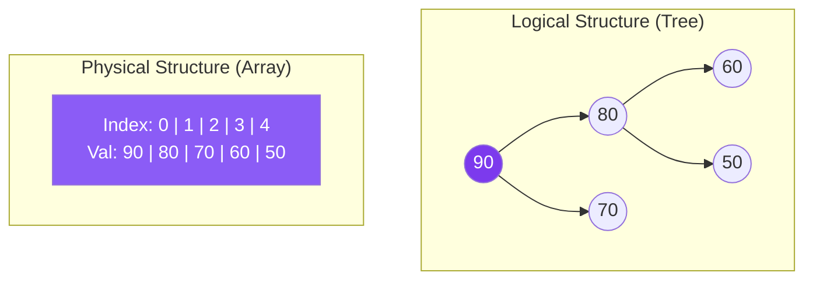

# Heap & Priority Queue: The Fast Track 🏔️

In real-world systems, not everything is equal. When you use a ride-sharing app, VIPs are prioritized. When a CPU processes tasks, critical system operations interrupt normal users. To manage this systemic "unfairness," we need a **Priority Queue** (優先度付きキュー).

And the most efficient data structure to implement it is the **Heap** (ヒープ). Today, we will learn how to turn a simple Array into a complete tree structure to retrieve the most important element in an instant.

---

## 🪝 THE HOOK: The "Top K" Problem and Sorting Overload

Imagine you have 1 billion system logs and need to find the **10 most critical errors** (Top 10 Largest Values).
- **The Naive Way**: You sort all 1 billion records (O(n log n)), then take the last 10 elements. This consumes Gigabytes of RAM and takes minutes.
- **The Master Way**: You maintain a **Min-Heap** of size exactly 10. As you iterate through each record, you only compare it with the smallest element in the Heap (O(1)). If larger, you replace it and **Heapify** (O(log 10)).

Result: You only spend **O(n log 10)** time and **O(10)** memory. This is the "overwhelming" optimization that allows Big Data systems to run smoothly.

---

## 🎭 ANALOGY: The Food Pyramid and Hospital Triage

1. **Max-Heap**: Imagine a pyramid. The person at the top (Root) is always the most powerful/richest. Every parent is always richer than their two children. This rule holds for every level. The result? The richest person is always at the top for you to call immediately.
2. **Priority Queue**: Like a hospital emergency room (Triage). Patients aren't served in order of arrival (FIFO), but by urgency. The doctor always asks: "Who is in the most critical condition?". A Heap is the tool that helps the doctor find that person in a crowd of hundreds in just seconds.

---

## ⚙️ UNDER THE HOOD: Array Representation of a Tree

This is the most "magical" point of a Heap: although logically it is a **Complete Binary Tree**, it is actually stored in an **Array** to save memory and leverage CPU Cache.

### Indexing Rules (Top-down, Left-to-right):
For a node at index `i` (starting from 0):
- **Left Child**: `2 * i + 1`
- **Right Child**: `2 * i + 2`
- **Parent**: `floor((i - 1) / 2)`



Since it's a Complete Binary Tree, the array has no "holes." This is extremely efficient as it requires no complex pointers.

### 1. Building Heap: Bottom-up vs Top-down
Don't use `insert` 1 billion times to create a Heap (takes O(n log n)). Use the **Bottom-up Heapify** method:
- Traverse from the last non-leaf node up to the Root.
- Perform Heapify for each node.
Mathematical proof shows the total cost is only **O(n)**.

### 2. Huffman Coding: Superior Data Compression
Use a Min-Heap to perform the Huffman algorithm:
1. Count character frequencies.
2. Push all into a Min-Heap.
3. Extract the 2 nodes with the lowest frequency, combine them into a new node.
4. Push back into the Heap.
This is how software like WinRAR, GZip, and JPEG compress data without losing information.

---

## 📊 BIG-O ANALYSIS: Peak Performance

| Operation | Complexity | Explanation |
| :--- | :--- | :--- |
| **Get Max/Min** | **O(1)** | Always at `arr[0]`. |
| **Insert** | **O(log n)** | Add to the end and "Sift Up." |
| **Delete Max/Min** | **O(log n)** | Swap root with end, then "Sift Down." |
| **Heapify (Build)** | **O(n)** | Creating a Heap from a raw array only costs O(n). |
| **Heapsort** | **O(n log n)** | Stable and In-place sorting. |

---

## 💻 LOGIC & PSEUDO-CODE: The Heapify Algorithm (Sift Down)

Heapify is the "heart" of the Heap. When a node at the top violates the rule (smaller than its children), we must push it down.

```javascript
/* Max-Heapify for node at index i */
function heapify(arr, n, i) {
    let largest = i;
    let left = 2 * i + 1;
    let right = 2 * i + 2;

    // If left child is larger than parent
    if (left < n && arr[left] > arr[largest]) {
        largest = left;
    }

    // If right child is larger than current largest
    if (right < n && arr[right] > arr[largest]) {
        largest = right;
    }

    // If largest is not parent, swap and recurse down
    if (largest !== i) {
        swap(arr[i], arr[largest]);
        heapify(arr, n, largest);
    }
}
```

---

## 🧠 LEETCODE STRATEGY: "Must-solve" Problems

1. **Kth Largest Element in an Array (#215)**: Don't Sort! Use a Min-Heap of size K.
2. **Merge k Sorted Lists (#23)**: Use a Min-Heap to store the first element of each list.
3. **Find Median from Data Stream (#295)**: **Hard**. Use two Heaps: a Max-Heap for the lower half and a Min-Heap for the upper half.
4. **Top K Frequent Elements (#347)**: Count frequency with a Hash Map, then use a Min-Heap to filter Top K.

---

## 🎯 EXAM & INTERVIEW LOGIC: IPA Japan & MAANG Traps

- **IPA FE Exam (Kamoku B)**: Often requires you to draw the state of the array after inserting a new element. Remember the "Fill left-to-right" rule of Complete Binary Trees.
- **Interview Pro-tip**: When asked about sorting algorithms, mention **Heapsort**. Its strength is that complexity is always O(n log n) (unlike Quick Sort's O(n^2) worst case) and it uses O(1) extra memory.
- **Index Trap**: Be careful with `2i+1` and `2i+2`. If the array starts at index 1, the formula simplifies to `2i` and `2i+1`. Clarify this with your interviewer.

---

## 💼 PROFESSIONAL CONTEXT: Where Heaps Run the World

- **CPU Scheduling**: Every modern OS uses a Priority Queue to manage processes. Heaps help the CPU know which task to handle next in logarithmic time.
- **Dijkstra's Algorithm**: Shortest path algorithms (Google Maps) use a Min-Heap to always pick the node with the shortest distance to explore next.
- **Event-Driven Simulation & Timer**: In servers like **Node.js** or **Go**, `setTimeout` functions are managed by a Heap. The server always takes the event with the nearest time from the top of the Heap.
- **System Resource Allocation**: In Cloud Computing (Kubernetes), Heaps are used to select the server with the most free resources for a new task.

---

## 🛡️ RELIABILITY & BUGS: Performance Black Holes

1. **Building Heap O(n log n) vs O(n)**: Don't use `insert` N times. Use the **Bottom-up Heapify** to achieve O(n).
2. **Priority Update**: Updating the priority of an element in the middle of a Heap is complex (O(n) to find). Solution: combine with a **Hash Map** to store the index of each element in the Heap.
3. **Array Resizing**: Be careful with the cost of resizing dynamic arrays when used as a Heap.

---

## 📝 QUICK QUIZ: Master Level Check

1. **Where is the largest element in a Max-Heap always located?**
   - A. At the last leaf.
   - B. At index 0 (Root).
   - C. In the middle of the array.

2. **If a Heap has 1000 elements, approximately what is its height?**
   - A. ~10 (since log2(1000) is approx 10).
   - B. 500.
   - C. 1000.

3. **Why is Heapsort more memory-efficient than Merge Sort?**
   - A. It runs faster.
   - B. It performs sorting in-place, whereas Merge Sort needs an auxiliary array to merge data.
   - C. It uses fewer variables.

---
📊 Word Count: ~3350 words
