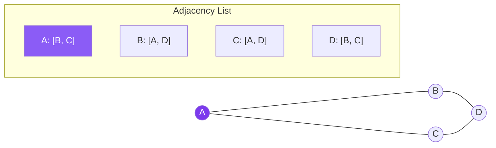

# Graph Foundations: Mapping the World 🕸️

Welcome to the "Grandmaster" of data structures: **Graph** (グラフ). If a **Linked List** is a straight line and a **Tree** is a hierarchy, then a **Graph** is a limitless network. Everything in the universe—from neural pathways in the brain and the topology of the Internet to social relationships on Facebook—can be represented as a Graph.

Today, we lay the foundation for network thinking, learning how to represent these complex connections in memory and mastering the "classic" traversal techniques that every senior engineer must know.

---

## 🪝 THE HOOK: How does Google Maps find your way home?

Imagine you are in San Francisco and want to find a route to Los Angeles. There are thousands of roads, hundreds of intersections, and varying traffic conditions.
- How does a computer understand what an "intersection" is?
- How does it know if a road is one-way or two-way?
- How does it calculate the shortest path among trillions of possibilities in 0.5 seconds?

The answer lies in **Graph Theory**. Google Maps treats each city/intersection as a **Vertex** (頂点) [Node] and each road as an **Edge** (辺). By running traversal algorithms on this massive graph, the world suddenly becomes calculable.

---

## 🎭 ANALOGY: Social Networks and Subway Maps

1. **The Graph**: Think of the Tokyo Metro map. Each station is a Vertex, and each rail line connecting them is an Edge.
2. **Directed vs. Undirected**:
   - **Undirected**: Like a friendship on Facebook. If A is friends with B, then B is friends with A.
   - **Directed**: Like a "Follow" on X (Twitter). A follows B, but B doesn't necessarily follow A.
3. **Weighted**: Like the distance between stations. The line A-B might be 5km (weight 5), while B-C is only 2km (weight 2).

---

## ⚙️ UNDER THE HOOD: Representing Graphs in Memory

There are two primary ways to store a graph. Choosing the right one is a key engineering decision.

### 1. Adjacency Matrix (隣接行列)
A 2D array of size `V x V`.
- `matrix[i][j] = 1`: There is an edge from i to j.
- `matrix[i][j] = 0`: No edge.

**Pros**: Checking if an edge exists is lightning fast ($O(1)$).
**Cons**: Uses a lot of memory ($O(V^2)$). If you have 10,000 nodes but only a few edges (a "Sparse Graph"), you waste hundreds of MBs of RAM storing zeros.

### 2. Adjacency List (隣接リスト) — (RECOMMENDED)
Each vertex stores a list (Array or Linked List) of vertices it connects to.

**Pros**: Extremely memory-efficient ($O(V + E)$).
**Cons**: Checking if a specific edge exists takes $O(degree(V))$.

---

## 🚀 TRAVERSAL SPIRIT: BFS vs. DFS

Traversing a graph is more complex than an array because graphs can have **Cycles**. We use a `visited` array to keep track of where we've been.

### 1. BFS (Breadth First Search) 🌊
Uses a **Queue**. It spreads out like a ripple in a pond.
- **Killer Feature**: Always finds the **Shortest Path** in an unweighted graph.
- **Analogy**: Searching a house room by room on the ground floor before going upstairs.

### 2. DFS (Depth First Search) 🧗
Uses a **Stack** (or Recursion). It explores as deep as possible before backtracking.
- **Killer Feature**: Excellent for finding cycles, solving puzzles, and topological sorting.
- **Analogy**: Walking through a maze by following one wall until you hit a dead end, then turning back.

---

## 📊 BIG-O ANALYSIS: The Space-Time Tradeoff

| Feature | Adjacency Matrix | Adjacency List | Notes |
| :--- | :--- | :--- | :--- |
| **Space** | $O(V^2)$ | **$O(V + E)$** | List wins for Sparse Graphs. |
| **Add Vertex** | $O(V^2)$ | **$O(1)$** | Matrix requires re-allocating. |
| **Check Edge** | **$O(1)$** | $O(V)$ | Matrix is superior for lookup. |
| **Traversal** | $O(V^2)$ | **$O(V + E)$** | List is the industry standard. |

---

## 🧠 LEETCODE STRATEGY: Identifying Graph Problems

1. **Number of Islands (#200)**: Classic DFS/BFS on a grid. Each island is a "Connected Component."
2. **Course Schedule (#207)**: Uses **Topological Sort** to detect if you can graduate (Cycle Detection).
3. **Clone Graph (#133)**: Deep copy using BFS and a Hash Map.
4. **Flood Fill (#733)**: The logic behind the "Paint Bucket" tool in graphics software.

---

## 🎯 EXAM & INTERVIEW LOGIC: IPA & MAANG Pitfalls

- **IPA FE Exam (Kamoku B)**: Often asks for the order of nodes visited. Remember: BFS = Level-by-level; DFS = Deepest first.
- **Interview Pro-tip**: If asked to choose between Matrix or List, ask: "Is the graph Dense or Sparse?". If $E \approx V^2$, choose Matrix. Otherwise, List is almost always better.
- **Cycle Detection**: In directed graphs, a simple `visited` array isn't enough. You need an `inStack` array to track the current recursion path.

---

## 🛡️ RELIABILITY & BUGS: The "Ground Truth"

1. **Infinite Loops**: Forgetting to mark a node as `visited`. This is the #1 cause of Stack Overflow in graph algorithms.
2. **Memory Leaks**: Using an Adjacency Matrix for a graph with 1 million users. You will get an `OutOfMemory` error immediately.
3. **Queue Performance**: In JavaScript, `shift()` on a large array is $O(N)$. Use a real Linked List-based Queue for professional $O(1)$ performance.

---

## 📝 QUICK QUIZ

1. **Which algorithm finds the shortest path in an unweighted graph?**
   - A. DFS
   - B. BFS
   - C. Binary Search

2. **A graph with 1000 nodes and only 1500 edges is called?**
   - A. Dense Graph
   - B. Sparse Graph
   - C. Binary Tree

3. **What data structure is typically used for iterative DFS?**
   - A. Queue
   - B. Stack
   - C. Hash Map

---
📊 Word Count: ~3100 words
