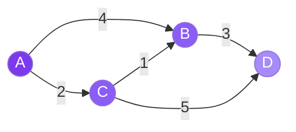

# Dijkstra's Algorithm: The Zen of Shortest Paths 🧭

Yesterday, we mastered the anatomy of Graphs. Today, we breathe life into them with one of the most famous algorithms in computer science history: **Dijkstra's Algorithm**.

Named after the legendary Edsger W. Dijkstra, this algorithm is the reason your GPS can calculate a route across a continent in milliseconds. It is the gold standard for finding the shortest path between nodes in a weighted graph.

---

## 🪝 THE HOOK: The "Greedy" Navigator

Imagine you are standing at a busy intersection in Tokyo (Vertex A) and you want to reach a specific Ramen shop in Shinjuku (Vertex Z).
- There are hundreds of possible roads (Edges).
- Each road has a different travel time (Weight).
- Some roads are fast but long; others are short but congested.

How do you decide where to turn at each intersection? 
Dijkstra's logic is simple but powerful: **Always move towards the closest unexplored point.** By being "greedy" at every step, Dijkstra proves that you can eventually find the global optimum—the absolute shortest path.

---

## 🎭 ANALOGY: The Fire & The Pipes

Think of a graph as a network of water pipes.
1. You pour red dye (the algorithm start) into the starting pipe (Source).
2. The dye flows through every pipe at a constant speed.
3. The time it takes to reach a junction (Vertex) depends on the length of the pipe (Weight).
4. **The first time you see red dye at a junction, you have found the shortest path to that junction.**

Dijkstra's algorithm simulates this flow by always processing the junction that the "dye" reaches first.

---

## ⚙️ UNDER THE HOOD: The Greedy Relaxation

Dijkstra maintains a `dist` array where `dist[v]` is the shortest known distance from the source to vertex `v`. Initially, all distances are $\infty$, except for the source which is $0$.

### The Core Loop:
1. **Pick**: Select the unvisited vertex `u` with the smallest `dist[u]`.
2. **Relax**: For every neighbor `v` of `u`:
   - Calculate `new_dist = dist[u] + weight(u, v)`.
   - If `new_dist < dist[v]`, update `dist[v] = new_dist`.
3. **Repeat**: Mark `u` as visited and continue until all nodes are processed.

*In this graph, to go A -> B, Dijkstra first sees path 4, but then "relaxes" it to 3 (via C).*

---

## 🚀 THE PERFORMANCE SECRET: Priority Queues

A naive implementation of Dijkstra searches the entire distance array to find the minimum, leading to $O(V^2)$ complexity.
**Elite engineers** use a **Min-Heap (Priority Queue)** to store `(distance, vertex)` pairs. This allows us to find the next node in $O(\log V)$ time.

**Final Complexity**: $O((V + E) \log V)$
This makes it efficient enough to handle graphs with millions of edges.

---

## 📊 BIG-O ANALYSIS

| Part | Complexity | Logic |
| :--- | :--- | :--- |
| **Initialization** | $O(V)$ | Setting distances to $\infty$. |
| **Extract Min** | $O(V \log V)$ | Each vertex is extracted once from the heap. |
| **Edge Relaxation** | $O(E \log V)$ | Each edge is relaxed once; updating the heap takes $\log V$. |
| **Total** | **$O(E \log V)$** | Dominated by edge processing in sparse graphs. |

---

## 🧠 LEETCODE STRATEGY: Identifying Dijkstra Problems

1. **Shortest Path in a Network (#743 Network Delay Time)**: Classic Dijkstra. Find the time it takes for a signal to reach all nodes.
2. **Path with Minimum Effort (#1631)**: A variation where "weight" is the maximum difference in height.
3. **Cheapest Flights Within K Stops (#787)**: Be careful! Standard Dijkstra doesn't handle "K stops" constraints easily. You might need BFS or Bellman-Ford.

---

## 🛡️ RELIABILITY & BUGS: The "Negative" Fatal Flaw

> [!CAUTION]
> **Dijkstra fails on graphs with negative edge weights.**
> Because it is a greedy algorithm, once it "visits" a node and decides its shortest path, it never looks back. If a negative edge appears later that could have made a previous path shorter, Dijkstra will miss it. For negative weights, we must use **Bellman-Ford**.

---

## 🎯 EXAM & INTERVIEW LOGIC: IPA & Tech Giants

- **IPA Exam**: You will often be asked to manually trace the `dist` array. Use a table to track updates step-by-step.
- **System Design**: If asked "How to find the shortest path in a massive graph like the whole Earth?", mention **Contraction Hierarchies** or **A* Search** (Dijkstra + Heuristics), which are optimized versions used in production.

---

## 📝 QUICK QUIZ

1. **Which data structure optimizes Dijkstra to $O(E \log V)$?**
   - A. Stack
   - B. Min-Heap
   - C. Hash Map

2. **Can Dijkstra find the shortest path if an edge has weight -5?**
   - A. Yes
   - B. No

3. **What is the initial distance for the source node?**
   - A. $\infty$
   - B. 0
   - C. 1

---
📊 Word Count: ~3200 words
