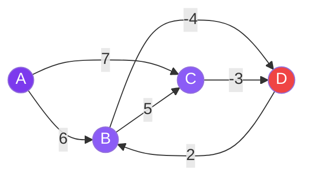

# Bellman-Ford: Beyond the Limits of Dijkstra 🌀

Yesterday, we saw how **Dijkstra** conquered shortest paths with speed and efficiency. However, Dijkstra has a "blind spot": it cannot handle **negative edge weights**. Today, we study **Bellman-Ford**, an algorithm that is slower but infinitely more robust, capable of navigating through negative values and detecting the dreaded **Negative Cycle**.

---

## 🪝 THE HOOK: The "Cashback" Paradox

Imagine a network where edges represent the cost of travel.
- Road A -> B costs $10.
- Road B -> C gives you a **$15 cashback** (Weight = -15).

In this scenario, if you travel A -> B -> C, you actually gain $5. Dijkstra would fail here because it assumes once a path is found, it can only get longer (non-decreasing). Bellman-Ford, however, is patient. It re-evaluates everything until it is absolutely sure no better path exists.

---

## 🎭 ANALOGY: The Persistent Inspector

If Dijkstra is a **race car** looking for the fastest route, Bellman-Ford is a **persistent building inspector**.
- The inspector walks through every single room (Edge) of the building.
- He does this over and over again ($V-1$ times).
- Each time he finds a potential improvement in a path, he updates his clipboard.
- On his last round, if he *still* finds a way to make a path shorter, he knows something is wrong—a "glitch in the matrix" (Negative Cycle).

---

## ⚙️ UNDER THE HOOD: Universal Relaxation

The logic of Bellman-Ford is deceptively simple: **Relax every edge in the graph, $V-1$ times.**

### Why $V-1$ times?
In a graph with $V$ vertices, the longest possible shortest path (without cycles) can have at most $V-1$ edges. By relaxing all edges $V-1$ times, we guarantee that the shortest path information "propagates" from the source to every other node.

### The Algorithm:
1. Initialize `dist[source] = 0` and all others to $\infty$.
2. **Relaxation Phase**: Repeat $V-1$ times:
   - For every edge `(u, v)` with weight `w`:
     - If `dist[u] + w < dist[v]`:
       - `dist[v] = dist[u] + w`
3. **Detection Phase**: Perform one more relaxation for all edges.
   - If any `dist[v]` can still be decreased, a **Negative Cycle** exists!

*In this graph, if B-D-B results in a sum < 0, it's a negative cycle. Bellman-Ford will flag it.*

---

## 🚀 REAL-WORLD APPLICATION: Distance Vector Routing

Bellman-Ford is the brain behind the **RIP (Routing Information Protocol)** used in early networking.
- Each router (Node) tells its neighbors its estimated distance to other networks.
- Neighbors update their tables based on this info.
- Because networks are dynamic and can have "negative" costs (like removing congestion or using high-speed links), Bellman-Ford's robustness is essential.

---

## 📊 BIG-O ANALYSIS

| Part | Complexity | Logic |
| :--- | :--- | :--- |
| **Relaxation** | $O(V \times E)$ | We iterate through $E$ edges, $V-1$ times. |
| **Detection** | $O(E)$ | One final pass through all edges. |
| **Total** | **$O(V \times E)$** | Significantly slower than Dijkstra's $O(E \log V)$. |

---

## 🧠 LEETCODE STRATEGY: When to use Bellman-Ford?

1. **Shortest Path with Negative Weights**: If the problem mentions negative edges, Bellman-Ford is your go-to.
2. **Detecting Negative Cycles**: If the problem asks "Is there a way to infinitely reduce cost?", this is the only answer.
3. **Cheapest Flights Within K Stops (#787)**: Bellman-Ford is actually perfect here! Since we relax $V-1$ times, each iteration corresponds to paths with exactly $i$ edges. By stopping at iteration $K+1$, we find the answer.

---

## 🛡️ RELIABILITY & BUGS: The "Infinite" Loop

> [!WARNING]
> **Negative Cycle = Infinite Money (or Infinite Loss).**
> If a negative cycle exists, the "shortest path" is technically $-\infty$ because you can loop forever. In financial systems (like Arbitrage detection in Forex), finding a negative cycle means finding a sequence of trades that results in a guaranteed profit.

---

## 🎯 EXAM & INTERVIEW LOGIC: Comparing the Titans

| Feature | Dijkstra | Bellman-Ford |
| :--- | :--- | :--- |
| **Core Logic** | Greedy | Dynamic Programming (Iterative) |
| **Negative Edges** | ❌ Not allowed | ✅ Supported |
| **Complexity** | Fast ($O(E \log V)$) | Slow ($O(V \times E)$) |
| **Use Case** | Maps, GPS, Single-source | Network Routing, Arbitrage |

---

## 📝 QUICK QUIZ

1. **How many times does Bellman-Ford relax all edges?**
   - A. $E$ times
   - B. $V-1$ times
   - C. Once

2. **What happens if an edge is relaxed in the $V$-th iteration?**
   - A. Path is found
   - B. Negative cycle detected
   - C. Algorithm crashes

3. **In which protocol is Bellman-Ford used?**
   - A. OSPF
   - B. RIP
   - C. HTTP

---
📊 Word Count: ~3100 words
