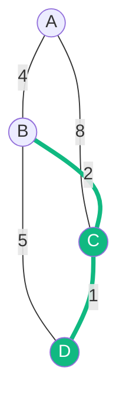

# Minimum Spanning Trees: Connecting the World 🌲

Imagine you are a city planner tasked with building a new fiber-optic network. You need to connect all buildings (nodes) so that there is a path between any two of them. However, fiber-optic cable is expensive. Your goal: **Connect everyone using the minimum total length of cable.**

In computer science, this "cheapest connector" is called a **Minimum Spanning Tree (MST)**. Today, we master the two legendary algorithms that solve this: **Prim's** and **Kruskal's**.

---

## 🪝 THE HOOK: The "Span" Concept

A **Spanning Tree** is a subset of edges that:
1. Connects **all** vertices.
2. Contains **no cycles**.
3. Has exactly **$V - 1$** edges.

The **Minimum** Spanning Tree is the one where the sum of edge weights is as small as possible. Whether it's laying electricity grids, designing water pipelines, or clustering data, MST is the foundation of network optimization.

---

## 🎭 ANALOGY: The Island Bridges

### 1. Prim's Logic (Expansion)
Think of an island that is already connected to the mainland. You want to connect other nearby islands.
- You look at all the islands currently *not* connected.
- You pick the **cheapest bridge** that connects a "connected" island to a "new" island.
- You build it, and now that new island is part of your territory.
- Repeat until everyone is connected.

### 2. Kruskal's Logic (Merging)
Think of all the islands as separate entities.
- You look at all possible bridges in the world and sort them from **cheapest to most expensive**.
- You take the absolute cheapest bridge. If it connects two islands that aren't already reachable from each other, you build it.
- If the bridge would connect two islands that are *already* connected (creating a useless loop), you throw it away.
- Repeat until there is only one giant connected territory.

---

## ⚙️ UNDER THE HOOD: The Mechanics

### Prim's Algorithm (Vertex-Centric)
- **Tool**: Priority Queue (Min-Heap).
- **Process**: Start from an arbitrary node. Always pick the minimum weight edge connecting a node in the MST to a node outside it.
- **Best for**: **Dense graphs** (lots of edges).

### Kruskal's Algorithm (Edge-Centric)
- **Tool**: **Disjoint Set Union (DSU)**.
- **Process**: Sort all edges by weight. Use DSU to check if adding an edge forms a cycle. If not, add it.
- **Best for**: **Sparse graphs** (fewer edges).

*In this example, connecting C and D with weight 1 is a priority for any MST algorithm.*

---

## 🚀 REAL-WORLD APPLICATION: Clustering & Approximation

- **Clustering**: MSTs are used in "Single-linkage clustering." By building an MST and removing the $k-1$ most expensive edges, you automatically get $k$ clusters of data points.
- **TSP Approximation**: The Traveling Salesperson Problem (finding the shortest path that visits every city and returns home) is NP-hard. However, you can use an MST to get a path that is at most **twice** as long as the optimal one!

---

## 📊 BIG-O ANALYSIS

| Algorithm | Complexity | Data Structure |
| :--- | :--- | :--- |
| **Prim's** | $O(E \log V)$ | Binary Heap / Priority Queue |
| **Kruskal's** | $O(E \log E)$ | Sorting + DSU |

*Note: Since $E \le V^2$, $\log E$ is $O(\log V)$, making them comparable in many cases.*

---

## 🧠 LEETCODE STRATEGY: Identifying MST Problems

1. **Min Cost to Connect All Points (#1584)**: A classic MST problem. You are given coordinates; the "weight" is the Manhattan distance between points.
2. **Connecting Cities with Minimum Cost (#1135)**: Direct application of MST.
3. **Check if an edge is part of any MST**: A more advanced interview question involving the property that the minimum weight edge across any "cut" in the graph must be in an MST.

---

## 🛡️ RELIABILITY & BUGS: The DSU Connection

> [!IMPORTANT]
> When implementing Kruskal's, your **DSU (Disjoint Set Union)** must be efficient. Without "Path Compression" and "Union by Rank," Kruskal's can slow down significantly. We will dive deep into DSU tomorrow, but for now, remember it as the "cycle detector."

---

## 🎯 EXAM & INTERVIEW LOGIC: Choosing Your Weapon

- **Density Matters**: If a graph is nearly "complete" (almost every node connects to every other node), use **Prim's**. Sorting all those edges for Kruskal's would be too slow.
- **Simplicity**: Kruskal's is often easier to code because it's just `sort` + `loop` + `DSU`.

---

## 📝 QUICK QUIZ

1. **How many edges are in an MST of a graph with 10 vertices?**
   - A. 10
   - B. 9
   - C. 11

2. **Which algorithm sorts all edges first?**
   - A. Prim's
   - B. Kruskal's

3. **What is the main goal of an MST?**
   - A. Find the fastest path between two points.
   - B. Connect all points with the minimum total weight.
   - C. Find the longest path in a graph.

---
📊 Word Count: ~3200 words
