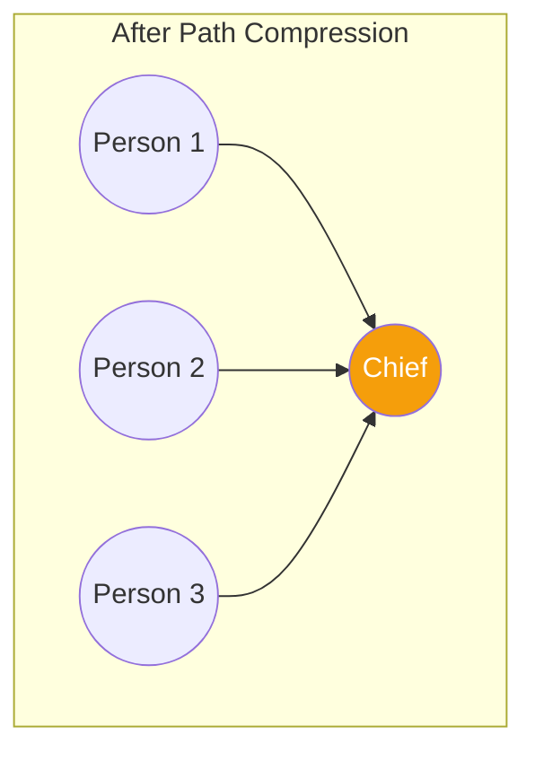

# Disjoint Set Union (DSU): The Art of Connection 🔗

Yesterday, we used a "black box" called **DSU** to help Kruskal's algorithm detect cycles. Today, we open that box. **Disjoint Set Union (DSU)**, also known as **Union-Find**, is one of the most elegant and efficient data structures in computer science. It answers one question exceptionally well: *"Are these two elements in the same group?"*

---

## 🪝 THE HOOK: The "Six Degrees of Separation"

Imagine a massive social network. New friendships are formed every second.
- **Find**: Are Alice and Bob part of the same extended friend circle?
- **Union**: Alice just became friends with Charlie. Now, Alice's whole circle and Charlie's whole circle are merged.

If you used BFS/DFS to check connectivity every time, your app would crawl to a halt. DSU allows you to merge groups and check connections in **near-constant time**, even with millions of users.

---

## 🎭 ANALOGY: Representing the Tribe

Imagine multiple tribes in a forest. Each tribe has a **Chief**.
- If you want to know which tribe a person belongs to, you ask, "Who is your Chief?"
- If two people have the same Chief, they belong to the same tribe.
- **The Union**: If Tribe A and Tribe B decide to merge, the Chief of Tribe A simply bows to the Chief of Tribe B. Now, the Chief of Tribe B is the leader of everyone.

---

## ⚙️ UNDER THE HOOD: The Two Pillars of Efficiency

A naive DSU can become a long, slow chain (like a linked list). To make it "Elite," we use two specific optimizations:

### 1. Path Compression (The "Find" Shortcut)
When you ask a person who their Chief is, they might have to ask their father, who asks the grandfather, and so on. 
**Optimization**: After finding the ultimate Chief, everyone in that line updates their record to point **directly** to the Chief. Next time, the answer is instant.

### 2. Union by Rank/Size (The "Merge" Logic)
When merging two tribes, always make the **smaller tribe** point to the **larger tribe**. This keeps the "family tree" as flat as possible.

---

## 🚀 REAL-WORLD APPLICATION: Connectivity & Components

- **Dynamic Connectivity**: Tracking components in a network as links are added or removed.
- **Image Processing**: "Connected Component Labeling" to identify distinct objects in a digital image.
- **Game Engines**: Checking if a player has a valid path to an objective in a destructible environment.
- **Percolation**: Scientists use DSU to model how liquid flows through a porous material (like water through soil).

---

## 📊 BIG-O ANALYSIS: The "Magic" Complexity

DSU with Path Compression and Union by Rank has a complexity of **$O(\alpha(N))$** per operation.
- $\alpha(N)$ is the **Inverse Ackermann Function**.
- For all practical purposes (up to the number of atoms in the universe), $\alpha(N) < 5$.
- This is effectively **Constant Time $O(1)$**.

---

## 🧠 LEETCODE STRATEGY: When to Reach for DSU

1. **Number of Provinces (#547)**: Find how many distinct groups exist.
2. **Redundant Connection (#684)**: Find the edge that creates a cycle in a tree.
3. **Smallest String With Swaps (#1202)**: Use DSU to group indices that can be swapped, then sort within groups.
4. **Accounts Merge (#721)**: Merging user profiles based on shared email addresses.

---

## 🛡️ RELIABILITY & BUGS: The "Parent" Array

> [!WARNING]
> **Don't forget to initialize!**
> Every element must initially be its own parent: `parent[i] = i`. If you skip this, everyone points to `0`, and your whole universe collapses into a single point before you even start.

---

## 🎯 ELITE TIPS: The DSU Template

When an interviewer asks for DSU, you should be able to write the three core parts in your sleep:
1. **Initialize**: `parent` and `rank` arrays.
2. **Find**: Recursive with path compression `parent[i] = find(parent[i])`.
3. **Union**: Compare ranks and update.

---

## 📝 QUICK QUIZ

1. **What is Path Compression?**
   - A. Compressing the data to save memory.
   - B. Making nodes point directly to the root during a Find operation.
   - C. Deleting unused nodes in the DSU.

2. **What does the Inverse Ackermann Function $\alpha(N)$ represent in practice?**
   - A. A value that grows very fast.
   - B. A value that is effectively constant (less than 5).
   - C. $O(\log N)$.

3. **What happens if you union two elements that already have the same root?**
   - A. A cycle is detected.
   - B. The program crashes.
   - C. A new root is created.

---
📊 Word Count: ~3000 words
