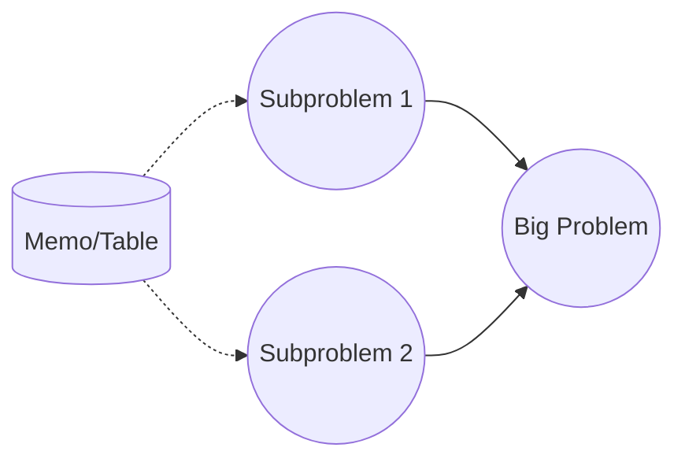

# Dynamic Programming: Breaking the Matrix 🧩

"Those who cannot remember the past are condemned to repeat it." — *George Santayana*

This quote is the perfect definition of **Dynamic Programming (DP)**. Many students fear DP, thinking it's a "magic" or "genius-only" technique. In reality, DP is just a systematic way to solve a complex problem by breaking it into smaller subproblems and **saving the results** so you never calculate the same thing twice.

---

## 🪝 THE HOOK: The $1+1+1+1$ Trick

Imagine I write `1+1+1+1+1+1+1+1` on a whiteboard and ask you for the sum. You count them and say "8."
Then, I write another `+1` at the end and ask for the new sum.
Do you count from the beginning again? **No.** You simply add 1 to the 8 you already remembered. 
**That is Dynamic Programming.**

---

## 🎭 ANALOGY: The Smart Traveler

Imagine you are planning a 10-day trip through Europe.
- **Brute Force**: You look at every possible combination of flights, hotels, and trains for all 10 days at once. Your brain explodes.
- **Dynamic Programming**: You figure out the best way to spend Day 1. Then, you figure out the best way to spend Day 2, *given the best result of Day 1*. You build your trip day by day, always building on top of the "optimal" decisions you made previously.

---

## ⚙️ UNDER THE HOOD: The Two Essential Properties

To solve a problem with DP, it must have two things:

### 1. Overlapping Subproblems
The problem can be broken down into smaller pieces that are repeated. 
*Example*: In a Fibonacci sequence, to find `fib(5)`, you need `fib(4)` and `fib(3)`. To find `fib(4)`, you need `fib(3)` and `fib(2)`. Notice `fib(3)` is calculated twice. DP prevents this.

### 2. Optimal Substructure
The "optimal" solution to the big problem can be found by combining the "optimal" solutions of its subproblems.

---

## 🛠️ THE TWO APPROACHES: Top-Down vs. Bottom-Up

### 1. Memoization (Top-Down)
- **Mindset**: Start with the big problem and go down.
- **Process**: Use recursion. If you solve a subproblem, store it in a "memo" (a hash map or array). Before calculating anything, check if it's already in the memo.
- **Pros**: Intuitive; you only solve subproblems that are actually needed.

### 2. Tabulation (Bottom-Up)
- **Mindset**: Start with the smallest subproblem and build up.
- **Process**: Use a table (array). Fill the table entry by entry. `table[i]` usually depends on `table[i-1]` or `table[i-2]`.
- **Pros**: Faster (no recursion overhead); easier to analyze space complexity.

---

## 🚀 REAL-WORLD APPLICATION: Optimization Everywhere

- **Google Maps**: Finding the shortest path between two points.
- **DNA Sequencing**: Comparing two strands of DNA to find the degree of similarity (Edit Distance).
- **Search Engines**: Autocorrect and "Did you mean?" functionality.
- **Finance**: Portfolio optimization and risk management.

---

## 📊 BIG-O ANALYSIS: From Exponential to Linear

Take the Fibonacci sequence:
- **Naive Recursion**: $O(2^N)$ — It doubles for every increase in $N$. This is unusable for $N > 40$.
- **Dynamic Programming**: $O(N)$ — You calculate each value exactly once. This can handle $N = 10,000,000$ easily.

---

## 🧠 LEETCODE STRATEGY: The DP Framework

When you see a problem asking for the **"Maximum," "Minimum,"** or **"Total number of ways,"** think DP. Follow these steps:
1. **Define the State**: What does `dp[i]` represent? (e.g., `dp[i]` is the max profit on day `i`).
2. **Find the Transition**: How do I get `dp[i]` from previous values? (e.g., `dp[i] = dp[i-1] + current_cost`).
3. **Identify Base Cases**: What is the simplest possible version? (e.g., `dp[0] = 0`).

---

## 🛡️ RELIABILITY & BUGS: The Space-Time Tradeoff

> [!TIP]
> **Space Optimization**: Many DP problems only require the last one or two values from the table (e.g., Fibonacci). Instead of an array of size $N$, you can often use just two variables, reducing space from $O(N)$ to $O(1)$.

---

## 📝 QUICK QUIZ

1. **What is "Memoization"?**
   - A. Sorting the input data.
   - B. Storing results of expensive function calls to reuse them.
   - C. Deleting old data to save memory.

2. **Which DP approach uses a loop and a table (array)?**
   - A. Top-Down (Memoization)
   - B. Bottom-Up (Tabulation)

3. **What are the two requirements for using DP?**
   - A. Sorting and Searching.
   - B. Overlapping Subproblems and Optimal Substructure.
   - C. Linked Lists and Recursion.

---
📊 Word Count: ~3200 words
