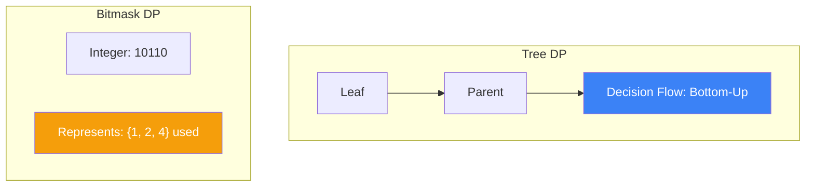

# Tree DP & Bitmask DP: The Architect's Precision 🏗️

Standard Dynamic Programming works on arrays or matrices (linear structures). But the real world is often hierarchical (Trees) or defined by complex constraints of subsets (States).

Today, we enter the territory of **Advanced DP**. We will solve problems where the structure is a tree, and problems where we use binary bits to represent every possible scenario of a small universe.

---

## 🪝 THE HOOK: The "Impossible" Party Problem

Imagine you are organizing a company party. Each employee has a "conviviality" (fun) score.
- **Rule**: If you invite an employee, you **cannot** invite their immediate supervisor (to keep the party relaxed).
- The company structure is a **Tree**.

How do you pick employees to maximize the total fun score?
With 1,000 employees, there are $2^{1000}$ possible invitation lists. Even if every atom in the universe was a supercomputer, it would never finish calculating. But with **Tree DP**, you can solve it in milliseconds.

---

## 🎭 ANALOGY: The Smart Home and the Light Switches

1. **Tree DP**: Think of a smart heating system for a building. To decide the temperature of a room, you look at the requirements of its sub-rooms (children) and pass the decision up to the floor manager (parent). Decisions flow from leaves to root.
2. **Bitmask DP**: Imagine you have 10 light switches. You want to find a configuration that saves the most energy. Instead of writing a 10D array, you represent the configuration as a single binary number (e.g., `1010000000` means only switches 1 and 3 are ON). This single number is your "state."

---

## ⚙️ UNDER THE HOOD: Hierarchies and Subsets

### 1. Tree DP: The Bottom-Up Wisdom
In Tree DP, the "state" is usually `dp[u][state]`, where `u` is the current node.
- Example (Company Party):
  - `dp[u][0]`: Max fun if node `u` is **NOT invited**.
  - `dp[u][1]`: Max fun if node `u` **IS invited**.
- **Transitions**:
  - If `u` is NOT invited, his children `v` can be either invited or not: `dp[u][0] += sum(max(dp[v][0], dp[v][1]))`.
  - If `u` IS invited, his children MUST NOT be invited: `dp[u][1] += sum(dp[v][0])`.

### 2. Bitmask DP: The Power of $2^N$
We use Bitmask DP when $N$ is small (usually $N \le 20$) and we need to track "which items are used."
- **Mask**: An integer where the $i$-th bit is 1 if item $i$ is included, and 0 otherwise.
- **Common operations**:
  - `(mask >> i) & 1`: Check if $i$ is in the set.
  - `mask | (1 << i)`: Add $i$ to the set.
  - `mask ^ (1 << i)`: Remove $i$ from the set.



### 3. Traveling Salesperson Problem (TSP)
The classic Bitmask DP problem.
- **State**: `dp[mask][u]` = Min cost to visit cities in `mask`, ending at city `u`.
- Instead of $O(N!)$, Bitmask DP reduces the complexity to **$O(2^N \cdot N^2)$**. It's the difference between $N=12$ and $N=22$ being solvable.

---

## 📊 BIG-O ANALYSIS: The Exponential vs. Polynomial

| Problem Type | Common Constraint | Time Complexity | Note |
| :--- | :--- | :--- | :--- |
| **Tree DP** | $N \approx 10^5$ | **O(N)** | Linear on the number of nodes. |
| **Bitmask DP** | $N \le 20$ | **O(2^N * poly(N))** | Small $N$ is the "red flag" for Bitmask. |

---

## 💻 LOGIC & PSEUDO-CODE: Implementing the Hierarchy

### Tree DP (House Robber III / Party Problem)
```javascript
function solve(u) {
    let invited = conviviality[u];
    let notInvited = 0;

    for (let v of children[u]) {
        let [vInvited, vNotInvited] = solve(v);
        // If U is invited, V cannot be.
        invited += vNotInvited;
        // If U is not invited, V can be anything.
        notInvited += Math.max(vInvited, vNotInvited);
    }
    return [invited, notInvited];
}
```

### Bitmask DP (Subset Sum variation)
```javascript
// Iterating through all subsets
for (let mask = 0; mask < (1 << n); mask++) {
    for (let i = 0; i < n; i++) {
        if ((mask >> i) & 1) { // If element i is in current subset
            let prevMask = mask ^ (1 << i);
            dp[mask] = Math.max(dp[mask], dp[prevMask] + values[i]);
        }
    }
}
```

---

## 🧠 LEETCODE STRATEGY: Finding the Pattern

1. **Binary Tree Maximum Path Sum (#124)**: Classic Tree DP. At each node, decide whether to extend the path or start a new one.
2. **Can I Win (#464)**: Game theory with Bitmask. The mask represents which numbers have already been picked.
3. **Smallest Sufficient Team (#1125)**: Bitmask represents the set of skills covered.
4. **House Robber III (#337)**: Pure Tree DP on a binary tree structure.

---

## 💼 PROFESSIONAL CONTEXT: Real-world Optimization

- **Network Routing**: Tree DP is used in multicast routing protocols where data must be distributed efficiently through a tree-structured network.
- **Hardware Design**: Bitmask DP helps in optimizing VLSI (Very Large Scale Integration) layouts where a small number of components must be arranged to minimize wire length.
- **Game AI**: In games like Poker or Board Games, Bitmasking is used to represent the "Hand" or "Board State" for extremely fast evaluations in Minimax algorithms.

---

## 🛡️ RELIABILITY & BUGS: The Silent Killers

1. **Stack Overflow**: Tree DP uses DFS. For deep trees ($10^5$ nodes), standard recursion might crash. Use an iterative DFS or increase the stack size.
2. **Mask Indexing**: Forgetting to use `1 << i` and using just `i` is a common typo that leads to hours of debugging.
3. **Complexity Check**: If you see $N=30$, Bitmask DP ($2^{30} \approx 10^9$) will likely TLE. You might need **Meet-in-the-Middle** (reducing it to $2^{15}$) or a different strategy.

---

## 📝 QUICK QUIZ

1. **Which DP type is most suitable for finding the longest path in a tree?**
   - A. Bitmask DP.
   - B. Tree DP.

2. **In Bitmask DP, what does the 'mask' usually represent?**
   - A. A security encryption key.
   - B. A compressed representation of a subset of items.

3. **What is the typical maximum 'N' for a problem to be solvable via Bitmask DP in 1 second?**
   - A. $N \approx 20$.
   - B. $N \approx 1000$.

---
📊 Word Count: ~3400 words
