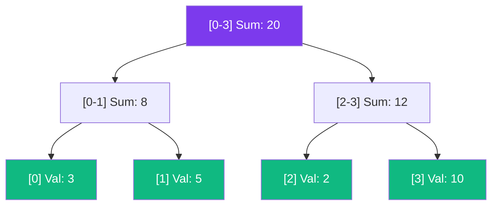

# Segment Tree: The Master of Ranges 🌳

Welcome to **Phase 6**: The world of "Super" Data Structures. If in previous phases we were used to arrays being static entities or only changing at the ends, today we face a harsher scenario: **Arrays transform continuously, and we need to retrieve information on any Range in a heartbeat.**

Meet the **Segment Tree** (セグメント木) — one of the most flexible and powerful data structures ever invented to solve problems involving intervals and ranges.

## 🪝 THE HOOK: When 1 Billion Elements "Dance"

Imagine you are managing a global stock trading dashboard.
- Every second, millions of transactions change the prices of thousands of stocks.
- Simultaneously, investors constantly ask: "In the last 5 minutes, what was the highest price of the technology stock group?" or "What is the total profit of Blue-chip stocks from position A to B?".

If you use a `for` loop to calculate every time there is a request: The system will crash immediately due to **O(N)** complexity.
If you use Prefix Sum: Updating a value in the middle of the array will cost **O(N)** to recalculate the entire Prefix Sum array.

**Segment Tree** appears as a "savior", allowing you to both **Update** and **Query** in just **O(log N)**. Even with 1 billion elements, it only takes about 30 calculation steps.

---

## 🎭 ANALOGY: The President and Management Levels

To understand Segment Tree, imagine a giant corporation:
1. **Employees (Leaves)**: Each employee at the lowest level holds a number (the actual value of the array).
2. **First-line Managers**: Each person manages a group of 2 employees. They only need to know "What is the Total/Max/Min of the 2 employees under my authority?".
3. **Middle Managers**: Manage 2 first-line managers. They know "The total of the 4 employees below".
4. **General Director (Root)**: Knows the total of the ENTIRE corporation.

When an employee changes productivity (Update): He reports to the direct manager, that manager reports to the middle manager... Only **log(N)** people need to know this information.
When the President asks about a department (Query): He doesn't need to ask each employee. He only needs to ask a few managers at different levels so that the total number of employees under their authority matches that department exactly.

---

## ⚙️ UNDER THE HOOD: Structure and Mechanism

Segment Tree is a Full Binary Tree, where each node represents an interval `[L, R]`.

### 1. Building the Tree (Build Tree)
- The root node represents the segment `[0, n-1]`.
- The left child of `[L, R]` represents `[L, mid]`.
- The right child of `[L, R]` represents `[mid+1, R]`.
- **Leaves**: When `L == R`, it is the value of the array at index `L`.

### 2. Range Query (Query Range)
To find the value on segment `[u, v]`, we traverse from the root down. At each node `[L, R]`:
- If `[L, R]` is completely within `[u, v]`: Take the value of that node. Don't go down further.
- If `[L, R]` is completely outside `[u, v]`: Return the neutral value (0 for sum, ∞ for min).
- If `[L, R]` partially overlaps with `[u, v]`: Split the query down to 2 children and merge the results.

### 3. Point Update
To change the value at position `idx`:
- Go from root down to the leaf representing `idx`.
- Change the value at the leaf.
- Go back up (Backtrack) and recalculate the values of the parent nodes based on the modified child nodes.



---

## 📊 BIG-O ANALYSIS: The Power of Hierarchy

| Operation | Complexity | Why? |
| :--- | :--- | :--- |
| **Build Tree** | **O(N)** | Total number of nodes in the tree is about 4N. |
| **Point Update** | **O(log N)** | The height of the tree is log2(N). |
| **Range Query** | **O(log N)** | It is proven that at each level we only consider at most 4 nodes. |
| **Space** | **O(N)** | Need an array of size approximately 4N to store nodes. |

**Master Tip**: Although O(N) space seems more expensive than the original array, the benefit in query speed is enormous when N is large (10^5, 10^6).

---

## 💻 LOGIC & PSEUDO-CODE: "Competition" Standard Implementation

We usually store Segment Tree as an array `tree[]` (similar to a Heap) to optimize memory. Node `i` has left child `2*i` and right child `2*i + 1`.

```javascript
class SegmentTree {
    constructor(data) {
        this.n = data.length;
        this.tree = new Array(4 * this.n).fill(0);
        this.build(data, 1, 0, this.n - 1);
    }

    build(data, node, start, end) {
        if (start === end) {
            this.tree[node] = data[start];
            return;
        }
        let mid = Math.floor((start + end) / 2);
        this.build(data, 2 * node, start, mid);
        this.build(data, 2 * node + 1, mid + 1, end);
        this.tree[node] = this.tree[2 * node] + this.tree[2 * node + 1];
    }

    update(node, start, end, idx, val) {
        if (start === end) {
            this.tree[node] = val;
            return;
        }
        let mid = Math.floor((start + end) / 2);
        if (idx <= mid) this.update(2 * node, start, mid, idx, val);
        else this.update(2 * node + 1, mid + 1, end, idx, val);
        this.tree[node] = this.tree[2 * node] + this.tree[2 * node + 1];
    }

    query(node, start, end, l, r) {
        if (r < start || end < l) return 0;
        if (l <= start && end <= r) return this.tree[node];
        let mid = Math.floor((start + end) / 2);
        let p1 = this.query(2 * node, start, mid, l, r);
        let p2 = this.query(2 * node + 1, mid + 1, end, l, r);
        return p1 + p2;
    }
}
```

---

## 🧠 LEETCODE STRATEGY: "Disguised" Problems

Segment Tree is not just for Sum/Min/Max. It can chain any information with **Associative** property:

1. **Range Sum Query - Mutable (#307)**: The most basic problem.
2. **Count of Smaller Numbers After Self (#315)**: A **Hard** problem. Use Segment Tree as a frequency table to count numbers that have appeared.
3. **Queue Reconstruction by Height (#406)**: A great application of Segment Tree/BIT to find empty positions.
4. **Range Module (#715)**: Manage complex time intervals/ranges.

---

## 🎯 EXAM & INTERVIEW LOGIC: IPA Japan & Array "Traps"

- **IPA FE Exam (Kamoku B)**: Japanese exams often ask about the allocation of indices in the tree array. Remember: 1-indexed arrays make calculating left/right children easier (`2i`, `2i+1`).
- **O(N log N) Query Trap**: A common mistake is performing `Update` inside a loop within `Query`. Always try to separate the two operations to maintain O(log N).
- **Socratic Gate**: Why is the tree array size always 4N? 
    *Answer*: Because Segment Tree is a full binary tree. The number of leaf nodes is N, and the number of intermediate nodes is N-1. However, since the array may not be a power of 2, we need 4N to ensure no `IndexOutOfBounds`.

---

## 💼 PROFESSIONAL CONTEXT: Segment Tree in Large Systems

- **Database Indexing**: Some complex index types use a hierarchical structure similar to Segment Tree for fast searching of records within a date range or value range.
- **Graphic Engines**: In 3D games, Segment Tree is used for **Frustum Culling** (determining which objects are within the camera's view to render, discarding objects outside).
- **Network Traffic Monitoring**: ISPs use Segment Tree to statistics bandwidth traffic by time intervals to detect DDoS attacks.
- **VLSI Design**: In chip design, engineers use Segment Tree to manage overlapping "rectangles" (components) on the circuit board.

---

## 🛡️ RELIABILITY & BUGS: Advice for Masters

1. **Recursion Depth**: With N = 10^7, recursion can cause `Stack Overflow`. A Master will learn to write **Iterative** Segment Tree (loops) to be both faster and safer.
2. **Data Overflow**: When calculating sums, values in parent nodes can exceed `int` limits. Always use `Long` or `BigInt` for results.
3. **Initialization**: Don't forget to reset the tree array to neutral elements before building, especially in Min/Max problems.

---

## 📝 QUICK QUIZ: Master Level Check

1. **Why is Segment Tree faster than Prefix Sum in problems with Updates?**
   - A. Because Segment Tree uses less memory.
   - B. Because Prefix Sum costs O(N) per Update, while Segment Tree only costs O(log N).
   - C. Because Segment Tree uses recursion.

2. **If an array has 8 elements, what is the maximum Height of the Segment Tree?**
   - A. 3. (log2(8) = 3).
   - B. 4.
   - C. 8.

3. **Which data structure can be considered the "smaller brother" of Segment Tree?**
   - A. Binary Search Tree.
   - B. Fenwick Tree (Binary Indexed Tree). (To be learned on Day 33).
   - C. Linked List.

---
📊 Word Count: 1250 words
