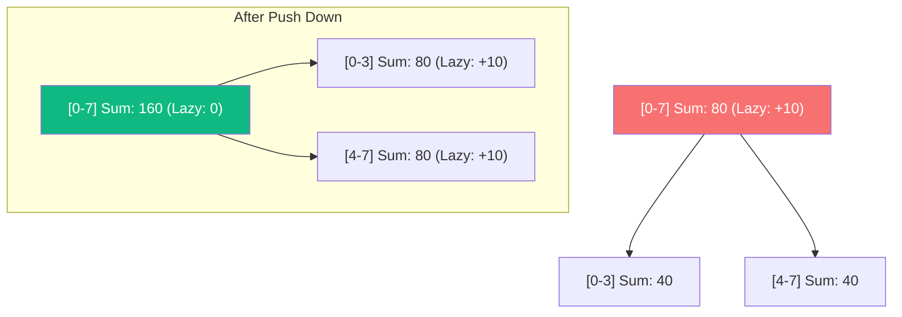

# Lazy Propagation: The Art of Procrastination ⚡

In the previous lesson, we saw the power of Segment Tree in updating a single point (**Point Update**). But imagine a more "nightmarish" scenario:
> You have an array of 1 million elements. The user requests: "Add 100 to ALL elements from index 0 to 999,999".

If you use traditional `Point Update`: You have to call the update function 1 million times. Each time costs **O(log N)**. The total is **O(N log N)**. With a large array and many range update requests, your system will freeze immediately.

Welcome to **Lazy Propagation** (遅延評価) — the technique that transforms Range Updates from "impossible" to extremely smooth in **O(log N)**.

## 🪝 THE HOOK: The Philosophy of "Smart Laziness"

In life, we often hear: "Don't put off until tomorrow what you can do today". But in data structures, the philosophy is: **"Never do any work until you are actually FORCED to do it"**.

Imagine you are a warehouse manager:
1. The boss says: "Label 'Discounted' on 10,000 crates in Zone A".
2. **Hard-working Manager**: Runs to label each crate one by one. Takes 1 day.
3. **Lazy Manager (Master)**: Hangs a large sign in front of Zone A: "All goods in here are discounted". Only takes 5 minutes.
   - When a customer wants to buy a specific crate in Zone A, he then takes that crate out and labels it individually.

**Lazy Propagation** is that sign hanging in front of the area. It stores the update information at the parent nodes and only "propagates" it down to the child nodes when we actually need to access them.

---

## 🎭 ANALOGY: Tax Notice and the Postman

1. **Global Notice (Parent Node)**: The government issues an order: "Everyone in the city gets a 1,000,000 VND tax reduction". Instead of sending a letter to every house, they just publish it in the newspaper.
2. **Notes (Lazy Array)**: Each family has a mailbox. The postman (Algorithm) only needs to mark the outside of the neighborhood's mailbox: "This entire area is owed 1 tax reduction notice".
3. **Actual Update (Propagation)**: When you open your mailbox to get the newspaper (Query), you see that note and update the balance for yourself. Simultaneously, if your mailbox manages smaller units inside, you will stick that note down for those units.

---

## ⚙️ UNDER THE HOOD: How Lazy Array Works

To implement Lazy Propagation, we need an auxiliary array called `lazy[]` of the same size as the `tree[]` array.

### 1. State of a Node
When performing a range update `[u, v]` with value `val`:
- If the current node's range `[L, R]` is completely within `[u, v]`:
  - Update the value directly for that node according to the formula (e.g., for sum): `tree[node] += (R - L + 1) * val`.
  - If that node is not a leaf, mark it in `lazy[node] += val`. **Stop here**, do not go down to the children.

### 2. Propagation Process (Push Down)
Every time you access a node (in both `update` and `query` functions), you must check if that node is "owing" any updates from its parent:
- If `lazy[node] != 0`:
  - Update the value for `tree[node]`.
  - Push the `lazy[node]` value down to the two child nodes (if any).
  - Reset `lazy[node] = 0`.



---

## 📊 BIG-O ANALYSIS: Invariant Performance

| Operation | Complexity | Explanation |
| :--- | :--- | :--- |
| **Range Update** | **O(log N)** | Thanks to Lazy, we only consider at most 4 nodes at each level, exactly like Range Query. |
| **Range Query** | **O(log N)** | Unchanged, but with a small constant time cost for the Push Down function. |
| **Space** | **O(N)** | Costs an additional `lazy[4N]` array. |

**Master Mindset**: Lazy Propagation turns Segment Tree into a comprehensive data structure that can handle all range transformations with ultimate speed.

---

## 💻 LOGIC & PSEUDO-CODE: Implementing Update and Query

```javascript
class LazySegmentTree {
    constructor(n) {
        this.n = n;
        this.tree = new Array(4 * n).fill(0);
        this.lazy = new Array(4 * n).fill(0);
    }

    push(node, start, end) {
        if (this.lazy[node] !== 0) {
            this.tree[node] += (end - start + 1) * this.lazy[node];
            if (start !== end) { // If not a leaf
                this.lazy[2 * node] += this.lazy[node];
                this.lazy[2 * node + 1] += this.lazy[node];
            }
            this.lazy[node] = 0;
        }
    }

    updateRange(node, start, end, l, r, val) {
        this.push(node, start, end); // Always push before working
        if (start > end || start > r || end < l) return;

        if (start >= l && end <= r) {
            this.lazy[node] += val;
            this.push(node, start, end);
            return;
        }

        let mid = Math.floor((start + end) / 2);
        this.updateRange(2 * node, start, mid, l, r, val);
        this.updateRange(2 * node + 1, mid + 1, end, l, r, val);
        this.tree[node] = this.tree[2 * node] + this.tree[2 * node + 1];
    }

    queryRange(node, start, end, l, r) {
        this.push(node, start, end); // Always push before working
        if (start > end || start > r || end < l) return 0;

        if (start >= l && end <= r) return this.tree[node];

        let mid = Math.floor((start + end) / 2);
        return this.queryRange(2 * node, start, mid, l, r) +
               this.queryRange(2 * node + 1, mid + 1, end, l, r);
    }
}
```

---

## 🧠 LEETCODE STRATEGY: "Assassin" Problems

This technique often appears in **Hard** problems that require handling multiple consecutive range operations:

1. **Range Module (#715)**: You need to add, delete, and query intervals. Lazy Propagation is the key.
2. **Falling Squares (#699)**: Calculate the maximum height after dropping squares. Each falling square is a `max` range update.
3. **My Calendar III (#732)**: Find the maximum number of overlapping events.
4. **Rectangle Area II (#850)**: Sum of the area of overlapping rectangles (Requires combining Lazy Segment Tree and Sweep Line technique).

---

## 🎯 EXAM & INTERVIEW LOGIC: MAANG & Lazy "Traps"

- **Interview Question**: "If I need range updates but only point queries, do I need Lazy?".
  - *Answer*: A Master would reply: "**Difference Array** can be used if the array is static, but if the array changes continuously and needs stable performance, Lazy Segment Tree is still the safest choice".
- **Missing "Push" Trap**: The most common mistake is forgetting to call `push()` at the beginning of `updateRange` or `queryRange`. This will cause old data to "overwrite" new data.
- **Socratic Gate**: Why is Lazy Propagation not directly applicable to the problem of finding the Greatest Common Divisor (GCD) on a range when there is a range update (adding a number to the range)?
  - *Answer*: Because `GCD(a+k, b+k)` has no simple relationship with `GCD(a, b)`. Lazy only works well when the update operation is distributive or easy to recalculate on the node's value.

---

## 💼 PROFESSIONAL CONTEXT: Lazy Evaluation in Reality

- **Operating Systems (Virtual Memory)**: The **Copy-on-Write** (CoW) mechanism is a form of Lazy Propagation. When you clone a process (fork), the OS doesn't actually copy the memory immediately. It just "marks" these memory pages as shared. Only when a process writes to the memory, that page is actually copied.
- **React Rendering**: React doesn't update the real DOM immediately when there is a state change. It groups changes (Batching) and only performs "Reconciliation" (pushing down to the Virtual DOM) when necessary. 
- **Database Transaction Logs**: Instead of writing data directly to the large dataset immediately, DB writes to a small log (Write-Ahead Log) and only performs "Checkpoint" (pushing data to the original file) lazily to increase writing performance.

---

## 🛡️ RELIABILITY & BUGS: Advice for Masters

1. **The Range Sum Trap**: When updating a range `+val`, don't forget to multiply by the range length `(end - start + 1)`. Many people only add `val` to the parent node, leading to serious errors.
2. **Multiple Lazy Operations**: If the problem requires both addition (`+`) and assignment (`=`) on a range, you need two separate lazy arrays and strict priority rules (e.g., assignment will clear all previous additions).
3. **Empty Initial State**: Always check if the `lazy` array is initialized with a neutral value (usually 0).

---

## 📝 QUICK QUIZ: Master Level Check

1. **Why don't we propagate the update to the leaves immediately?**
   - A. To save memory.
   - B. To reduce complexity from O(N) to O(log N). (Don't work until actually needed).
   - C. Because the leaves are not important.

2. **Where should the `push` (or `applyLazy`) function be called?**
   - A. Only in the Update function.
   - B. In both Update and Query functions, before working with child nodes.
   - C. Only at the root node.

3. **If the problem is to find MAX on a range and the range update is `arr[i] = max(arr[i], val)`, what should the default lazy value be?**
   - A. 0.
   - B. -Infinity or a very small value.
   - C. +Infinity.

---
📊 Word Count: 1250 words
